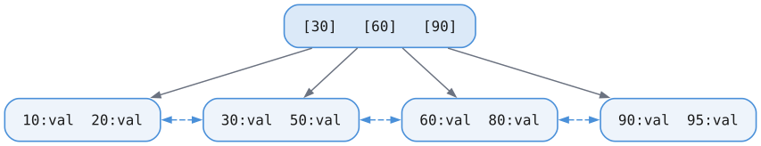
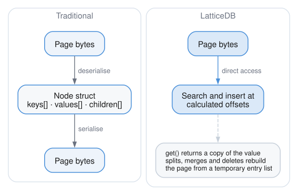
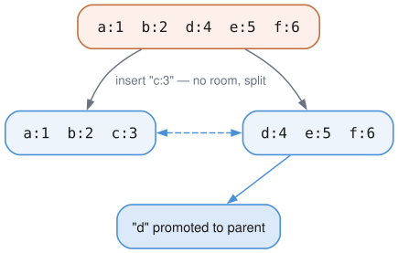

# B+Tree

## What It Is

A B+Tree is a self-balancing tree structure optimized for disk-based storage. It provides O(log N) lookups, inserts, and deletes, with efficient range scans.

## Why B+Tree?

### The Problem with Binary Trees

A binary search tree with 1 million entries is ~20 levels deep (log2(1M) ≈ 20). Each level requires a disk read. That's 20 disk reads per lookup!

### B+Tree: Wide and Shallow

A B+Tree has many keys per node (hundreds), making it very shallow:

```
Binary Tree (1M entries):          B+Tree (1M entries):
        depth ~20                       depth ~3

          ○                               ○
         / \                         /    |    \
        ○   ○                       ○     ○     ○
       /\   /\                    / | \ / | \ / | \
      ○ ○ ○  ○                   ○  ○  ○ ○  ○  ○ ○ ○
     ... (20 levels)             (leaf level)

    20 disk reads                   3 disk reads!
```

With 100 keys per node: log100(1M) ≈ 3 levels.

### Data Only in Leaves

B+Trees store all data in leaf nodes. Internal nodes only contain keys for routing:



## Our Implementation: Direct Page Manipulation

We don't create "node objects" in memory. Instead, we read/write bytes directly in page buffers. The "node" is just a lens over page bytes.



Searches, in-place inserts and leaf deletes need no intermediate node object. Two
places still copy: `get` returns an owned copy of the value (the caller frees it with
`freeValue`), and splits, merges and redistribution copy the entries into a
temporary list and rebuild the pages from it, in one pass. `getBorrowed` avoids the
first copy: it returns the value as a slice of its leaf, which stays pinned with a
shared latch until the caller calls `release()` (an overflow value is materialised
and freed by `release()`). The node, edge and symbol lookups use it, since they only
decode the value. A caller must release before writing to the same tree, or the
write waits on the latch for ever.

## Page Layout

### Leaf Node

Leaf pages are slotted pages. The header and slot array grow forward from byte 0;
entry bytes grow backward from the end of the page; free space is whatever remains
in the middle. (The tables show offsets; the page size is 4096 bytes by default.)

| Offset | Size | Field |
|--------|------|-------|
| 0–7 | 8 B | Page header — type (leaf), flags, reserved, checksum |
| 8–9 | 2 B | Entry count (u16) |
| 10–11 | 2 B | Flags (u16) |
| 12–15 | 4 B | Next leaf page (u32) |
| 16–19 | 4 B | Previous leaf page (u32) |
| 20 → | 2 B each | Slot array — one `entry_offset` (u16) per entry, growing forward |
| ← end of page | variable | Entries, growing backward: `[key_len][value_len][key][value or overflow descriptor]` |

**Variable-length entries**: Keys and values are stored at the end of the page,
growing downward from high offsets. Slots at the front point to the entry
records.

Large values are stored through generic B+Tree overflow records. A leaf entry
uses the normal key bytes plus a compact overflow descriptor; the descriptor
contains the total value length, first overflow page, page count, checksum, and
a small local prefix. Point reads and range scans materialize the full value
transparently, and deletes free the overflow chain.

Values up to `64 MiB` are accepted by the B+Tree layer when the key and overflow
descriptor can fit in an empty leaf. Keys are unique: inserting a key that is
already present fails with `DuplicateKey`.

Keys are capped at `BTree.maxKeySize(page_size)`, a quarter of an internal page's
payload less one slot: **1012 bytes at 4 KB pages**. Any key can become a separator
in an internal node, and the cap guarantees that an overflowing internal node can
always split by bytes into two non-empty halves that fit. `insert`, `replace`, `put`
and `canFitLeafEntry` reject a longer key with `PageFull`. Longer keys already in a
file written by an earlier release can still be read and deleted. Symbol names
(labels, edge types, property keys) are stored as keys, so this also caps their
length. Inline-capable values may still be stored
as overflow records when keeping them inline would make future 4 KiB leaf splits
impossible to divide into two valid ordered pages.

### Internal Node

Internal pages use the same slotted layout, but each slot carries a child pointer
alongside the key offset, and the values are separator keys rather than user data.
A node with `n` keys has `n + 1` children: slot `i`'s child holds keys that sort
below key `i`, and the rightmost child holds keys greater than or equal to the last
key.

| Offset | Size | Field |
|--------|------|-------|
| 0–7 | 8 B | Page header — type (internal), flags, reserved, checksum |
| 8–9 | 2 B | Key count (u16) |
| 10–11 | 2 B | Level (u16; 1 = parent of leaves, increasing toward the root) |
| 12–15 | 4 B | Rightmost child (u32) |
| 16 → | 6 B each | Slot array — `key_offset` (u16) plus `child_page` (u32), growing forward |
| ← end of page | variable | Separator keys, growing backward |

## Point Lookup

Finding a value by key:

Simplified from `src/storage/btree.zig` (error mapping left out):

```zig
pub fn get(self: *Self, key: []const u8) !?[]const u8 {
    // 1. Start at root
    var page_id = self.root_page;

    while (true) {
        // 2. Fetch page from buffer pool
        const frame = try self.bp.fetchPage(page_id, .shared);
        defer self.bp.unpinPage(frame, false);

        const header: *const PageHeader = @ptrCast(@alignCast(frame.data.ptr));

        if (header.page_type == .btree_leaf) {
            // 3. Binary search in leaf; return an owned copy of the value
            const result = LeafNode.searchSlot(frame.data, key, self.comparator);
            if (!result.found) return null;
            const stored = LeafNode.getStoredValue(frame.data, result.slot);
            return try self.materializeStoredValue(stored); // follows overflow chains
        }

        // 4. Binary-search the separators for the child, descend
        page_id = self.findChild(frame.data, key);
    }
}
```

Both searches are binary. In an internal node `findChildIndex` finds the first
separator greater than the key (an upper bound), or the rightmost child if there is
none.

**Example lookup for key "dog":**


## Insertion

### Simple Case: Space in Leaf

An insert either succeeds or returns an error with no page of the tree changed.
Simplified from `insert` (pin bookkeeping and error cleanup left out):

```zig
pub fn insert(self: *Self, key: []const u8, value: []const u8) !void {
    if (key.len > maxKeySize(self.page_size)) return error.PageFull;

    // 1. Descend from the root, pinning every page on the path exclusively and
    //    remembering which child was taken at each level
    var path = InsertPath{};
    defer path.release(self.bp);
    try self.descendForInsert(key, &path);

    // 2. Reject duplicates
    const leaf = path.frames[path.len - 1];
    const search = LeafNode.searchSlot(leaf.data, key, self.comparator);
    if (search.found) return error.DuplicateKey;

    // 3. Prepare either inline bytes or an overflow descriptor
    var prepared = try self.prepareStoredValue(key, value);

    // 4. Insert in place; one scan of the slot array finds the free space and
    //    reports PageFull if the entry does not fit
    if (self.insertLeafEntryStored(leaf.data, search.slot, key, prepared.value, prepared.overflow)) |_| {
        return;
    } else |err| if (err != error.PageFull) return err;

    // 5. Does not fit: plan and apply a split
    try self.splitAndInsert(&path, search.slot, false, prepared.entry(key), ...);
}
```

### Splitting a Leaf

When a leaf is full:



`splitAndInsert` plans the whole split before it changes anything:

1. Build the leaf's entries plus the new one, in order, and choose a byte-balanced
   split point that leaves both halves within a page (`chooseLeafSplitPoint`).
2. Walk up the pinned path while the separator does not fit the parent. For each
   ancestor that overflows, build its combined key/child image and choose the
   promoted key by bytes (`chooseInternalPromotion`).
3. Reserve every new page the split needs, one per splitting level plus a new root
   if the root splits, by allocating and pinning it, and find the right sibling
   whose `prev` link must change.

If any of that fails (an I/O error or a full disk allocating a page, no buffer frame,
no memory for an image), the reserved pages go back to the freelist and the error is
returned with the tree untouched. Only then is the plan applied, which rewrites
pinned pages and cannot fail: both leaves are written, the sibling links fixed (old →
new → the old leaf's former next leaf), and each separator inserted into its parent
or carried up into the next split.

The split point is chosen by serialized byte size, not just entry count. This
matters when a leaf mixes small keys with large values: both halves must fit in
the configured page size after the new entry is included. Internal nodes are split
by bytes too; with the key-size cap that always yields two halves that fit.

### Replacing a Value

`replace(key, value)` changes the value of an existing key and returns
`KeyNotFound` otherwise; `put(key, value)` inserts or replaces. Both make one
descent over the same pinned path and are all or nothing like `insert`. The new
value, including any overflow chain, is prepared before the leaf changes. A value of
the same stored size is overwritten in place; otherwise, if the leaf has room once
the old entry is gone, the old entry is removed and the new one written into the
same leaf; otherwise the leaf splits through the planned split, with the old entry
left out of the leaf image. The old overflow chain is freed only after no leaf
points at it. The node store's update uses `replace`, so a node update can no longer
fail half way and leave the node deleted.

### Growing the Tree

When the root splits, we create a new root:


The tree grows at the top, not the bottom. All leaves stay at the same depth.

## Range Scan

Thanks to linked leaves, range scans are efficient:

Simplified from `src/storage/btree.zig`:

```zig
pub fn range(self: *Self, start_key: ?[]const u8, end_key: ?[]const u8) !Iterator {
    // 1. Find starting leaf
    const leaf_page = if (start_key) |key|
        try self.findLeafForKey(key)
    else
        try self.findFirstLeaf();

    // 2. Keep it pinned and position at the first entry >= start_key
    const frame = try self.bp.fetchPage(leaf_page, .shared);
    const start_slot: u16 = if (start_key) |key|
        LeafNode.searchSlot(frame.data, key, self.comparator).slot
    else
        0;

    return Iterator{
        .tree = self,
        .current_frame = frame,
        .current_slot = start_slot,
        .end_key = end_key,
        .scratch_value = null,
    };
}
```

The range is half-open: `start_key` is inclusive and `end_key` is exclusive, so
the iterator stops at the first key that is greater than or equal to `end_key`.
Call `deinit` on the iterator if you stop early, to unpin the current leaf.

**Iterator walks the leaf chain:**


No need to traverse internal nodes for each entry - just follow the links.

## Concurrency

The B+Tree does not do latch crabbing. A lookup latches one page at a time through
the buffer pool: it unpins (and so unlatches) a node before it fetches the child. An
insert, `replace` or `put` pins and exclusively latches the whole root-to-leaf path on
the way down and releases it in one place when it is done, so a split can update the
parents it already holds.

That is only safe because nothing modifies a tree concurrently with another
operation on it. A database has a single writer, and the C API serialises the
calls on a handle behind one mutex. The per-frame latches protect individual
pages, not the shape of the tree.

## The BTree Struct

```zig
pub const BTree = struct {
    bp: *BufferPool,           // Page cache
    root_page: PageId,         // Current root
    comparator: KeyComparator, // For ordering
    page_size: u32,            // Usually 4096
    allocator: Allocator,

    // ...methods
};
```

This is just ~40 bytes of metadata. The actual data lives in pages on disk.

The operations: `get` (owned copy), `getBorrowed` (lent value, `release()` it),
`contains`, `insert`, `replace`, `put`, `delete`, and `range` (an iterator).

## Key Design Decisions

### Variable-Length Keys and Values

We store the actual bytes, not fixed-size slots. This supports:
- Short keys efficiently (no wasted space)
- Long keys, up to `maxKeySize` (1012 bytes at 4 KB pages)
- Any binary data

### Separator Keys in Internal Nodes

Internal nodes store separator keys, not full key-value pairs. This maximizes fanout (keys per internal node).

### In-Place Delete and Leaf Merging

A delete removes the entry inside the leaf: whatever lies below it in the entry heap
moves up by its size and its slot is removed, so the heap stays contiguous, with no
allocation and one pass. Any overflow chain owned by the removed entry is freed
afterwards, once the leaf no longer points at it; if freeing fails part way, the
rest of the chain is leaked rather than left referenced by a live entry.

Siblings are looked at only when the leaf has fallen below a third of a page. Then
adjacent leaves under the same parent are merged whenever their combined payload
fits on one page. The redundant leaf is unlinked and returned to the freelist, and a root
with only that leaf remaining is collapsed. Space within a surviving leaf is
reusable immediately by later inserts or updates, while reclaimed pages are
reused by any later database allocation.

When a sparse leaf cannot merge because its sibling is too full, entries are
redistributed by stored byte size and the parent separator is updated. Removing
a leaf separator can in turn rebalance internal pages: compatible internal
siblings absorb their parent separator and merge, while oversized pairs
redistribute keys and promote a new separator. Rebalancing propagates to the
root, collapsing every now-redundant tree level.

### Page-Based, With Explicit Overflow

Each B+Tree node is exactly one page. Large values span linked overflow pages
through an explicit descriptor stored in the leaf; ordinary internal and leaf
pages remain fixed-size and directly addressable.

## Example: Full Insert Sequence

Insert "zebra" into a tree:


## Performance Characteristics

| Operation | Average Case | Worst Case |
|-----------|--------------|------------|
| Lookup    | O(log N)     | O(log N)   |
| Insert    | O(log N)     | O(log N)   |
| Range(k)  | O(log N + k) | O(log N + k) |

Where N is the number of entries and k is the number of entries in range.

Disk I/O per operation: ~3-4 reads for trees up to billions of entries.
