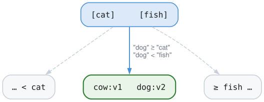

# B+Tree

## What It Is

A B+Tree is a self-balancing tree structure optimized for disk-based storage. It provides O(log N) lookups, inserts, and deletes, with efficient range scans.

## Why B+Tree?

### The Problem with Binary Trees

A binary search tree with 1 million entries is ~20 levels deep (log2(1M) ≈ 20). Each level requires a disk read. That's 20 disk reads per lookup!

### B+Tree: Wide and Shallow

A B+Tree has many keys per node (hundreds), making it very shallow:

```
Binary Tree (1M entries):          B+Tree (1M entries):
        depth ~20                       depth ~3

          ○                               ○
         / \                         /    |    \
        ○   ○                       ○     ○     ○
       /\   /\                    / | \ / | \ / | \
      ○ ○ ○  ○                   ○  ○  ○ ○  ○  ○ ○ ○
     ... (20 levels)             (leaf level)

    20 disk reads                   3 disk reads!
```

With 100 keys per node: log100(1M) ≈ 3 levels.

### Data Only in Leaves

B+Trees store all data in leaf nodes. Internal nodes only contain keys for routing:


## Our Implementation: Direct Page Manipulation

We don't create "node objects" in memory. Instead, we read/write bytes directly in page buffers. The "node" is just a lens over page bytes.


Searches and in-place inserts need no intermediate node object. Two places still
copy: a lookup returns an owned copy of the value (the caller frees it with
`freeValue`), and splits, merges and deletes copy the page's entries into a
temporary list and rebuild the page from it.

## Page Layout

### Leaf Node

Leaf pages are slotted pages. The header and slot array grow forward from byte 0;
entry bytes grow backward from the end of the page; free space is whatever remains
in the middle. (The tables show offsets; the page size is 4096 bytes by default.)

| Offset | Size | Field |
|--------|------|-------|
| 0–7 | 8 B | Page header — type (leaf), flags, reserved, checksum |
| 8–9 | 2 B | Entry count (u16) |
| 10–11 | 2 B | Flags (u16) |
| 12–15 | 4 B | Next leaf page (u32) |
| 16–19 | 4 B | Previous leaf page (u32) |
| 20 → | 2 B each | Slot array — one `entry_offset` (u16) per entry, growing forward |
| ← end of page | variable | Entries, growing backward: `[key_len][value_len][key][value or overflow descriptor]` |

**Variable-length entries**: Keys and values are stored at the end of the page,
growing downward from high offsets. Slots at the front point to the entry
records.

Large values are stored through generic B+Tree overflow records. A leaf entry
uses the normal key bytes plus a compact overflow descriptor; the descriptor
contains the total value length, first overflow page, page count, checksum, and
a small local prefix. Point reads and range scans materialize the full value
transparently, and deletes free the overflow chain.

Values up to `64 MiB` are accepted by the B+Tree layer when the key and overflow
descriptor can fit in an empty leaf. Keys are unique: inserting a key that is
already present fails with `DuplicateKey`. Inline-capable values may still be stored
as overflow records when keeping them inline would make future 4 KiB leaf splits
impossible to divide into two valid ordered pages.

### Internal Node

Internal pages use the same slotted layout, but each slot carries a child pointer
alongside the key offset, and the values are separator keys rather than user data.
A node with `n` keys has `n + 1` children: slot `i`'s child holds keys that sort
below key `i`, and the rightmost child holds keys greater than or equal to the last
key.

| Offset | Size | Field |
|--------|------|-------|
| 0–7 | 8 B | Page header — type (internal), flags, reserved, checksum |
| 8–9 | 2 B | Key count (u16) |
| 10–11 | 2 B | Level (u16; 1 = parent of leaves, increasing toward the root) |
| 12–15 | 4 B | Rightmost child (u32) |
| 16 → | 6 B each | Slot array — `key_offset` (u16) plus `child_page` (u32), growing forward |
| ← end of page | variable | Separator keys, growing backward |

## Point Lookup

Finding a value by key:

Simplified from `src/storage/btree.zig` (error mapping left out):

```zig
pub fn get(self: *Self, key: []const u8) !?[]const u8 {
    // 1. Start at root
    var page_id = self.root_page;

    while (true) {
        // 2. Fetch page from buffer pool
        const frame = try self.bp.fetchPage(page_id, .shared);
        defer self.bp.unpinPage(frame, false);

        const header: *const PageHeader = @ptrCast(@alignCast(frame.data.ptr));

        if (header.page_type == .btree_leaf) {
            // 3. Binary search in leaf; return an owned copy of the value
            const result = LeafNode.searchSlot(frame.data, key, self.comparator);
            if (!result.found) return null;
            const stored = LeafNode.getStoredValue(frame.data, result.slot);
            return try self.materializeStoredValue(stored); // follows overflow chains
        }

        // 4. Scan the separators left to right for the child, descend
        page_id = self.findChild(frame.data, key);
    }
}
```

The leaf search is binary. Choosing a child in an internal node is a linear scan
over its separator keys (`findChild`).

**Example lookup for key "dog":**



## Insertion

### Simple Case: Space in Leaf

Insertion recurses from the root. Simplified from `insert`, `insertRecursive` and
`insertIntoLeaf` (pin bookkeeping and error cleanup left out):

```zig
pub fn insert(self: *Self, key: []const u8, value: []const u8) !void {
    const result = try self.insertRecursive(self.root_page, key, value);
    // A split that reaches the root grows the tree by one level
    if (result.split) |split| try self.createNewRoot(split.key, result.page_id, split.new_page);
}

fn insertRecursive(self: *Self, page_id: PageId, key: []const u8, value: []const u8) !InsertResult {
    const frame = try self.bp.fetchPage(page_id, .exclusive);
    if (isLeaf(frame.data)) return self.insertIntoLeaf(frame, key, value);

    // Internal node: unpin it, recurse into the child, and come back only if
    // the child split and its separator has to be added here
    const child = self.findChild(frame.data, key);
    self.bp.unpinPage(frame, false);
    const child_result = try self.insertRecursive(child, key, value);
    if (child_result.split) |split| {
        const again = try self.bp.fetchPage(page_id, .exclusive);
        return self.insertIntoInternal(again, split.key, split.new_page);
    }
    return .{ .page_id = page_id, .split = null };
}

fn insertIntoLeaf(self: *Self, frame: *BufferFrame, key: []const u8, value: []const u8) !InsertResult {
    // 1. Reject duplicates
    const search = LeafNode.searchSlot(frame.data, key, self.comparator);
    if (search.found) return error.DuplicateKey;

    // 2. Prepare either inline bytes or an overflow descriptor
    var prepared = try self.prepareStoredValue(key, value);

    // 3. Insert in place if the slot and entry fit, otherwise split
    if (LeafNode.getFreeSpace(frame.data, self.page_size) >= slotAndEntrySize(key, prepared.value)) {
        try self.insertLeafEntryStored(frame.data, search.slot, key, prepared.value, prepared.overflow);
        return .{ .page_id = frame.page_id, .split = null };
    }
    return self.splitLeafAndInsert(frame, search.slot, prepared.entry(key), ...);
}
```

### Splitting a Leaf

When a leaf is full:


`splitLeafAndInsert`, in outline:

1. Copy every entry of the full leaf, plus the new one in its sorted position, into
   a temporary list.
2. Choose a byte-balanced split point that leaves both halves within a page
   (`chooseLeafSplitPoint`).
3. Allocate a new leaf, then reinitialise the old leaf and write the first half
   back into it and the second half into the new leaf.
4. Fix the sibling links: old → new → the old leaf's former next leaf, and that
   leaf's `prev` pointer.
5. Return the new leaf's first key as the separator. The caller one level up
   inserts it into the parent, which may split in turn.

The split point is chosen by serialized byte size, not just entry count. This
matters when a leaf mixes small keys with large values: both halves must fit in
the configured page size after the new entry is included.

### Growing the Tree

When the root splits, we create a new root:


The tree grows at the top, not the bottom. All leaves stay at the same depth.

## Range Scan

Thanks to linked leaves, range scans are efficient:

Simplified from `src/storage/btree.zig`:

```zig
pub fn range(self: *Self, start_key: ?[]const u8, end_key: ?[]const u8) !Iterator {
    // 1. Find starting leaf
    const leaf_page = if (start_key) |key|
        try self.findLeafForKey(key)
    else
        try self.findFirstLeaf();

    // 2. Keep it pinned and position at the first entry >= start_key
    const frame = try self.bp.fetchPage(leaf_page, .shared);
    const start_slot: u16 = if (start_key) |key|
        LeafNode.searchSlot(frame.data, key, self.comparator).slot
    else
        0;

    return Iterator{
        .tree = self,
        .current_frame = frame,
        .current_slot = start_slot,
        .end_key = end_key,
        .scratch_value = null,
    };
}
```

The range is half-open: `start_key` is inclusive and `end_key` is exclusive, so
the iterator stops at the first key that is greater than or equal to `end_key`.
Call `deinit` on the iterator if you stop early, to unpin the current leaf.

**Iterator walks the leaf chain:**


No need to traverse internal nodes for each entry - just follow the links.

## Concurrency

The B+Tree does not do latch crabbing. Each operation latches one page at a time
through the buffer pool: a descent unpins (and so unlatches) a node before it
fetches the child, and an insert that has to add a separator to a parent fetches
that parent again on the way back up.

That is only safe because nothing modifies a tree concurrently with another
operation on it. A database has a single writer, and the C API serialises the
calls on a handle behind one mutex. The per-frame latches protect individual
pages, not the shape of the tree.

## The BTree Struct

```zig
pub const BTree = struct {
    bp: *BufferPool,           // Page cache
    root_page: PageId,         // Current root
    comparator: KeyComparator, // For ordering
    page_size: u32,            // Usually 4096
    allocator: Allocator,

    // ...methods
};
```

This is just ~40 bytes of metadata. The actual data lives in pages on disk.

## Key Design Decisions

### Variable-Length Keys and Values

We store the actual bytes, not fixed-size slots. This supports:
- Short keys efficiently (no wasted space)
- Long keys (a key must fit in a leaf with its value or its 28-byte overflow
  descriptor, which is about page size − 54 bytes for a key whose value overflows)
- Any binary data

### Separator Keys in Internal Nodes

Internal nodes store separator keys, not full key-value pairs. This maximizes fanout (keys per internal node).

### Delete Compaction and Leaf Merging

Deletes remove the slot, rebuild the surviving leaf entries contiguously, and
free any overflow chain owned by the removed entry. Afterward, adjacent leaves
under the same parent are merged whenever their combined payload fits on one
page. The redundant leaf is unlinked and returned to the freelist, and a root
with only that leaf remaining is collapsed. Space within a surviving leaf is
reusable immediately by later inserts or updates, while reclaimed pages are
reused by any later database allocation.

When a sparse leaf cannot merge because its sibling is too full, entries are
redistributed by stored byte size and the parent separator is updated. Removing
a leaf separator can in turn rebalance internal pages: compatible internal
siblings absorb their parent separator and merge, while oversized pairs
redistribute keys and promote a new separator. Rebalancing propagates to the
root, collapsing every now-redundant tree level.

### Page-Based, With Explicit Overflow

Each B+Tree node is exactly one page. Large values span linked overflow pages
through an explicit descriptor stored in the leaf; ordinary internal and leaf
pages remain fixed-size and directly addressable.

## Example: Full Insert Sequence

Insert "zebra" into a tree:


## Performance Characteristics

| Operation | Average Case | Worst Case |
|-----------|--------------|------------|
| Lookup    | O(log N)     | O(log N)   |
| Insert    | O(log N)     | O(log N)   |
| Range(k)  | O(log N + k) | O(log N + k) |

Where N is the number of entries and k is the number of entries in range.

Disk I/O per operation: ~3-4 reads for trees up to billions of entries.
