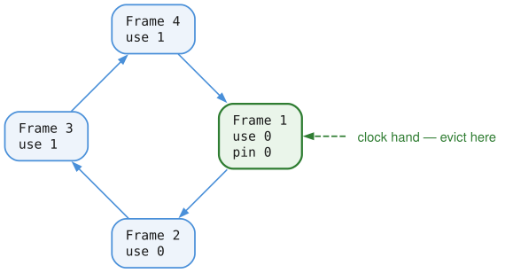

# Buffer Pool

## What It Is

The Buffer Pool is a cache that keeps frequently accessed pages in memory. Instead of reading from disk every time, we check the buffer pool first.

## The Problem It Solves

Disk I/O is slow:

| Operation | Typical latency |
|-----------|----------------:|
| CPU instruction | ~1 ns |
| RAM access | ~100 ns |
| SSD read | ~100,000 ns (100 µs) |
| HDD read | ~10,000,000 ns (10 ms) |

RAM is 1,000-100,000x faster than disk. If we can keep hot pages in RAM, performance improves dramatically.

## Architecture


## The Frame

Each frame holds one page:

```zig
pub const BufferFrame = struct {
    page_id: PageId,                    // Which page is here (0 = empty)
    data: []align(4096) u8,             // The page bytes (page_size long)
    pin_count: atomic(u32),             // Reference count
    dirty: bool,                        // Modified since read?
    usage_count: u8,                    // For Clock eviction (0 or 1)
    latch: RwLatch,                     // Reader-writer lock
};
```

### Pin Count

The pin count is a reference count:

| Call | Effect | Meaning |
|------|--------|---------|
| `fetchPage()` | `pin_count += 1` | I am using this page |
| `unpinPage()` | `pin_count -= 1` | I am done with this page |

| Pin count | Consequence |
|-----------|-------------|
| `> 0` | Page is in use and cannot be evicted |
| `= 0` | Page may be evicted if a frame is needed and it is clean |

### Dirty Flag

| Event | Dirty flag | Meaning |
|-------|-----------|---------|
| Read page | `false` | Frame matches disk |
| Modify page | `true` | Frame differs from disk |
| Flush | `false` | Frame matches disk again |

A dirty page is never evicted, and never written to the file on its own. It stays
in its frame until the next flush writes every dirty page together (see
[Writing Pages Back](#writing-pages-back)).

### Reader-Writer Latch

```
Multiple readers OR one writer

Read latch:    "I'm reading, others can read too"
Write latch:   "I'm modifying, exclusive access"
```

## Fetching a Page

Simplified from `src/storage/buffer_pool.zig` (error cleanup left out):

```zig
pub fn fetchPage(self: *Self, page_id: PageId, mode: LatchMode) !*BufferFrame {
    self.mutex.lock();

    // 1. Check if already in buffer pool
    if (self.page_table.get(page_id)) |frame_id| {
        const frame = &self.frames[frame_id];
        _ = frame.pin_count.fetchAdd(1, .monotonic);
        frame.usage_count = 1;            // a hit sets the use bit
        self.mutex.unlock();
        self.acquireLatch(frame, mode);   // latch outside the mutex; waits
                                          // while a fetch is still reading it
        return frame;
    }

    // 2. Not in pool - take a free frame, evict a clean one, or grow the pool
    const frame_id = try self.getFreeFrame();
    const frame = &self.frames[frame_id];

    // 3. Claim the frame, publish it in the page table, and latch it
    //    exclusively before letting go of the mutex. The frame was free or
    //    just evicted, so nobody holds or waits on its latch.
    frame.page_id = page_id;
    frame.dirty = false;
    frame.usage_count = 1;
    _ = frame.pin_count.fetchAdd(1, .monotonic);
    try self.page_table.put(page_id, frame_id);
    _ = frame.latch.tryAcquireExclusive(); // always succeeds here
    self.mutex.unlock();

    // 4. Read page from disk, outside the mutex but under the latch
    try self.pm.readPage(page_id, frame.data);

    // 5. Keep the latch the caller asked for (exclusive stays; shared is
    //    released and taken again shared)
    return frame;
}
```

A second fetch of the same page that arrives while the first is still reading it
finds the page in the table and waits on the frame's latch, as it would for any
writer, until the read is done. It then checks that the frame still holds its page:
if the read failed, it lets go and fetches again. A frame that such a waiter still
has pinned is not put back on the free list; it is reclaimed like any unpinned
frame. Before this, the second fetch could latch the frame before the read began and
see the bytes the frame held before, another page's or zeroes.

## The Clock Eviction Algorithm

When the buffer pool is full, we need to evict a page to make room. We use the Clock algorithm (also called "second chance").

### Why Clock?

- **LRU (Least Recently Used)** is optimal but expensive - requires updating timestamps on every access
- **Clock** approximates LRU cheaply using a usage bit. `usage_count` is a `u8`,
  but a hit sets it to 1 rather than incrementing it, so it behaves as a bit

### How It Works

Imagine the frames arranged in a circle with a clock hand:



**To find a victim:**

Simplified from `getFreeFrame`, which runs with the pool mutex held:

```zig
fn getFreeFrame(self: *Self) !FrameId {
    // Try free list first
    if (self.free_list.pop()) |frame_id| return frame_id;

    // Clock sweep: at most two full rotations
    var iterations: usize = 0;
    var passed_over_dirty = false;
    while (iterations < self.frame_count * 2) : (iterations += 1) {
        const frame = &self.frames[self.clock_hand];
        const frame_id: FrameId = @intCast(self.clock_hand);

        // Skip pinned pages
        if (frame.pin_count.load(.monotonic) > 0) {
            self.advanceClock();
            continue;
        }

        // Never evict a dirty page: it waits for the next flush
        if (frame.dirty) {
            passed_over_dirty = true;
            self.advanceClock();
            continue;
        }

        // Second chance: if used recently, clear and skip
        if (frame.usage_count > 0) {
            frame.usage_count -= 1;
            self.advanceClock();
            continue;
        }

        // Found a clean victim: drop it from the table, no write needed
        _ = self.page_table.remove(frame.page_id);
        frame.page_id = NULL_PAGE;
        self.advanceClock();
        return frame_id;
    }

    // Every frame pinned: the caller is holding too much at once
    if (!passed_over_dirty) return error.BufferPoolFull;
    // Some frames were only dirty: grow by one overflow frame instead
    return self.addOverflowFrame();
}
```

**The key insight:** The use bit gives pages a "second chance". A recently used page survives one pass of the hand. Only pages that haven't been used since the hand last passed get evicted.

Eviction never writes anything: the victim is always a page the file already holds.
When the sweep passes over frames that are only dirty, the pool allocates an
overflow frame beyond its configured size instead. Overflow frames are given back
after the next flush has cleaned them. `BufferPoolFull` now means every frame is
pinned, which in practice is a pin that was never released.

A sweep that finds every frame of the pool proper dirty, as through most of a large
commit or an index build, records that, and until a flush cleans the frames, or a
frame goes back to the free list, the pool grows straight away instead of sweeping
two full turns for every new page. The overflow list counts its released slots and
is searched only when it has one.

### The page table

The page table, from page id to frame, is a hash map. A removed key leaves a
tombstone, and a lookup of a page that is not in the pool probes until it reaches a
slot that has never held a key, so a pool that evicts and misses for long enough
would turn its free slots into tombstones and make every miss walk more of the
table. A large commit made this much worse: the table grew with the overflow frames
and never shrank after the flush gave them back. Removals therefore rehash the table
in place once a quarter of its slots may have become tombstones, a few slot visits
per removal, and giving back the overflow frames, or emptying the pool, rebuilds the
table at the size the pool's own frames need. In a process that had just built a
million-node database, a full scan went from 28.9 µs to about 1 µs a node and a
random node read from 51.1 µs to about 1.7 µs, the same as after reopening the file
(release build, a busy machine).

## Unpinning Pages

When done with a page:

```zig
pub fn unpinPage(self: *Self, frame: *BufferFrame, dirty: bool) void {
    // Mark dirty if modified
    if (dirty) {
        frame.dirty = true;
    }

    // Release whichever latch is held (read from the latch state)
    self.releaseLatch(frame);

    // Decrement pin count
    _ = frame.pin_count.fetchSub(1, .monotonic);
}
```

Always unpin! Failure to unpin causes:
- Pages stuck in memory forever
- Buffer pool eventually fills with pinned pages
- `BufferPoolFull` errors

## Writing Pages Back

Most buffer pools write a dirty page out when they want its frame, and this one
used to. It no longer does, because of the write-ahead log.

The log records what transactions did to the graph, not what happened to pages, so
it can only be replayed onto a database file that is a complete, consistent image
(see [Write-Ahead Log](./wal.md#how-latticedb-applies-it)). A page written on its
own breaks that. A leaf split changes three pages; if the pool evicts and writes the
old leaf, the file holds a leaf with half its keys missing while the new leaf and
the parent that leads to them exist only in memory. After a checkpoint has emptied
the log, that file is the only copy of everything committed before it, and a kill at
that point lost committed data: 4000 small transactions against a 48-page pool lost
nodes at the first kill.

So a dirty page reaches the file in exactly one way: as part of a flush of every
dirty page, the pages freed since the last flush and the header, together, through a
journal.

Simplified from `flushAll` and `writeAtomically`:

```zig
// Write every dirty page, the freed pages and the header as one atomic step.
pub fn flushAll(self: *Self) !u32 {
    // Pages freed since the last flush join the freelist now
    for (self.pm.deferredFrees()) |page_id| formatAsFreelistPage(page_id);

    // Every dirty frame, in the pool and in overflow frames, sorted by page id
    const dirty = self.collectDirtyFrames();

    // 1. Copy the header image and every page to <db>-journal, and fsync it
    try journal.write(file_uuid, page_size, header_image ++ dirty);
    // 2. Write the header and the pages in place, then fsync the database file
    try self.pm.writeSealed(0, header_image);
    for (dirty) |frame| try self.pm.writeSealed(frame.page_id, frame.data);
    try self.pm.sync();
    // 3. Empty the journal (not synced: applying it again is harmless)
    journal.clear() catch {};

    for (dirty) |frame| frame.dirty = false;
    self.releaseIdleOverflow();
    return dirty.len;
}
```

If the process dies during the in-place writes, the journal holds a complete copy of
everything being written, and the next open writes the same pages again before it
reads anything else. If it dies while the journal itself is being written, the
journal fails its checksums and is discarded, and the database file has not been
touched. Either way the file is a whole image, before the flush or after it.
[Checkpointing](./checkpointing.md#the-journaled-flush) describes the journal's
format and what each crash point leaves. An in-memory database has no journal.

`flushPage(page_id)` still exists, but one page cannot go to the file on its own: if
the page is dirty, it flushes everything.

The pool cannot check the two rules that govern when a flush may run, so its
callers keep them:

1. **Every tree a dirty page belongs to must be whole in memory**, because the
   image written is what recovery will start from. The database knows that holds
   when no page is pinned: a page is pinned for the length of any tree operation
   that touches it.
2. **The log must be synced first**, because pages may carry the effects of
   transactions whose commit records have only been handed to the operating system
   (`sync_mode = .normal`). A page must never reach the file ahead of the log that
   explains it.

The database flushes at checkpoints, at close, on an explicit `sync()`, and early:
after a commit, between the entities a commit applies, before each write made
outside a transaction, and between the records recovery replays, it flushes if at
least half the pool's frames are dirty and nothing is pinned. Before flushing it
writes the vector index's in-memory node map into its tree and copies the tree roots
into the header, so the image is whole in those respects too, and syncs the log.

What this costs: every page a flush writes is written twice, once to the journal and
once in place, and a flush syncs both files. Between flushes the pool holds every
page changed since the last one, so a large transaction can take it well past its
configured size.

## Thread Safety

The buffer pool is thread-safe:

1. **Mutex** protects page_table, free_list, clock_hand
2. **Per-frame latches** protect page data
3. **Atomic pin_count** for safe reference counting

| Step | Thread 1 — `fetchPage(5)` | Thread 2 — `fetchPage(5)` |
|-----:|---------------------------|---------------------------|
| 1 | `mutex.lock()` | `mutex.lock()` — blocked |
| 2 | look up page 5 | waiting |
| 3 | `pin_count++` | waiting |
| 4 | `mutex.unlock()` | `mutex.lock()` — acquired |
| 5 | `frame.latch.read()` | look up page 5 — found |
| 6 | read data | `pin_count++` |
| 7 | read data | `mutex.unlock()` |
| 8 | read data | `frame.latch.read()` |
| 9 | `unpinPage()` | read data |
| 10 | — | `unpinPage()` |

The page table mutex is held only long enough to find the frame and bump the pin
count. Reading the page data happens under the per-frame latch, so two readers of
the same page overlap rather than serialising. On a miss the mutex is likewise
released after the frame is claimed, latched and entered in the page table, and the
disk read happens outside it, under the frame's exclusive latch.

Multiple threads can read the same page concurrently (shared latch).

## Memory Alignment

Page buffers are 4KB-aligned:

```zig
const page_alignment = comptime Alignment.fromByteUnits(4096);
const data = try allocator.alignedAlloc(u8, page_alignment, page_size);
```

Why?

1. **Direct I/O**: Some systems require aligned buffers for O_DIRECT (LatticeDB
   does not use O_DIRECT today)
2. **SIMD**: Aligned data enables vectorized operations
3. **Cache lines**: Better CPU cache utilization

## Sizing the Buffer Pool

```zig
// 64MB buffer pool = 16,384 pages at 4 KB
var bp = try BufferPool.init(allocator, &pm, 64 * 1024 * 1024);
```

The pool holds `pool_size / page_size` frames. A file-backed database sizes it
from, in order of priority:

1. The `LATTICE_BUFFER_POOL_MB` environment variable, if set to a positive number
2. An explicit size: `buffer_pool_size` in the Zig `DatabaseConfig`, or
   `cache_size_mb` in the C open options (`LATTICE_OPEN_OPTIONS_DEFAULT` sets 100)
3. Otherwise automatic sizing: 16 MB, plus 12 MB when full-text search is enabled
   (the Zig default) and 12 MB more when vectors are enabled

All of these are the pool's resting size. Between flushes it may hold more, since
dirty pages are kept until the next flush rather than evicted.

Guidelines:
- **More is better** (to a point)
- **Working set**: Should fit frequently accessed pages
- **Available RAM**: Leave room for OS and other processes

### In-memory databases are different

All of the above assumes there is a disk to avoid. When the storage underneath is
already RAM — a `:memory:` database, or one opened from bytes — a cache miss costs
a copy from one part of memory to another rather than a trip to a device, so the
pool stops being the difference between fast and slow.

Measured on a fourteen megabyte in-memory database, twelve full scans took 9.2
seconds against a 256 KB pool and 9.9 against a 32 MB one. A hundred and twenty
times the memory bought nothing.

So an in-memory database gets a small fixed pool rather than a fraction of the
data. That keeps peak memory close to the size of the database itself, which
matters when the point of the feature is holding many small databases at once.

**The floor is a correctness requirement, not a tuning choice.** When the clock
sweep finds every frame pinned the pool returns `BufferPoolFull`, and that surfaces
as a failed query rather than a slow one. The pool must always have room for the
largest set of pages pinned simultaneously. (Frames that are merely dirty make the
pool grow instead, so the floor is about pins, not writes.)

That number was measured rather than guessed, since guessing it trades memory
against query failures. Pools from four frames upward were run through a deep
variable-length traversal, a filtered scan, a full-text search, and a bulk write
over a fifteen-hundred node graph. Four frames completed all of it — the engine
does not hold many pages pinned at once. The floor sits at sixty-four, sixteen
times that, because the measurement was single threaded and concurrent readers
each pin pages of their own.

## Usage Pattern

```zig
var bp = try BufferPool.init(allocator, &pm, pool_size);
defer bp.deinit();  // Flushes dirty pages, best effort; close() reports errors

// Read a page
const frame = try bp.fetchPage(page_id, .shared);
defer bp.unpinPage(frame, false);
const value = readValueFromPage(frame.data);

// Modify a page
const frame = try bp.fetchPage(page_id, .exclusive);
defer bp.unpinPage(frame, true);  // true = dirty
modifyPage(frame.data);
```

## Key Invariants

1. **Pin before access**: Never access page data without pinning
2. **Unpin when done**: Every fetchPage must have matching unpinPage
3. **Mark dirty**: If you modified the page, set dirty=true when unpinning
4. **Flush only between operations, with the log synced first**: the database does
   this at checkpoints, at close, in `sync()` and in its early flushes. `close()`
   flushes and reports an error if the flush fails; `deinit()` flushes too but
   swallows the error
