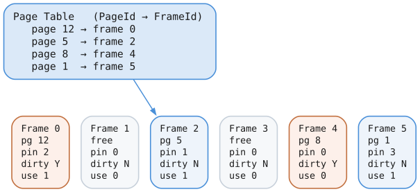

# Buffer Pool

## What It Is

The Buffer Pool is a cache that keeps frequently accessed pages in memory. Instead of reading from disk every time, we check the buffer pool first.

## The Problem It Solves

Disk I/O is slow:

| Operation | Typical latency |
|-----------|----------------:|
| CPU instruction | ~1 ns |
| RAM access | ~100 ns |
| SSD read | ~100,000 ns (100 µs) |
| HDD read | ~10,000,000 ns (10 ms) |

RAM is 1,000-100,000x faster than disk. If we can keep hot pages in RAM, performance improves dramatically.

## Architecture



## The Frame

Each frame holds one page:

```zig
pub const BufferFrame = struct {
    page_id: PageId,                    // Which page is here (0 = empty)
    data: []align(4096) u8,             // The page bytes (page_size long)
    pin_count: atomic(u32),             // Reference count
    dirty: bool,                        // Modified since read?
    usage_count: u8,                    // For Clock eviction (0 or 1)
    latch: RwLatch,                     // Reader-writer lock
};
```

### Pin Count

The pin count is a reference count:

| Call | Effect | Meaning |
|------|--------|---------|
| `fetchPage()` | `pin_count += 1` | I am using this page |
| `unpinPage()` | `pin_count -= 1` | I am done with this page |

| Pin count | Consequence |
|-----------|-------------|
| `> 0` | Page is in use and cannot be evicted |
| `= 0` | Page may be evicted if a frame is needed |

### Dirty Flag

| Event | Dirty flag | Meaning |
|-------|-----------|---------|
| Read page | `false` | Frame matches disk |
| Modify page | `true` | Frame differs from disk |
| Write to disk | `false` | Frame matches disk again |

Dirty pages MUST be written to disk before eviction. Otherwise we lose data!

### Reader-Writer Latch

```
Multiple readers OR one writer

Read latch:    "I'm reading, others can read too"
Write latch:   "I'm modifying, exclusive access"
```

## Fetching a Page

Simplified from `src/storage/buffer_pool.zig` (error cleanup left out):

```zig
pub fn fetchPage(self: *Self, page_id: PageId, mode: LatchMode) !*BufferFrame {
    self.mutex.lock();

    // 1. Check if already in buffer pool
    if (self.page_table.get(page_id)) |frame_id| {
        const frame = &self.frames[frame_id];
        _ = frame.pin_count.fetchAdd(1, .monotonic);
        frame.usage_count = 1;            // a hit sets the use bit
        self.mutex.unlock();
        self.acquireLatch(frame, mode);   // latch outside the mutex
        return frame;
    }

    // 2. Not in pool - take a free frame or evict one (flushing it if dirty)
    const frame_id = try self.getFreeFrame();
    const frame = &self.frames[frame_id];

    // 3. Claim the frame and publish it in the page table
    frame.page_id = page_id;
    frame.dirty = false;
    frame.usage_count = 1;
    _ = frame.pin_count.fetchAdd(1, .monotonic);
    try self.page_table.put(page_id, frame_id);
    self.mutex.unlock();

    // 4. Read page from disk, outside the mutex
    try self.pm.readPage(page_id, frame.data);

    // 5. Latch and return
    self.acquireLatch(frame, mode);
    return frame;
}
```

## The Clock Eviction Algorithm

When the buffer pool is full, we need to evict a page to make room. We use the Clock algorithm (also called "second chance").

### Why Clock?

- **LRU (Least Recently Used)** is optimal but expensive - requires updating timestamps on every access
- **Clock** approximates LRU cheaply using a usage bit. `usage_count` is a `u8`,
  but a hit sets it to 1 rather than incrementing it, so it behaves as a bit

### How It Works

Imagine the frames arranged in a circle with a clock hand:


**To find a victim:**

Simplified from `getFreeFrame`, which runs with the pool mutex held:

```zig
fn getFreeFrame(self: *Self) !FrameId {
    // Try free list first
    if (self.free_list.pop()) |frame_id| return frame_id;

    // Clock sweep: at most two full rotations
    var iterations: usize = 0;
    while (iterations < self.frame_count * 2) : (iterations += 1) {
        const frame = &self.frames[self.clock_hand];
        const frame_id: FrameId = @intCast(self.clock_hand);

        // Skip pinned pages
        if (frame.pin_count.load(.monotonic) > 0) {
            self.advanceClock();
            continue;
        }

        // Second chance: if used recently, clear and skip
        if (frame.usage_count > 0) {
            frame.usage_count -= 1;
            self.advanceClock();
            continue;
        }

        // Found victim: write it back if dirty, then drop it from the table
        if (frame.dirty) try self.pm.writePage(frame.page_id, frame.data);
        _ = self.page_table.remove(frame.page_id);
        frame.page_id = NULL_PAGE;
        frame.dirty = false;
        self.advanceClock();
        return frame_id;
    }

    return error.BufferPoolFull;  // Nothing evictable
}
```

**The key insight:** The use bit gives pages a "second chance". A recently used page survives one pass of the hand. Only pages that haven't been used since the hand last passed get evicted.

Eviction can happen at any time, so a dirty page may be written to the database
file long before, or long after, the transaction that dirtied it commits. Nothing
in the pool waits for the log.

## Unpinning Pages

When done with a page:

```zig
pub fn unpinPage(self: *Self, frame: *BufferFrame, dirty: bool) void {
    // Mark dirty if modified
    if (dirty) {
        frame.dirty = true;
    }

    // Release whichever latch is held (read from the latch state)
    self.releaseLatch(frame);

    // Decrement pin count
    _ = frame.pin_count.fetchSub(1, .monotonic);
}
```

Always unpin! Failure to unpin causes:
- Pages stuck in memory forever
- Buffer pool eventually fills with pinned pages
- `BufferPoolFull` errors

## Flushing Pages

Writing dirty pages to disk:

Simplified (both take a shared latch on the frame, spinning until it is free,
before writing it):

```zig
// Flush one page
pub fn flushPage(self: *Self, page_id: PageId) !void {
    const frame = self.lookupFrame(page_id) orelse return; // under the mutex

    if (frame.dirty) {
        try self.pm.writePage(frame.page_id, frame.data);
        frame.dirty = false;
    }
}

// Flush all dirty pages, returning how many were written
pub fn flushAll(self: *Self) !u32 {
    var flushed: u32 = 0;
    for (self.frames) |*frame| {
        if (frame.page_id != NULL_PAGE and frame.dirty) {
            try self.pm.writePage(frame.page_id, frame.data);
            frame.dirty = false;
            flushed += 1;
        }
    }
    return flushed;
}
```

Flushing writes pages; it does not fsync the database file. That is the page
manager's `sync`, which a checkpoint issues after its flush.

## Thread Safety

The buffer pool is thread-safe:

1. **Mutex** protects page_table, free_list, clock_hand
2. **Per-frame latches** protect page data
3. **Atomic pin_count** for safe reference counting

| Step | Thread 1 — `fetchPage(5)` | Thread 2 — `fetchPage(5)` |
|-----:|---------------------------|---------------------------|
| 1 | `mutex.lock()` | `mutex.lock()` — blocked |
| 2 | look up page 5 | waiting |
| 3 | `pin_count++` | waiting |
| 4 | `mutex.unlock()` | `mutex.lock()` — acquired |
| 5 | `frame.latch.read()` | look up page 5 — found |
| 6 | read data | `pin_count++` |
| 7 | read data | `mutex.unlock()` |
| 8 | read data | `frame.latch.read()` |
| 9 | `unpinPage()` | read data |
| 10 | — | `unpinPage()` |

The page table mutex is held only long enough to find the frame and bump the pin
count. Reading the page data happens under the per-frame latch, so two readers of
the same page overlap rather than serialising. On a miss the mutex is likewise
released after the frame is claimed and entered in the page table, and the disk
read happens outside it.

Multiple threads can read the same page concurrently (shared latch).

## Memory Alignment

Page buffers are 4KB-aligned:

```zig
const page_alignment = comptime Alignment.fromByteUnits(4096);
const data = try allocator.alignedAlloc(u8, page_alignment, page_size);
```

Why?

1. **Direct I/O**: Some systems require aligned buffers for O_DIRECT (LatticeDB
   does not use O_DIRECT today)
2. **SIMD**: Aligned data enables vectorized operations
3. **Cache lines**: Better CPU cache utilization

## Sizing the Buffer Pool

```zig
// 64MB buffer pool = 16,384 pages at 4 KB
var bp = try BufferPool.init(allocator, &pm, 64 * 1024 * 1024);
```

The pool holds `pool_size / page_size` frames. A file-backed database sizes it
from, in order of priority:

1. The `LATTICE_BUFFER_POOL_MB` environment variable, if set to a positive number
2. An explicit size: `buffer_pool_size` in the Zig `DatabaseConfig`, or
   `cache_size_mb` in the C open options (`LATTICE_OPEN_OPTIONS_DEFAULT` sets 100)
3. Otherwise automatic sizing: 16 MB, plus 12 MB when full-text search is enabled
   (the Zig default) and 12 MB more when vectors are enabled

Guidelines:
- **More is better** (to a point)
- **Working set**: Should fit frequently accessed pages
- **Available RAM**: Leave room for OS and other processes

### In-memory databases are different

All of the above assumes there is a disk to avoid. When the storage underneath is
already RAM — a `:memory:` database, or one opened from bytes — a cache miss costs
a copy from one part of memory to another rather than a trip to a device, so the
pool stops being the difference between fast and slow.

Measured on a fourteen megabyte in-memory database, twelve full scans took 9.2
seconds against a 256 KB pool and 9.9 against a 32 MB one. A hundred and twenty
times the memory bought nothing.

So an in-memory database gets a small fixed pool rather than a fraction of the
data. That keeps peak memory close to the size of the database itself, which
matters when the point of the feature is holding many small databases at once.

**The floor is a correctness requirement, not a tuning choice.** When the clock
sweep finds no evictable frame the pool returns `BufferPoolFull`, and that surfaces
as a failed query rather than a slow one. The pool must always have room for the
largest set of pages pinned simultaneously.

That number was measured rather than guessed, since guessing it trades memory
against query failures. Pools from four frames upward were run through a deep
variable-length traversal, a filtered scan, a full-text search, and a bulk write
over a fifteen-hundred node graph. Four frames completed all of it — the engine
does not hold many pages pinned at once. The floor sits at sixty-four, sixteen
times that, because the measurement was single threaded and concurrent readers
each pin pages of their own.

## Usage Pattern

```zig
var bp = try BufferPool.init(allocator, &pm, pool_size);
defer bp.deinit();  // Flushes dirty pages

// Read a page
const frame = try bp.fetchPage(page_id, .shared);
defer bp.unpinPage(frame, false);
const value = readValueFromPage(frame.data);

// Modify a page
const frame = try bp.fetchPage(page_id, .exclusive);
defer bp.unpinPage(frame, true);  // true = dirty
modifyPage(frame.data);
```

## Key Invariants

1. **Pin before access**: Never access page data without pinning
2. **Unpin when done**: Every fetchPage must have matching unpinPage
3. **Mark dirty**: If you modified the page, set dirty=true when unpinning
4. **Flush before close**: deinit() flushes, or call flushAll() explicitly
