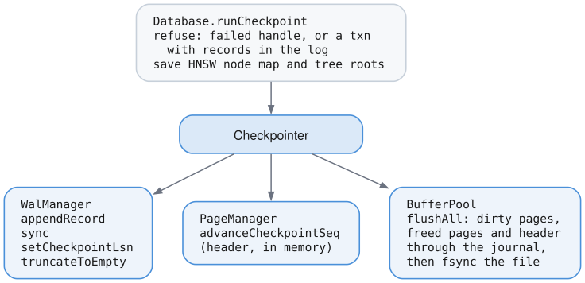

# Checkpointing

## The Problem

Without checkpointing, two bad things happen:

1. **WAL grows forever** - Every transaction appends records, file gets huge
2. **Recovery takes forever** - After crash, must replay entire WAL from the beginning

After a year of operation the WAL holds millions of records stretching back to day
one, and recovery has to replay every one of them. Without checkpoints, startup time
grows without bound.

## The Solution

A checkpoint says: "Everything up to this point is safely on disk in the main database file. We don't need the old WAL records anymore."


Most of the work of a checkpoint is getting the pages into the file, and that is
the part that has to be done carefully.

## Why Pages Cannot Go One at a Time

The obvious flush is a loop: for each dirty page, write it at its offset. A crash
can stop that loop anywhere. For a log of page images that would not matter, but
LatticeDB's log is logical (see [Write-Ahead Log](./wal.md#how-latticedb-applies-it)),
and a logical record can only be replayed onto a file that is a whole, consistent
image. Take a B+Tree split that changed three pages: the leaf that split, its new
sibling, and the parent that points at both. If the loop writes the leaf and dies
before the parent, the file holds a leaf that has lost half its keys and a parent
that knows nothing of the sibling holding them. The log says "insert node 42"; it
has no way to say "put the parent back".

So the database file only ever moves from one whole image to the next. That takes
three pieces.

### A buffer pool that never writes a page on its own

The buffer pool never evicts a dirty page. When the clock sweep finds only dirty
(or pinned) frames, the pool grows by an overflow frame beyond its configured size,
and gives the extra frames back after the next flush has cleaned them. Freed pages
are deferred the same way: freeing a page does not write a freelist link into the
file; the page manager remembers it, and the next flush chains it onto the freelist
together with everything else. The file header, with the tree roots and the
freelist head, changes only in memory between flushes. See
[Buffer Pool](./buffer-pool.md#writing-pages-back).

### Flushing early

Holding every dirty page costs memory: between flushes, a large transaction, a long
recovery or a run of direct writes can push the pool well past its configured
size. So the database also flushes before a checkpoint is due. When at least half
the pool's frames are dirty and **no page is pinned**, it writes the vector index's
in-memory node map into its tree, copies the tree roots into the header, syncs the
log, and flushes; without a log, it first applies the changefeed's retention policy
(below), since there are no checkpoints to do it. It is called after every commit,
before each write made outside a transaction, and between the operations recovery
replays, and does nothing when it cannot act. With a log it is also called between
the entities a commit applies (`relieveApplyPressure`).

"Nothing pinned" is how it knows no B+Tree operation is half done: a page is pinned
for the length of an operation that touches it. An early flush can still land in
the middle of a commit and write half a transaction, but that transaction's commit
record is already in the log, so recovery finishes it. Without a log nothing could
finish it, so no early flush runs while a commit is being applied: the pool grows
past its size if it must, and the flush the end of the commit offers writes the
transaction whole. Early flushes are not checkpoints: they leave the log as it was.

### The journaled flush

Every write of pages to the database file goes through one function,
`BufferPool.flushAll`, and it writes everything at once: every dirty page, the
pages freed since the last flush (formatted as freelist pages), and the header,
sorted by page number. What makes that one step atomic is writing it twice.


Before any page is written in place, the whole set is written to a second file
beside the database, `<database>-journal`, and synced. The journal is a 4 KB header
(magic `"LTDJ"`, version, page size, page count, the database's file UUID, a
checksum of the table and one of the header itself), a table of page ids and CRC32C
checksums padded to 4 KB, and then the page images, header first. It is written
images first, then the table, then the header, and synced once. Only then are the
pages written in place, header first, and the database file synced. Finally the
journal is truncated, without a sync.

The journal is read only when the database is opened, before anything else reads
the file (see [Recovery](./recovery.md#finishing-an-interrupted-flush)). If its
header and table verify, it names this database, and every image matches its
checksum, all of it is written in place; otherwise it is discarded.

| Crash during | State | Next open |
|--------------|-------|-----------|
| Writing the journal | Journal incomplete; database file untouched | Journal fails its checks and is discarded: the old image |
| Writing pages in place | Journal complete and synced; file part old, part new | Journal applied: the new image |
| Truncating the journal | File complete and synced; journal perhaps still there | Journal applied again, writing bytes the pages already hold: the new image |

The cost is plain: every page reaches the disk twice, and every flush syncs two
files. Flushes are much rarer than commits, which is what makes that affordable.
An in-memory database has no journal, since there is no crash for it to survive.
While a database is open the journal file exists, empty between flushes; a clean
close deletes it.

### Log first, then pages

Every caller of the flush syncs the log first when there is one: an early flush, a
checkpoint, `sync()`, and close. An image may contain half of a transaction that the
log can finish, but only if the log has it. In the default sync mode the log is
already synced at every commit and this extra sync is cheap; in
`sync_mode = .normal` it is what makes recent commit records durable before the
pages that depend on them. A database opened without a log has only the journaled
flush: a commit is durable once a flush after it has finished, and because the
flush never writes part of a transaction, the file always holds whole
transactions.

## How a Checkpoint Runs

Every checkpoint goes through one function in the database, `runCheckpoint`.

### Refusals

Two refusals come first:

- **A failed handle** (see [Transaction Manager](./transaction-manager.md#when-commit-fails))
  holds trees missing part of a committed transaction. Checkpointing them would
  write that state to the file and then empty the log that could repair it, so the
  checkpoint returns an error.
- **An open transaction with records in the log.** Recovery only redoes a
  transaction whose `TXN_BEGIN` it reads; a checkpoint that moved the replay point
  past that record, or emptied the log under it, would make recovery drop the
  transaction's commit. Such a checkpoint returns `TransactionConflict`. Because a
  transaction writes nothing to the log until it commits, this is rare in practice:
  readers, and writers still staging changes, do not hold a checkpoint back.

### Changefeed retention

Next the checkpoint applies the changefeed's retention policy. Under `last:N`
(keep the newest N events) or `age:` (keep the events committed within that long)
it drops the events the policy no longer keeps, oldest first; under `all`, the
default, it does nothing, and under `off` no events are written at all. The deletes
are not logged. The pass first raises a floor kept beside the feed, below which
every event is gone, and the floor and the deletes reach the file in this
checkpoint's flush, together. Replay skips any logged event below the floor, so a
dropped event cannot come back, and a reader that asks for the feed from its
beginning starts at the floor. The pass is bounded, to 4,096 events plus those
committed since the last complete pass, so a backlog left by a stricter policy is
worked off over several checkpoints instead of stalling one;
`Database.trimChangefeed` (`lattice_changefeed_trim` in C) applies the policy in
full and syncs. Without a log, where there are no checkpoints, the same pass runs
before the flushes of `sync()`, close and the early flush.

### State outside the buffer pool

Then two pieces of state that live outside the buffer pool are put into it: the
vector index's in-memory node map is written into its B+Tree, and the B+Tree root
page numbers are copied into the file header. Without that, the flush would write
pages whose roots the header does not name, and a process killed after a truncating
checkpoint would reopen onto stale roots with nothing left in the log to replay.

### The eight steps

The `Checkpointer` in `src/storage/checkpoint.zig` then runs:

1. Append `CHECKPOINT_BEGIN` to the log.
2. Sync the log.
3. In truncate mode, advance `checkpoint_seq` in the header, in memory. The flush in
   the next step writes it, so it is durable before the log is reset in step 8;
   anything following the log for replication reads the reset from it.
4. Flush: the journaled flush above, which also syncs the database file.
5. Append `CHECKPOINT_END`, with the number of pages flushed.
6. Set the log header's `checkpoint_lsn` to the `CHECKPOINT_END` record.
7. Sync the log.
8. In truncate mode, cut the log back to its header and sync it. If that fails the
   pages are already durable, so the checkpoint still succeeds and reports
   `wal_truncated = false`.

The begin and end records are informational: recovery reads past them. What
recovery uses is `checkpoint_lsn` in the log header and, in the default mode, the
truncation.

## The Checkpoint Modes

The mode decides what happens at steps 4 and 8.

### Truncate Mode

Flushes everything and then resets the log to its header. It is the only mode that
bounds the log's size, the default for automatic checkpoints, and what open, close
and `lattice checkpoint` use. The running session keeps counting LSNs; a later open
of the empty log starts again from 1.

### Full Mode

Flushes everything and leaves the log in place, with `checkpoint_lsn` marking where
replay now starts. Backup and serialisation use it to make the file a complete
database before copying it, without disturbing anything reading the log.

### Passive Mode

Does not wait. If any dirty page is pinned, it writes nothing at all and returns
with `checkpoint_lsn` where it was. It cannot flush the pages it is able to and skip
the rest, because a flush of some dirty pages and not others is exactly a torn image.

A full or passive checkpoint keeps every frame, so the log keeps growing. It bounds
recovery time, not disk space.

## What If We Crash Mid-Checkpoint?

The file is always a whole image, and the log is never emptied before the image
that replaces it is synced.

| Crash after | Database file | What recovery does |
|-------------|---------------|--------------------|
| Steps 1–3 | The previous image | Replays the log as before; `CHECKPOINT_BEGIN` is ignored |
| During step 4 | The previous image or the new one, decided by the journal | Replays the whole log onto whichever it is |
| Steps 4–7 | The new image | Replays from whichever `checkpoint_lsn` the header holds; the records it replays are already in the image, and replaying them changes nothing |
| Step 8 | The new image | Finds an empty log, or one the truncation had not yet reached |

The last two rows depend on replay being idempotent: the log records state outcomes
("property `age` of node 42 is 31"), so replaying one onto an image that already
holds it changes nothing. A torn checkpoint costs replay time, not correctness.

## Statistics

Each checkpoint returns stats:

```zig
CheckpointStats{
    pages_flushed: 42,        // How many dirty pages written
    duration_ns: 15_000_000,  // 15ms
    checkpoint_lsn: 1002,     // New checkpoint position
    wal_truncated: false,     // Whether WAL was reset
}
```

They say what the checkpoint did, including when a passive checkpoint wrote nothing
or a truncation failed after the flush succeeded. Useful for monitoring:
- If `pages_flushed` is always high, consider checkpointing more often
- If `duration_ns` is high, disk might be slow
- Track `checkpoint_lsn` growth over time

## When to Checkpoint

Usually you don't decide. Checkpoints run at four moments.

**After a commit**, when the log holds at least `max_wal_frames` frames. The
`auto_checkpoint` setting in `DatabaseConfig` is on by default:

| Setting | Default | Meaning |
|---------|---------|---------|
| `max_wal_frames` | null: an eighth of the buffer pool, 1000 to 16,384 frames | WAL frames written before a checkpoint is considered |
| `min_interval_ns` | 0 | Shortest gap between two automatic checkpoints |
| `mode` | `.truncate` | The only mode that resets the log, so the only one that bounds its size |

Left null, `max_wal_frames` is scaled to the buffer pool the database opened
with: the log may grow to an eighth of the pool's bytes, never less than 1000
frames of 4096 bytes and never more than 64 MB, counted in the log's own frame
size (`AutoCheckpointConfig.defaultMaxWalFrames`). The 100 MB cache of the C API
and the bindings gives 3,200 frames; the Zig API's 28 MB default and an in-memory
database's small fixed pool give 1000; 512 MB or more gives 16,384. The reason is
the cost of a checkpoint: it writes every page dirtied since the last one twice and
syncs, and with a 1 GB cache a bulk load of 1M nodes and 2M relationships took
12.1 s at 1000 frames and 8.6 s at 64 MB. The cap bounds what a crash leaves to
replay and the size of the `-wal` file. A number set in `max_wal_frames`, or through
any of the setters below, is used as it is. `Database.autoCheckpoint()` returns the
policy with the frame count filled in, so it says what the default came to.

Each commit that changed something writes at least one frame, so with a small
cache the default is at most a thousand write transactions. The automatic checkpoint is best
effort: it runs after the commit has succeeded, and if it fails, or is refused
because a transaction has records in the log, the commit still reports success and
the next commit tries again. Setting `auto_checkpoint = null` turns it off.
`Database.setAutoCheckpoint` changes the policy commits follow on an open database
(null or 0 frames for none) without changing what open and close do; the C API's
`lattice_set_auto_checkpoint`, each binding's setter, the CLI's
`--auto-checkpoint=<frames>` and the `LATTICE_AUTO_CHECKPOINT_FRAMES` variable all
set it.

It runs inside the commit call that crossed the threshold, not on a background
thread, so that one call returns later. In the published measurements
([Benchmarks](../performance/benchmarks.md): 0.17.0 through the C API, default
settings, Apple M5), of 20,000 single-node commits the median took 44 µs and the
99.9th percentile 1.4 ms; about one commit in a few hundred also ran a checkpoint,
and those, with the disk's own stalls, are that 99.9th percentile. The slowest
single commit ranged from 2 ms to over 200 ms from run to run. Taking the
checkpoint off the commit path would need a
background checkpointer, which LatticeDB does not have; a program that cannot
afford the pause can raise the interval, or turn the automatic checkpoint off and
run checkpoints itself.

**At open**, after recovery, if the log holds records after its last checkpoint,
so the next open has nothing to replay and a torn frame at the log's tail does not
sit in front of new ones. A read-only open that recovers a crashed database runs
this checkpoint too, on its in-memory overlay of the files, so it changes nothing on
disk (see [Recovery](./recovery.md#the-order-of-work-at-open)).

**At close**, for the same reason: `Database.close()` runs a truncate checkpoint when
the log holds records after its last checkpoint, and the C API's `lattice_close`
syncs the database first and then does the same. A log that ends at its own last
checkpoint (a `.full` or `.passive` checkpoint, such as the one a replication
snapshot takes, leaves its records behind) has nothing to fold in and is left as it
is: resetting it would advance the log's reset counter, which replication reads as
the start of a new generation. Either way a cleanly closed database needs nothing
from its log, and the journal is deleted. Both the open and the close checkpoint are skipped when
`auto_checkpoint` is null, which leaves truncating the log to the caller, and both
are skipped on a failed handle.

**On request**:
- **`Database.checkpoint(mode)`** in the Zig API, `lattice_checkpoint(db, mode,
  &stats)` in C, and each binding's `checkpoint`. While a transaction has records
  in the log it is refused with `TransactionConflict` (`LATTICE_ERROR_LOCK_TIMEOUT`
  in C). Without a log it does nothing and reports no pages flushed; on a read-only
  handle the Zig call does nothing and the C call returns `LATTICE_ERROR_READ_ONLY`.
- **`lattice checkpoint <path>`**: opens the database and runs a truncate checkpoint.
- **`backup` and `serialize`**: run a full checkpoint so the copied file stands on
  its own (see [Portable Databases](./portable-databases.md)).

The `Checkpointer` also has a size check you can use when managing checkpoints by
hand:

```zig
// Check if WAL has grown too large
if (checkpointer.shouldCheckpoint(1000)) {
    _ = try checkpointer.checkpoint(.truncate);
}
```

A small threshold means a short replay after a crash and a flush, with its journal,
every few commits; a large one means fewer flushes, a longer log, and more reliance
on early flushes to keep the buffer pool in bounds.

## Integration



The Checkpointer coordinates between:
- **BufferPool**: `flushAll`, the journaled flush of every dirty page, freed page
  and the header, which also syncs the database file
- **PageManager**: bumps `checkpoint_seq` in the in-memory header
- **WalManager**: Records checkpoint markers, updates checkpoint_lsn, truncates the log

The database around it decides whether a checkpoint may run at all, applies the
changefeed's retention policy, and puts the vector index map and tree roots in place
first.

## API

From the database (returns `null` for a read-only handle or one without a WAL):

```zig
// Checkpoint and reset the log
if (try db.checkpoint(.truncate)) |stats| {
    log("Flushed {} pages", stats.pages_flushed);
}
```

The `Checkpointer` underneath. Called directly it skips the database's refusals and
the vector index and tree-root step, which is why the database never does:

```zig
var checkpointer = Checkpointer.init(allocator, &bp, &pm, &wal);

// Passive checkpoint: writes nothing if a dirty page is pinned
const passive_stats = try checkpointer.checkpoint(.passive);

// Full checkpoint (pages durable, log left in place)
const full_stats = try checkpointer.checkpoint(.full);

// Truncate checkpoint (reclaim WAL space)
const truncate_stats = try checkpointer.checkpoint(.truncate);

// Check if checkpoint needed
if (checkpointer.shouldCheckpoint(1000)) {
    _ = try checkpointer.checkpoint(.truncate);
}

// Get last checkpoint stats
if (checkpointer.getLastStats()) |stats| {
    log("Flushed {} pages in {}ms", stats.pages_flushed, stats.duration_ns / 1_000_000);
}
```

## Summary

| Concept | Purpose |
|---------|---------|
| Journaled flush | Every dirty page, freed page and the header reach the file together, or not at all |
| No dirty eviction | The buffer pool grows instead of writing a page on its own |
| Early flush | Half the pool dirty and nothing pinned: flush without checkpointing |
| checkpoint_lsn | Recovery starting point |
| CHECKPOINT_BEGIN/END | Markers in the log; informational |
| Passive mode | Writes nothing if a dirty page is pinned |
| Full mode | Flushes everything, keeps the log |
| Truncate mode | Flushes everything and empties the log; the automatic default |
| Auto-checkpoint | After a commit, once the log reaches an eighth of the buffer pool (1000 frames to 64 MB); refused while a transaction has records in the log |

Checkpointing is the bridge between WAL-based durability (fast commits) and bounded recovery time (fast restart). Without it, durability requires replaying the entire history on every startup.
