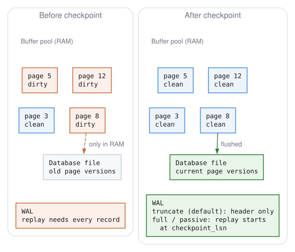

# Checkpointing

## The Problem

Without checkpointing, two bad things happen:

1. **WAL grows forever** - Every transaction appends records, file gets huge
2. **Recovery takes forever** - After crash, must replay entire WAL from the beginning

After a year of operation the WAL holds millions of records stretching back to day
one, and recovery has to replay every one of them. Without checkpoints, startup time
grows without bound.

## The Solution

A checkpoint says: "Everything up to this point is safely on disk in the main database file. We don't need the old WAL records anymore."



The checkpoint itself is the `Checkpointer` in `src/storage/checkpoint.zig`. It
works on pages: it flushes the buffer pool, not transactions. Who runs it, and when,
is up to the `Database` (see [When to Checkpoint](#when-to-checkpoint)).


## How It Works Step by Step

### Step 1: Write CHECKPOINT_BEGIN to WAL

```
WAL: [...existing records...][CHECKPOINT_BEGIN, lsn=1000]
```

This marks the start of the checkpoint in the log. It is informational: recovery
reads past `CHECKPOINT_BEGIN` and `CHECKPOINT_END` without acting on them. What
recovery uses is the `checkpoint_lsn` in the WAL header (step 6).

### Step 2: Sync WAL

```
fsync(wal_file)
```

Ensures CHECKPOINT_BEGIN is on disk before we start flushing pages.

### Step 3: Flush Dirty Pages

Scan the buffer pool and write dirty pages to the database file:

```
for each frame in buffer_pool:
    if frame.dirty:
        write frame.data to database_file at page offset
        frame.dirty = false
```

**Passive mode**: Skip pages that are currently pinned (in use by transactions). This avoids blocking active work.

**Full mode**: Wait for latches if needed. Guarantees all dirty pages are flushed.

### Step 4: Sync Database File

```
if mode == truncate: checkpoint_seq += 1, rewrite the file header
fsync(database_file)
```

Critical! This ensures all the page writes are actually on disk, not sitting in OS
buffers. A truncate checkpoint first bumps `checkpoint_seq` in the database file
header, so the counter is durable before the log is reset in step 7.

### Step 5: Write CHECKPOINT_END to WAL

```
WAL: [...][CHECKPOINT_BEGIN][CHECKPOINT_END, lsn=1002]
```

This marks successful completion. The payload includes stats (pages flushed).

### Step 6: Update checkpoint_lsn

```
wal_header.checkpoint_lsn = 1002  // LSN of CHECKPOINT_END
fsync(wal_file)
```

This is the key marker for recovery: the next recovery starts reading at LSN 1002.
It says "everything before LSN 1002 is safely on disk" — which holds for a full or
truncate checkpoint taken with no transaction open (see below).

### Step 7: Truncate (truncate mode only)

```
wal_header.frame_count = 0
wal_header.checkpoint_lsn = 0
truncate(wal_file, 4096)   // header only
fsync(wal_file)
```

The log is now empty. If truncation fails, the pages are already durable, so the
checkpoint still succeeds and reports `wal_truncated = false`.

## The Checkpoint Modes

### Passive Mode

```
"Checkpoint what you can without disrupting active work"

for each frame:
    if dirty AND not pinned AND can get latch immediately:
        flush it
    else:
        skip it (maybe next time)
```

Good for: Background checkpointing during normal operation. Doesn't block transactions.

Bad: May leave some dirty pages unflushed. It still advances `checkpoint_lsn` to its
`CHECKPOINT_END` afterwards, so recovery after a crash will not replay the records
behind a page it skipped.

### Full Mode

```
"Checkpoint everything, wait if necessary"

for each frame:
    if dirty:
        wait for latch (spin until available)
        flush it
```

Good for: Complete checkpoint before shutdown, or when WAL is getting too large.

Bad: May briefly block transactions waiting for latches.

### Truncate Mode

```
"Full checkpoint, then reset WAL to beginning"

1. Do full checkpoint (bumping checkpoint_seq first)
2. Truncate WAL file to just the header
3. Reset frame_count and checkpoint_lsn to 0
```

Good for: Bounding the WAL's size. It is the only mode that shrinks the log, and the
default for automatic checkpoints.

### No Transaction May Be Open

Recovery only redoes a transaction whose `TXN_BEGIN` it reads, and it starts
reading at `checkpoint_lsn`, or at the start of a freshly truncated log. A
transaction that is open when a checkpoint runs has its `TXN_BEGIN` behind that
point, so if it commits afterwards and the process then crashes before the next
checkpoint, recovery skips it. In every mode, then, a checkpoint has to run with no
transaction open. The automatic checkpoint checks for that and waits for the next
commit; `Database.checkpoint` in the Zig API does not check, so its caller must.

## What If We Crash Mid-Checkpoint?

Recovery ignores the `CHECKPOINT_BEGIN` and `CHECKPOINT_END` records themselves. Only
the `checkpoint_lsn` in the WAL header matters, and it moves only in step 6, after
the pages have been flushed and fsynced.

| Crash point | `checkpoint_lsn` | State of the database file | What recovery does |
|-------------|------------------|----------------------------|--------------------|
| Before step 6 | Previous value | Some, all or none of the pages flushed | Replays from the previous `checkpoint_lsn`, re-executing the logical records on top of whatever pages made it |
| After step 6, before truncation | New value | Fully flushed | Replays only what follows the new `checkpoint_lsn` |
| After truncation | 0, empty log | Fully flushed | Nothing to replay |

A torn checkpoint costs replay time, not correctness.

## Statistics

Each checkpoint returns stats:

```zig
CheckpointStats{
    pages_flushed: 42,        // How many dirty pages written
    duration_ns: 15_000_000,  // 15ms
    checkpoint_lsn: 1002,     // New checkpoint position
    wal_truncated: false,     // Whether WAL was reset
}
```

Useful for monitoring:
- If `pages_flushed` is always high, consider checkpointing more often
- If `duration_ns` is high, disk might be slow
- Track `checkpoint_lsn` growth over time

## When to Checkpoint

Usually you don't decide: checkpointing is automatic and size-based. The
`auto_checkpoint` setting in `DatabaseConfig` is on by default:

| Setting | Default | Meaning |
|---------|---------|---------|
| `max_wal_frames` | 1000 | WAL frames written before a checkpoint is considered |
| `min_interval_ns` | 0 | Shortest gap between two automatic checkpoints |
| `mode` | `.truncate` | The only mode that resets the log, so the only one that bounds its size |

After every commit, the database checks: no transaction open, the WAL holds at least
`max_wal_frames` frames, and the minimum interval has passed. If so it runs a
checkpoint in `mode` before the commit returns. It is best effort: a failed
checkpoint is not reported as a failed commit, and the next commit tries again.
Setting `auto_checkpoint = null` turns it off.

The other places a checkpoint runs:
- **C `lattice_close`**: syncs the database (vector index, tree roots, dirty pages,
  log), then runs a truncate checkpoint, then closes. A cleanly closed database
  leaves an empty log.
- **Zig `Database.close()`**: does not checkpoint. It persists the vector index and
  tree roots and flushes dirty pages on a best-effort basis, without an fsync of
  the database file, and leaves the log in place to be replayed at the next open.
  Call `checkpoint(.truncate)` first if you want a clean log.
- **`lattice checkpoint <path>`**: opens the database and runs a truncate checkpoint.
- **`backup` and `serialize`**: run a full checkpoint so the copied file stands on
  its own (see [Portable Databases](./portable-databases.md)).

The `Checkpointer` also has a size check you can use when managing checkpoints by
hand:

```zig
// Check if WAL has grown too large
if (checkpointer.shouldCheckpoint(1000)) {
    _ = try checkpointer.checkpoint(.truncate);
}
```

## Integration


The Checkpointer coordinates between:
- **BufferPool**: Knows which pages are dirty
- **PageManager**: Writes pages to database file, bumps `checkpoint_seq`, fsyncs
- **WalManager**: Records checkpoint markers, updates checkpoint_lsn, truncates the log

## API

From the database (returns `null` for a read-only handle or one without a WAL):

```zig
// Checkpoint and reset the log
if (try db.checkpoint(.truncate)) |stats| {
    log("Flushed {} pages", stats.pages_flushed);
}
```

The `Checkpointer` underneath:

```zig
var checkpointer = Checkpointer.init(allocator, &bp, &pm, &wal);

// Passive checkpoint (background)
const passive_stats = try checkpointer.checkpoint(.passive);

// Full checkpoint (pages durable, log left in place)
const full_stats = try checkpointer.checkpoint(.full);

// Truncate checkpoint (reclaim WAL space)
const truncate_stats = try checkpointer.checkpoint(.truncate);

// Check if checkpoint needed
if (checkpointer.shouldCheckpoint(1000)) {
    _ = try checkpointer.checkpoint(.truncate);
}

// Get last checkpoint stats
if (checkpointer.getLastStats()) |stats| {
    log("Flushed {} pages in {}ms", stats.pages_flushed, stats.duration_ns / 1_000_000);
}
```

## Summary

| Concept | Purpose |
|---------|---------|
| Dirty page flush | Write modified pages to database file |
| checkpoint_lsn | Recovery starting point |
| CHECKPOINT_BEGIN/END | Markers in the log; informational |
| Passive mode | Non-blocking background checkpoint |
| Full mode | Complete checkpoint, may block briefly |
| Truncate mode | Reclaim WAL disk space; the automatic default |
| Auto-checkpoint | After a commit, at 1000 frames, with no transaction open |

Checkpointing is the bridge between WAL-based durability (fast commits) and bounded recovery time (fast restart). Without it, durability requires replaying the entire history on every startup.
