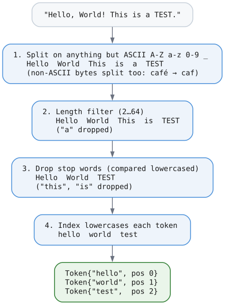
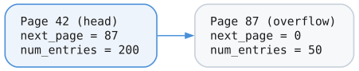
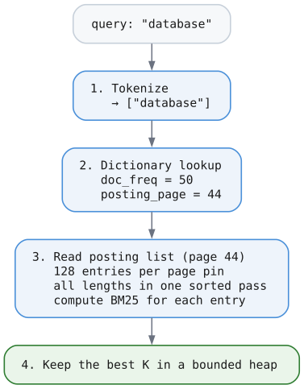
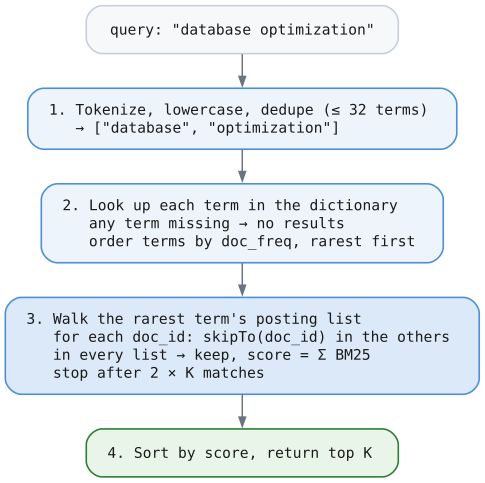
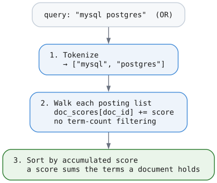
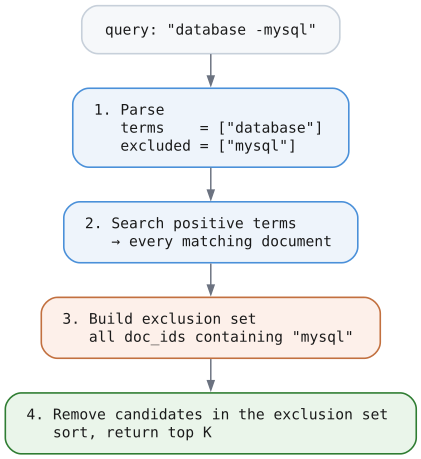

# Full-Text Search (BM25)

This document explains how Lattice's full-text search works, from text input to ranked results.

## Overview

Full-text search allows you to find documents containing specific words or phrases, ranked by relevance. Lattice implements the **BM25** (Best Match 25) ranking algorithm, the same algorithm used by Elasticsearch and other production search engines.

An index covers exactly one label and one property — `Document.body`, say. You
declare it once, and writing that property keeps it current. Sections 13 to 16
cover how a declaration is stored, how one set of trees carries many indexes, how
writes maintain them, and why the one-label-one-property shape is what lets a
query read the index instead of scanning.

The FTS system consists of five components:


## 1. Tokenizer

The tokenizer breaks text into searchable tokens.

### What It Does

Given input text:
```
"The quick brown fox jumps over the lazy dog"
```

The tokenizer produces:
```
["quick", "brown", "fox", "jumps", "lazy", "dog"]
```

Notice "The", "the", and "over" are missing—they're **stop words**.

### How It Works



The tokenizer decodes UTF-8. A word is a run of code points that are letters,
digits or combining marks in any script, plus `_`; spaces, punctuation, symbols
and emoji separate words, and so does any byte that is not valid UTF-8. Han
ideographs and hiragana are a word each, since those scripts do not separate
words with spaces. So `Müller`, `москва` and `snake_case` are one word each, and
`東京` is two. On ASCII text the result is byte for byte what 0.16.0 produced.
Indexes built by 0.16.0 keep its ASCII-only splitting; see
[Analysis is recorded per index](#analysis-is-recorded-per-index).

The tokenizer returns each token's original text. Normalisation happens in one
function, `normalizeTerm`, which indexing, every query form, uncommitted-text
matching and highlighting all call with the same configuration:

1. **Lowercase** Latin (including Latin Extended), Greek, Cyrillic and Armenian
   letters, and full-width ASCII.
2. **Fold accents** when `remove_accents` is set (the default): `café` → `cafe`,
   `Straße` → `strasse`, `æ` → `ae`, Greek tonos and dialytika removed, and
   combining marks of decomposed text dropped. Folding never makes a word longer
   in bytes.
3. **Stem** when `use_stemming` is set (off by default), with the English Porter
   stemmer.

Words shorter than `min_token_length` (2) or longer than `max_token_length` (64)
bytes are dropped before normalisation, and stop words are compared against the
lowercased, accent-folded word before stemming.

### Analysis is recorded per index

An index records how it analyses text (a version, whether accents are folded,
whether words are stemmed, and the language) under a six-byte key in its own
document-lengths scope when its first document goes in. From then on the record
wins over the configuration, so a word is always looked up as the term it was
stored as, even if the configuration changes between opens.

An index that has documents and no record was built by 0.16.0 or earlier. Its
terms came from the ASCII-only tokenizer, so it keeps that tokenizer
(`ascii_only`): every byte that is not an ASCII letter, digit or `_` separates
words, terms are ASCII-lowercased, and there is no accent folding or stemming.
Its stored terms stay findable, and searching it behaves as it did. Once every
document has left the index, the next one records the new analysis. Dropping an
index clears its record with the rest of its keys, so dropping and declaring it
again rebuilds it with the new tokenizer; so does the rebuild that follows a
recovery that replayed the log.

No existing key or value changed, and 0.16.0 never reads the new key, so 0.16.0
can still open and write a database this version wrote. It splits non-ASCII
words its old way, though, so it does not find non-ASCII words this version
indexed.

### Stop Words

Stop words are common words that add little search value. Lattice ships one
stop-word list: about 100 **English** words (the, and, is, a, to, of, in, that,
it, …), in `src/fts/stopwords.zig`.

The tokenizer config has a `language` field, and the list is looked up by
language, but every language currently returns the English list. Setting
`.language = .german` changes nothing.

### Configuration

```zig
pub const TokenizerConfig = struct {
    min_token_length: u8 = 2,      // Skip tokens shorter than this (bytes)
    max_token_length: u8 = 64,     // Skip tokens longer than this (bytes)
    lowercase: bool = true,         // Compare stop words in lowercase
    remove_accents: bool = true,    // Fold accents ("café" -> "cafe")
    remove_stop_words: bool = true, // Filter common words
    use_stemming: bool = false,     // Porter-stem terms when indexing and searching
    language: Language = .english,  // Every language uses the English stop words
    ascii_only: bool = false,       // 0.16.0 splitting; set by the index, not by callers
};
```

The database takes this from `DatabaseConfig.fts_config.tokenizer`, one setting
for every index it opens, and it applies only to indexes that have not yet
recorded their analysis. The C API, the bindings and Cypher do not expose it, so
outside Zig every new index folds accents and does not stem.

### Porter Stemmer

The engine includes an English Porter stemmer, which reduces tokens to their
root forms:

| Input token | Stemmed |
|-------------|---------|
| `running` | `run` |
| `connected` | `connect` |
| `optimization` | `optim` |
| `databases` | `databas` |

With `use_stemming` set, a new or emptied index stores and looks up stemmed
terms, so `run` finds `running`; the setting is recorded in the index (see
above), so an index that already has documents keeps the analysis it recorded. It is off by default, and only a Zig caller can set it, through the
database's `fts_config`. Highlighting normalises through the same function, so
given the index's analysis (`FtsIndex.analysis()`) it marks the words search
matched.

For non-English languages the stemmer returns words unchanged.

Use `normalizeAndStem()` or `normalizeAndStemWithLanguage()` for manual stemming:

```zig
var buf: [64]u8 = undefined;

// English stemming
const en_stemmed = tokenizer_mod.normalizeAndStemWithLanguage("RUNNING", &buf, true, .english);
// en_stemmed = "run"

// German (no stemmer available, returns lowercased)
const de_stemmed = tokenizer_mod.normalizeAndStemWithLanguage("RUNNING", &buf, true, .german);
// de_stemmed = "running"
```

---

## 2. Dictionary

The dictionary maps tokens to integer IDs and tracks statistics.

### What It Does

| Token | TokenId | DocFreq | PostingPage |
|-------|--------:|--------:|------------:|
| `hello` | 1 | 5 | 42 |
| `world` | 2 | 3 | 43 |
| `database` | 3 | 12 | 44 |
| `search` | 4 | 8 | 45 |

### What the TokenId is for

The dictionary entry's `posting_page` is what leads from a token to its
postings. The `token_id` is only a label: it is written into the header of the
token's posting pages and never used to find anything. Each `FtsIndex` instance
starts numbering from the same first value (the database builds one per
search), so the same id can label different tokens.

### Storage Format

The dictionary uses a B+Tree with:
- **Key**: Token string (e.g., `"hello"`)
- **Value**: DictionaryEntry (24 bytes)

| Field | Size | Offset |
|-------|-----:|-------:|
| `total_freq` | 8 B | 0 |
| `token_id` | 4 B | 8 |
| `doc_freq` | 4 B | 12 |
| `posting_page` | 4 B | 16 |
| `_padding` | 4 B | 20 |

Fields are ordered largest-first to minimize internal padding (u64 requires 8-byte alignment).

| Field | Type | Description |
|-------|------|-------------|
| `total_freq` | u64 | Total occurrences across all documents |
| `token_id` | u32 | Unique identifier (1 to ~4 billion) |
| `doc_freq` | u32 | Number of documents containing this token |
| `posting_page` | PageId | First page of the posting list |
| `_padding` | u32 | Explicit padding for 8-byte struct alignment |

### Operations

**getOrCreate(token)** - Get existing TokenId or create new one:
1. Look up `"hello"` in the B+Tree.
2. If found, return the existing `token_id`.
3. If not found:
   1. Assign the next `token_id` — say 5.
   2. Insert the token into the B+Tree.
   3. Return 5.

---

## 3. Posting Lists

A posting list stores which documents contain a specific token.

### What It Does

For the token "database" (TokenId 3):
| DocId | TermFreq | |
|------:|---------:|---|
| 15 | 3 | document 15 contains `database` three times |
| 42 | 1 | |
| 89 | 7 | |
| 156 | 2 | |
| 203 | 1 | |
| … | … | |

### Page Layout

Each posting list page is 4096 bytes. This is the current (V2) layout:

| Region | Bytes | Contents |
|--------|-------|----------|
| `PageHeader` | 0–7 | `page_type = fts_posting`; page-header flag `0x01` marks the V2 layout |
| `PostingPageHeader` | 8–31 (24 B) | see below |
| Skip-pointer area | 32–283 (252 B) | fixed reserve: up to 15 pointers of 16 B `[doc_id, byte_offset, entry_count]` |
| Posting data | 284 → | varint encoded entries, see below |

Each entry is `[doc_id: varint][term_freq: varint]`. When the index stores
positions, the entry continues with `[position_count: varint][position: varint]
× position_count`. Doc ids and positions are stored as absolute values, not as
deltas.

**PostingPageHeader fields**

| Field | Type | Meaning |
|-------|------|---------|
| `token_id` | u32 | Label of the token this list belongs to |
| `num_entries` | u32 | Postings held in this page |
| `next_page` | u32 | Overflow page, 0 for none |
| `num_skip_pointers` | u16 | Number of skip pointers in use |
| `flags` | u16 | `0x01` = entries carry positions (for phrase queries) |
| `data_start` | u32 | Byte offset where posting data begins (284) |
| `data_end` | u32 | Byte offset where posting data currently ends |

The older V1 layout has a 20-byte header without `data_end` and room for 16 skip
pointers. Posting data starts at byte 284 in both, so a V1 page is upgraded in
place the first time an entry is appended to it. Creating any posting page also
raises the file header's `format_version` and `min_reader_version` to at
least 2.

### Varint Encoding

Document IDs and frequencies are stored using **variable-length integers** (varints) for compression:

| Value | Varint bytes | Encoded size | Fixed-width size |
|------:|--------------|-------------:|-----------------:|
| 127 | `[0x7F]` | 1 B | 8 B |
| 128 | `[0x80, 0x01]` | 2 B | 8 B |
| 16,383 | `[0xFF, 0x7F]` | 2 B | 8 B |
| 1,000,000 | `[0xC0, 0x84, 0x3D]` | 3 B | 8 B |

**Encoding algorithm:**
```
while value >= 0x80:
    output byte = (value & 0x7F) | 0x80   // Low 7 bits + continuation flag
    value = value >> 7
output byte = value                        // Final byte (no continuation)
```

**Example:** Encoding 300 (binary: 1 0010 1100)
```
300 = 0b100101100

Step 1: 300 >= 128, so:
        output[0] = (300 & 0x7F) | 0x80 = 0x2C | 0x80 = 0xAC
        300 >> 7 = 2

Step 2: 2 < 128, so:
        output[1] = 2 = 0x02

Result: [0xAC, 0x02] (2 bytes instead of 8)
```

### Overflow Pages

When a posting list exceeds one page, it chains to overflow pages:



### Skip Pointers

Skip pointers let a seek within a posting page binary-search to roughly the
right place instead of scanning from the start, which speeds up multi-term AND
queries. They are per page: each page has its own fixed reserve of at most 15,
so entries beyond the 15th interval on a page are reached by scanning.

**Structure:**
| Field | Size | Offset |
|-------|-----:|-------:|
| `doc_id` | 8 B | 0 |
| `byte_offset` | 4 B | 8 |
| `entry_count` | 4 B | 12 |

**How they work:**

Skip pointers are created every 128 entries (SKIP_INTERVAL). They record:
- `doc_id`: The document ID at that entry
- `byte_offset`: Where to jump in the posting data
- `entry_count`: Number of entries before this pointer

```
Posting list with 500 entries:

Skip Pointers:
  [0] doc_id=1280, offset=512, count=128   ← entry 128
  [1] doc_id=2560, offset=1024, count=256  ← entry 256
  [2] doc_id=3840, offset=1536, count=384  ← entry 384

Seeking to doc_id 3000:
  1. Binary search skip pointers: find [1] (doc_id=2560 < 3000)
  2. Jump to offset 1024
  3. Linear scan from entry 256 to find doc_id 3000

Result: Skipped 256 entries instead of scanning all 300
```

**Search does not use them.** `skipTo()` assumes a list in doc_id order, and
posting lists are not kept in that order: updating an indexed property removes
the document's postings and appends the new ones at the tail of each list, and a
transaction that writes several documents commits them in hash order. A merge
that advanced the other lists with `skipTo()` silently dropped any match stored
behind its cursor, which is how 0.16.0's AND search lost documents. The AND
search (section 6) now reads each list through once instead. Skip pointers are
still written and maintained, and the iterator still offers `skipTo()`.

Reading is batched: `PostingIterator.next()` decodes up to 128 entries per page
pin, rather than pinning the page once per entry.

---

## 4. Document Length Storage

BM25 scoring requires knowing each document's length. This is stored in a separate B+Tree:

| DocId | Length (tokens) |
|------:|----------------:|
| 1 | 150 |
| 2 | 45 |
| 3 | 892 |
| … | … |

**Why store lengths?**

BM25 penalizes long documents to prevent them from dominating results just because they contain more words. A 10,000-word document mentioning "database" once is less relevant than a 100-word document mentioning it once.

**Statistics tracked:**
- `total_docs`: Total documents indexed
- `total_tokens`: Sum of all document lengths
- `avg_doc_length`: Average tokens per document (for normalization)

A failure to write the statistics is returned to the caller; it used to be
ignored, which could leave an index with no statistics and every later score
computed against an empty corpus. The same tree also holds the index's analysis
record (section 1).

A search looks up the lengths of all the documents it scores in one pass, sorted
by key, with a cursor that seeks forward through the tree, so neighbouring keys
share a descent instead of costing one each. A storage error while reading
lengths fails the search rather than dropping the document.

---

## 5. BM25 Scoring

BM25 calculates a relevance score for each document.

### The Formula

```
Score(D, Q) = Σ IDF(term) × TF_norm(term, D)
              for each term in query Q
```

Where:

**IDF (Inverse Document Frequency):**
```
IDF(term) = log((N - df + 0.5) / (df + 0.5) + 1)

N  = total number of documents
df = number of documents containing this term
```

Rare terms get higher IDF scores. If "quantum" appears in 5 of 10,000 documents, it's more significant than "the" appearing in 9,500.

**TF_norm (Normalized Term Frequency):**
```
TF_norm = (tf × (k1 + 1)) / (tf + k1 × (1 - b + b × (dl / avgdl)))

tf    = term frequency in this document
k1    = saturation parameter (default 1.2)
b     = length normalization (default 0.75)
dl    = document length
avgdl = average document length
```

### Parameters

| Parameter | Default | Effect |
|-----------|---------|--------|
| `k1` | 1.2 | Controls term frequency saturation. Higher = more weight to repeated terms |
| `b` | 0.75 | Length normalization. 0 = no normalization, 1 = full normalization |

### Scoring Example

```
Corpus: 1000 documents, average length 200 tokens
Query: "database optimization"

Document 42:
  - Length: 150 tokens
  - "database" appears 3 times
  - "optimization" appears 1 time

Term: "database"
  - doc_freq = 50 (appears in 50 docs)
  - IDF = log((1000 - 50 + 0.5) / (50 + 0.5) + 1) = log(19.82) ≈ 2.99

  - tf = 3
  - dl/avgdl = 150/200 = 0.75
  - TF_norm = (3 × 2.2) / (3 + 1.2 × (1 - 0.75 + 0.75 × 0.75))
            = 6.6 / (3 + 1.2 × 0.8125)
            = 6.6 / 3.975
            ≈ 1.66

  - Score for "database" = 2.99 × 1.66 ≈ 4.96

Term: "optimization"
  - doc_freq = 10 (rarer term)
  - IDF = log((1000 - 10 + 0.5) / (10 + 0.5) + 1) ≈ 4.55

  - tf = 1
  - TF_norm = (1 × 2.2) / (1 + 1.2 × 0.8125) ≈ 1.12

  - Score for "optimization" = 4.55 × 1.12 ≈ 5.10

Total Score for Document 42 = 4.96 + 5.10 = 10.06
```

---

## 6. Search Flow

### Single-Term Search



### Multi-Term Search (AND Semantics)



A query is split into at most 32 distinct normalised terms. A document matches
only if it contains every term, so a term that is not in the dictionary at all
means nothing matches, and a failed dictionary lookup or posting read is an
error rather than a term quietly left out. The rarest term's posting list
(lowest `doc_freq`) supplies the candidates, held in a hash map by doc_id. Every
other list is then read through once, rarest next, and each entry is matched
against the candidates by doc_id, so the result does not depend on the order the
lists are stored in. A term that matches no remaining candidate ends the search
early.

Every document that has all the terms is scored, and the best `limit` are kept
in a bounded heap (ties keep posting order). The answer is the true top K at any
limit. A single-term search keeps the best `limit` the same way. Document
lengths are looked up only for documents in every list.

Reading every list in full means an AND query costs about the sum of its terms'
document frequencies, so a common term costs as much beside a rare one as on its
own.

### Which operations are reachable

`FtsIndex` implements more query forms than the database exposes:

| Entry point | Query form |
|-------------|------------|
| Cypher `x.prop @@ text`, `lattice_fts_search` | plain AND of the terms (`search()`) |
| `lattice_fts_search_fuzzy` | fuzzy match (`searchFuzzy()`) |
| `FtsIndex` only | OR, `-term` exclusion, phrases and quoted phrases, prefix (`term*`) |

Through `@@` and `lattice_fts_search`, quotes and a leading `-` are treated as
separators like any other punctuation: `"database -mysql"` searches for
documents containing both `database` and `mysql`. The sections below on OR,
exclusion, phrase and prefix search describe the component, for use from Zig.

### OR Search

OR search returns documents matching **any** query term:

```zig
// Returns docs containing "mysql" OR "postgres" OR both
const results = try fts.searchOr("mysql postgres", 10);

// Or use explicit mode selection
const results = try fts.searchWithMode("mysql postgres", .@"or", 10);
```



### NOT Search (Exclusions)

Prefix terms with `-` to exclude documents containing them:

```zig
// Find "database" docs that don't mention "mysql"
const results = try fts.searchWithMode("database -mysql", .@"and", 10);

// Multiple exclusions
const results = try fts.searchWithMode("database -mysql -oracle", .@"and", 10);
```



Exclusion is applied after the candidate search, and so are phrase
intersections. Every sub-search that is narrowed afterwards runs without a
limit, and ranking and the limit come last, so a document that survives the
narrowing is never cut beforehand for scoring below documents that do not
survive it. Only a lone term search, with no exclusions and no phrases, stops at
`limit` directly, which is the one case where that is exact.

`searchWithMode` splits each whitespace-separated run of the query with the
tokenizer, so `foo-bar` asks for both `foo` and `bar` (a `-` inside a word is a
separator, not an exclusion), and punctuation such as `bread, butter` is
separated rather than kept. An exclusion written as a phrase, `-"a b"`, is
treated as a required phrase, not excluded.

### Phrase Search

Phrase search finds documents where terms appear **adjacent and in order**:

```zig
// Enable position storage in config
var fts = FtsIndex.init(allocator, &bp, &dict_tree, &lengths_tree, null, .{
    .store_positions = true,
});

// Search for exact phrase
const results = try fts.searchPhrase("quick brown fox", 10);
```

```
Query: "quick brown fox" (phrase)

Document 1: "The quick brown fox jumps"     ← MATCHES (adjacent: pos 0,1,2)
Document 2: "A quick red brown fox"         ← NO MATCH (not adjacent)
Document 3: "The brown quick fox"           ← NO MATCH (wrong order)
```

Positions count only the tokens that were kept, so stop words and too-short
words (`The`, `A`) take no position.

**How it works:**

1. Fetch the posting lists with positions:

   | Term | Postings |
   |------|----------|
   | `quick` | doc 1 @ 0, doc 2 @ 0 |
   | `brown` | doc 1 @ 1, doc 2 @ 2 |
   | `fox` | doc 1 @ 2, doc 2 @ 3 |

2. For each candidate document, check that the positions are adjacent:

   | Document | Positions | Adjacent? |
   |----------|-----------|-----------|
   | doc 1 | `quick@0`, `brown@1`, `fox@2` | Yes — 0+1=1 and 0+2=2, so it matches |
   | doc 2 | `quick@0`, `brown@2`, `fox@3` | No — 0+1=1 but `brown` is at 2 |

Every term of the phrase has to line up behind the same start: the search keeps,
per document, the positions of the first term that can still begin the phrase
and narrows them term by term. A phrase's own words go through the index's
tokenizer, so stop words in it are dropped the way indexing dropped them, and
`"Bank of America"` matches the text "Bank of America".

**Note:** Phrase queries require `store_positions = true` in FtsConfig, which is
off by default and is not exposed by the C API or the bindings. Without
positions, `searchPhrase()` falls back to AND semantics, and so does a quoted
phrase given to `searchWithMode()` in AND mode: it asks for its words. In OR mode
without positions a phrase is left out of the query. One posting entry holds at
most a page's worth of positions; occurrences of a term beyond that still count
towards its frequency, but a phrase starting past that point in a document is
not found.

### Quoted Phrase Syntax

You can also use quoted strings in `searchWithMode()` calls to detect phrase queries. (`search()` treats quotes as separators like any other punctuation.)

```zig
// These are equivalent:
const results1 = try fts.searchPhrase("quick brown", 10);
const results2 = try fts.searchWithMode("\"quick brown\"", .@"and", 10);
```

**Combining phrases with terms and exclusions:**

```zig
// Phrase + additional term (AND mode)
// Matches documents with "quick brown" phrase AND term "jumps"
const results = try fts.searchWithMode("\"quick brown\" jumps", .@"and", 10);

// Phrase + exclusion
// Matches documents with "quick brown" phrase but NOT containing "fox"
const results = try fts.searchWithMode("\"quick brown\" -fox", .@"and", 10);

// Multiple phrases
// Matches documents with both phrases
const results = try fts.searchWithMode("\"quick brown\" \"lazy dog\"", .@"and", 10);

// Phrase with OR mode
// Matches documents with "quick brown" phrase OR term "rabbit"
const results = try fts.searchWithMode("\"quick brown\" rabbit", .@"or", 10);
```

**Single-word quotes:**

Single words in quotes are treated as regular terms (since a one-word phrase is just a term):

```zig
// These are equivalent:
const results1 = try fts.search("database", 10);
const results2 = try fts.searchWithMode("\"database\"", .@"and", 10);
```

### Fuzzy Search

Fuzzy search finds documents even when query terms contain typos. It uses Levenshtein (edit) distance to match terms within a configurable threshold.

```zig
const fuzzy = @import("fts/fuzzy.zig");

// Search with typo tolerance (max 2 edits)
const results = try fts.searchFuzzy("databse", .{
    .max_distance = 2,      // Allow up to 2 edits
    .min_term_length = 4,   // Only fuzzy-match terms >= 4 chars
}, 10);
defer fts.freeResults(results);
// Matches documents containing "database" (edit distance 1)
```

**How it works:**

```
Query: "databse" (typo)
  ↓
Scan dictionary for terms within edit distance 2:
  - "database" (distance=1) ✓
  - "datastore" (distance=3) ✗
  ↓
Search matching terms with distance penalty:
  - Score("database") × penalty(1) = Score × 0.75
  ↓
Return ranked results
```

Each query word scores a document by its **best** expansion in that document,
not the sum of all of them, so a document holding two spellings near one word
("databases database" for "databse") does not outrank its own exact match. The
words' scores then add up, and a document needs to match only one word: fuzzy
search is OR across words. Words shorter than `min_term_length` are matched
exactly. Expanded terms are copied out of the dictionary's pages, so they stay
valid after the walk unpins them.

**Distance penalty formula:**

```
penalty = 1.0 - (distance / max_distance)²

Examples (max_distance = 2):
- distance 0: 1.00 (exact match)
- distance 1: 0.75 (25% penalty)
- distance 2: 0.00 (filtered out)
```

**Levenshtein distance** counts the minimum single-character edits needed:
- **Insertion**: "helo" → "hello" (distance 1)
- **Deletion**: "hello" → "helo" (distance 1)
- **Substitution**: "hello" → "hallo" (distance 1)

**Note:** Transpositions ("recieve" → "receive") count as 2 edits in standard Levenshtein.

### Prefix/Wildcard Search

Prefix search finds documents containing terms that start with a given prefix. Use `*` as a suffix wildcard.

```zig
const prefix = @import("fts/prefix.zig");

// Search for terms starting with "optim" (matches "optimize", "optimization", "optimizer")
const results = try fts.searchWithPrefix("optim*", .{
    .min_prefix_length = 2,   // Minimum prefix length (prevents "a*" explosion)
    .max_expansions = 50,     // Maximum terms to expand
}, 10);
defer fts.freeResults(results);
```

**How it works:**

```
Query: "optim*"
  ↓
Calculate range bounds: ["optim", "optin")
  ↓
B+Tree range scan to find matching terms:
  - "optimization" ✓
  - "optimize" ✓
  - "optimizer" ✓
  ↓
Search all matching terms (like OR query)
  ↓
Return ranked results
```

**Combining prefix with regular terms:**

```zig
// AND semantics: documents must contain "systems" AND a term starting with "data"
const results = try fts.searchWithPrefix("systems data*", .{}, 10);
// Matches documents with both "systems" and "database"/"datastore"/"data"
```

Each query word counts once per document however many of a prefix's expansions
the document holds, so `"zebra optim*"` does not match a document containing
"optimize optimization" and no "zebra". The query is split into words the way the
tokenizer splits text (`systems,` is looked up as `systems`), words the tokenizer
would drop (stop words, single characters) are dropped, and a word with no
matches makes the result empty.

**Constraints:**
- Suffix wildcards only (`optim*`), not prefix wildcards (`*tion`)
- No middle wildcards (`da*base`)
- Minimum prefix length configurable (default 2 chars)
- Maximum expansions capped to prevent explosion

### Search Highlighting

Search highlighting returns text snippets with matched terms marked, enabling UI display of search results with context.

```zig
const highlight = @import("fts/highlight.zig");

const text = "The database stores data efficiently for optimal performance.";
const query_terms = [_][]const u8{ "database", "data" };

const result = try highlight.highlight(
    allocator,
    text,
    &query_terms,
    .{ .use_stemming = false },  // TokenizerConfig
    .{
        .context_chars = 80,      // Characters of context around matches
        .max_snippets = 3,        // Maximum snippets to return
        .merge_distance = 40,     // Merge snippets closer than this
        .prefix_marker = "<em>",  // Marker before matched terms
        .suffix_marker = "</em>", // Marker after matched terms
        .ellipsis = "...",        // Added when text is truncated
    },
);
defer highlight.freeResult(allocator, result);

// result.snippets[0].text = "The <em>database</em> stores <em>data</em> efficiently..."
// result.total_matches = 2
```

**How it works:**

```
Query terms: ["database", "data"]
Document: "The database stores data efficiently for optimal performance."
  ↓
Re-tokenize document with same config:
  - "database" at offset 4 → stems to "databas" or "database"
  - "data" at offset 20 → stems to "data"
  ↓
Match against query terms (stemmed comparison):
  - Match found at positions 4-12 and 20-24
  ↓
Group matches into snippets with context:
  - Single snippet with both matches (close together)
  ↓
Insert markers around matches:
  - "The <em>database</em> stores <em>data</em> efficiently..."
```

**With stemming:**

```zig
const text = "The runners were running fast in the marathon.";
const query_terms = [_][]const u8{"run"};  // Already stemmed query

const result = try highlight.highlight(
    allocator,
    text,
    &query_terms,
    .{ .use_stemming = true },  // Enable stemming
    .{ .prefix_marker = "**", .suffix_marker = "**" },
);
// "running" stems to "run" → match
// "runners" stems to "runner" → no match
// result.snippets[0].text = "The runners were **running** fast..."
```

**Key design decisions:**
- **Re-tokenization approach**: Document text is re-tokenized at query time (no storage overhead)
- **Stemmed matching**: Query terms are matched against stemmed document tokens
- **Original text preserved**: Markers wrap the original text, not stemmed forms
- **Configurable markers**: Default `<em>`/`</em>` but customizable for any format
- **Snippet merging**: Close matches combined into single snippets

**Finding matches only (without snippets):**

```zig
const matches = try highlight.findMatches(
    allocator,
    text,
    &query_terms,
    .{ .use_stemming = false },
);
defer highlight.freeMatches(allocator, matches);

for (matches) |match| {
    // match.start = byte offset of match start
    // match.end = byte offset of match end (exclusive)
    const matched_text = text[match.start..match.end];
}
```

---

## 7. Indexing Flow

Nothing calls this directly any more. Writing an indexed property is what runs it,
and section 15 covers how that happens. The mechanics below are unchanged: this is
what one document costs whenever it is indexed.

### Indexing one document


---

## 8. Data Structures Summary

### In-Memory

| Structure | Purpose |
|-----------|---------|
| `Tokenizer` | Streaming text tokenization |
| `PostingIterator` | Iterate posting list entries |
| `Bm25Scorer` | Calculate relevance scores |

### On-Disk (B+Trees)

| B+Tree | Key | Value |
|--------|-----|-------|
| Dictionary | 4-byte scope prefix + token string | DictionaryEntry (24 bytes) |
| DocLengths | 4-byte scope prefix + DocId (8 bytes) | Length (4 bytes) |
| Reverse index | 4-byte scope prefix + DocId | Terms the document contributed |
| Index catalog | `[kind, scope_id, property_id]` | empty; the key is the record |

The scope prefix is what keeps one declared index out of another's way; section
14 explains it. The catalog shares its tree with the property indexes, under
different kind discriminators.

### On-Disk (Pages)

| Page Type | Content |
|-----------|---------|
| `FTS_POSTING` | Posting list entries (varint encoded) |

---

## 9. Limitations and Future Work

### Current Limitations

1. **Stemming only from Zig** - `use_stemming` stems new indexes, but only a Zig caller can set it; through the C API, the bindings and Cypher there is no stemming
2. **English stop words only** - The `language` setting does not change the stop-word list, and the stemmer is English only
3. **Old indexes keep ASCII tokenization** - An index that held documents before this release keeps splitting on non-ASCII bytes until it is emptied, or dropped and declared again; there is no reindex command
4. **Plain AND through the database** - `@@` and `lattice_fts_search` support neither OR within one query, `-term`, phrases nor prefixes; those exist only on `FtsIndex`
5. **Unspaced scripts** - Han and hiragana are indexed a character at a time; Thai, Lao and Khmer runs become one long term, and a term over 64 bytes is dropped
6. **A node and an edge index cannot share a name and property** - see section 14
7. **One property per index** - Searching several fields as one document means storing the combined text in a property and indexing that. The reasoning is in the design note: an index spanning `title` and `body` would make `d.title @@ "x"` match on body text, which is the confusion per-property indexes exist to remove.
8. **Selectivity is per term, not per phrase** - the estimate that chooses between two indexes is the rarest term's document frequency, which bounds an AND query correctly but says nothing about how often the terms occur *together*. Two predicates whose terms are individually common but jointly rare estimate as common.
9. **Fuzzy matching does not reach uncommitted text** - Text written in the current transaction is matched by whole terms, through the index's tokenizer, rather than by edit distance, because fuzzy expansion walks the committed dictionary. It is scored by the number of distinct query terms it contains, not BM25.
10. **Excluded phrases** *(FtsIndex)* - `-"a b"` in `searchWithMode()` is treated as a required phrase

### Implemented Features

Items marked *(FtsIndex)* are implemented in the component but not reachable
through the database, the C API or Cypher.

1. **Phrase queries** *(FtsIndex)* - `searchPhrase("quick brown fox")` with position verification
2. **Boolean queries** - AND (default, everywhere); OR (`searchOr`) and NOT (`-term` syntax) *(FtsIndex)*
3. **Porter stemmer (English)** - applied by indexing, search and highlighting when `use_stemming` is set (Zig only); also available as `normalizeAndStem()`
4. **Position indexing** *(FtsIndex)* - `store_positions=true` for phrase queries
5. **Skip pointers** - written per posting page and usable through `PostingIterator.skipTo()`; search does not use them (section 3)
6. **Quoted phrase syntax** *(FtsIndex)* - Parse `"exact phrase"` in `searchWithMode()` calls
7. **Fuzzy search** - Levenshtein distance for typo tolerance via `searchFuzzy()` and `lattice_fts_search_fuzzy`
8. **Stop words** - one English list
9. **Prefix/wildcard search** *(FtsIndex)* - `searchWithPrefix("optim*")` expands to matching terms
10. **Search highlighting** *(Zig module only)* - `highlight()` returns snippets with matched terms marked
11. **Document deletion** - `removeDocument()` with reverse index properly cleans posting lists and stats
12. **Per-property indexes** - one index per label and property, declared and then maintained by writes (sections 13 to 15)
13. **Relationship indexes** - the same over a relationship type and property
14. **Index seek as the access path** - a full-text predicate reads the index instead of filtering a label scan (section 16)
15. **Corpus statistics on disk** - document count and average length survive a reopen, so scores do not depend on what the session happened to index
16. **Unicode tokenization** - words in any script, lowercasing and accent folding, with the analysis recorded per index (section 1)

### Planned Features

1. **Multi-language stemmers** - Snowball stemmers for German, French, etc.

---

## 10. The Index Component Directly

This is the engine component, wired up by hand. It is here to show what the
pieces above do together, not as an API to use: nothing outside the storage layer
constructs an `FtsIndex`, and `indexDocument` is reached by writing an indexed
property rather than by calling it.

For the API you would actually use, see
[Full-Text Search (@@)](../cypher/full-text-search.md) and the
[full-text search guide](../guides/full-text-search.md).

```zig
const std = @import("std");
const lattice = @import("lattice");

pub fn main() !void {
    var gpa = std.heap.DebugAllocator(.{}){};
    const allocator = gpa.allocator();

    // Initialize storage (simplified)
    var bp = try BufferPool.init(allocator, &pm, 64 * 4096);
    var dict_tree = try BTree.init(allocator, &bp);
    var lengths_tree = try BTree.init(allocator, &bp);

    // Create FTS index with phrase query support (no reverse index tree)
    var fts = FtsIndex.init(allocator, &bp, &dict_tree, &lengths_tree, null, .{
        .store_positions = true,  // Enable phrase queries
    });

    // Index documents
    _ = try fts.indexDocument(1, "Introduction to database systems");
    _ = try fts.indexDocument(2, "Advanced database optimization techniques");
    _ = try fts.indexDocument(3, "Web development with JavaScript");
    _ = try fts.indexDocument(4, "Database performance and MySQL tuning");

    // Basic AND search (all terms must match)
    const results1 = try fts.search("database optimization", 10);
    defer fts.freeResults(results1);
    // Returns doc 2 (contains both terms)

    // OR search (any term matches)
    const results2 = try fts.searchOr("mysql postgres", 10);
    defer fts.freeResults(results2);
    // Returns doc 4 (contains "mysql")

    // NOT search (exclusions with -prefix)
    const results3 = try fts.searchWithMode("database -mysql", .@"and", 10);
    defer fts.freeResults(results3);
    // Returns docs 1, 2 (contain "database" but not "mysql")

    // Phrase search (exact sequence)
    const results4 = try fts.searchPhrase("database systems", 10);
    defer fts.freeResults(results4);
    // Returns doc 1 (has "database systems" as adjacent phrase)

    // Quoted phrase syntax (alternative to searchPhrase)
    // Phrase "database optimization" + term "advanced"
    const results5 = try fts.searchWithMode("\"database optimization\" advanced", .@"and", 10);
    defer fts.freeResults(results5);
    // Returns doc 2 (has phrase "database optimization" AND term "advanced")

    // Fuzzy search (typo tolerance)
    const results6 = try fts.searchFuzzy("databse", .{
        .max_distance = 2,
        .min_term_length = 4,
    }, 10);
    defer fts.freeResults(results6);
    // Returns docs with "database" (edit distance 1 from "databse")

    for (results1) |result| {
        std.debug.print("Doc {}: score {d:.2}\n", .{ result.doc_id, result.score });
    }
}
```

---

## 11. Serialization Pattern

All on-disk structures use `extern struct` with compile-time size assertions:

```zig
/// Good: Self-documenting, compile-time verified
pub const PostingPageHeaderV2 = extern struct {
    token_id: TokenId,
    num_entries: u32,
    next_page: PageId,
    num_skip_pointers: u16,
    flags: u16,
    data_start: u32,
    data_end: u32,

    pub const OFFSET: usize = @sizeOf(PageHeader);

    comptime {
        std.debug.assert(@sizeOf(PostingPageHeaderV2) == 24);
    }

    pub fn read(data: []const u8) PostingPageHeaderV2 {
        return std.mem.bytesAsValue(
            PostingPageHeaderV2,
            data[OFFSET..][0..@sizeOf(PostingPageHeaderV2)],
        ).*;
    }

    pub fn write(self: *const PostingPageHeaderV2, data: []u8) void {
        const dest = data[OFFSET..][0..@sizeOf(PostingPageHeaderV2)];
        @memcpy(dest, std.mem.asBytes(self));
    }
};
```

**Why this pattern?**

1. **No magic numbers** - Field layout is defined by the struct, not manual offsets
2. **Compile-time verification** - `comptime` block catches size mismatches immediately
3. **Self-documenting** - Struct fields serve as documentation
4. **Consistent with codebase** - WAL, PageHeader, FileHeader all use this pattern

**Alignment considerations:**

When structs contain `u64` fields, use explicit padding and order fields largest-first:

```zig
pub const DictionaryEntry = extern struct {
    total_freq: u64,   // 8 bytes - largest first (requires 8-byte alignment)
    token_id: u32,     // 4 bytes
    doc_freq: u32,     // 4 bytes
    posting_page: u32, // 4 bytes
    _padding: u32 = 0, // 4 bytes - explicit trailing padding

    comptime {
        std.debug.assert(@sizeOf(DictionaryEntry) == 24);
    }
};
```

---

## 13. Declared Indexes

An index covers one label and one property. Nothing is indexed until you say so.

```zig
try db.createNodeFtsIndex("Document", "body");
```

Declaring reads `body` from every node already carrying `Document` and indexes
it, so adding an index to a database full of documents makes them searchable
immediately rather than only affecting what arrives afterwards. That mirrors what
`createNodePropertyIndex` does, for the same reason: an index that only covers
future writes is a trap.

### Where a declaration lives

Declarations go in the same B+Tree as the property index catalog, under their own
kind discriminators:

| Kind | Meaning |
|------|---------|
| 1 | node property index |
| 2 | edge property index |
| 3 | node full-text index |
| 4 | edge full-text index |

The key is `[kind (1 byte), scope_id (2 bytes big-endian), property_id (2 bytes
big-endian)]` and the value is empty — the key is the whole record. `scope_id` is
a label for a node index and a relationship type for an edge one; both are symbol
ids from the same table the rest of the engine uses.

Sharing the catalog tree was free. The key already began with a kind byte, so
adding two more kinds needed no format change and no new tree. Big-endian is what
makes a range scan over one kind possible: `[3]` to `[4]` covers every node
full-text declaration and nothing else.

### Why not multiple properties per index

Storing several properties as one document is easy. Asking for it is not. If an
index merged `title` and `body`, then `WHERE d.title @@ "x"` would match documents
whose *body* contained the term, and the property name would be lying — which is
the exact confusion per-property indexes exist to remove. Reusing property access
as the query syntax requires one property per index.

Somebody who wants several fields ranked as one document stores the combined text
in a property and indexes that. The text is then visible in the database, where it
can be read and rebuilt, instead of living only inside an index.

---

## 14. One Set of Trees, Many Indexes

Every declared index shares the dictionary, document-length, and reverse-index
trees. Without something separating them, a term indexed for `title` would be
found by a search of `body`.

Every key written for an index carries a four-byte prefix naming it:

```
[scope_id (2 BE), property_id (2 BE)]  ++  the key the store wanted
```

So `bread` in `Document.title` and `bread` in `Document.body` are two different
keys in one tree, and a range over a prefix walks one index's terms and stops.

Unlike the catalog key, the prefix carries no kind byte. Labels and
relationship types are interned in the same symbol table, so a node index on
label `X` and an edge index on relationship type `X` over the same property
would get the same prefix and share entries: each would return the other's ids
and overwrite the other's document lengths, and dropping either would clear
both. Declaring the second of such a pair is therefore refused with
`AlreadyExists`. Giving edge indexes their own prefix would change the keys of
indexes already on disk, and there is no free prefix space for a kind that could
not collide with some node prefix. A database that declared both before the
check existed keeps sharing; dropping both and declaring again the one you keep
separates them.

### Why a view rather than a prefix argument

The prefix is applied by a wrapper — `ScopedTree` — that the stores hold in place
of a raw B+Tree. The stores' key-building code did not change at all.

The alternative was passing a prefix into each place that builds a key, of which
there are about a dozen across three files. Missing one would not fail to
compile. It would write an entry the matching read could never find, or read
another index's entries. One place to get right beats twelve places to remember.

### The prefix arithmetic

Walking one index means ranging from its prefix to the next one. Computing "the
next prefix" has a trap: a prefix ending in `0xFF` has to carry into the byte
before it. Incrementing the last byte alone wraps to zero, producing an upper
bound *below* the lower one, and the index reads as empty. That carry is a
function with its cases tested rather than arithmetic written inline twice.

### Where the prefix comes off again

Reads strip the prefix before returning keys, because callers want the term.
This matters more than it sounds: fuzzy search measures edit distance against the
term text, so four bytes of index identity on the front puts every term far
outside any sensible distance and nothing ever matches. The stripping lives in
the iterator, next to the prefixing, so the two cannot drift apart.

---

## 15. Keeping Indexes Current

Writing an indexed property maintains the index. There is no separate indexing
call, and nothing to forget.

Create, update, and delete all funnel through one function per entity kind, where
an empty old state means a create and an empty new state means a delete. Eight
call sites reach those two functions, which is eight fewer places that could each
decide what a change means.

### What is indexed

Only string properties. A number, a list, or an absent property contributes
nothing. Rendering `42` as `"42"` so a text search could match it would be a
different feature with different rules, and doing half of it silently would make
results hard to explain.

### Unchanged text is left alone

An update whose indexed text did not change skips the index entirely. Without
that, writing any property on an entity would reindex its longest indexed string,
and the cost of an unrelated write would scale with how much text the entity
happens to carry.

### Recovery

Redo replays into the stores directly rather than through the write path, so
nothing maintains the indexes while it runs — the same situation the property
indexes are already in. After a redo, each declared index is cleared and rebuilt.

The clear works by scope prefix rather than by walking documents. An entity the
redo deleted is no longer there to walk, so walking would leave its terms behind
to keep matching. Deleting by prefix is a batched collect-then-delete, because the
tree's iterator pins a leaf and holds a slot in it, which makes deleting during
iteration unsafe; a fixed batch keeps memory flat rather than proportional to what
is often the largest structure in the database.

Posting pages of a cleared index stay allocated. Nothing points at them once the
dictionary entries naming them are gone, so it is wasted space rather than wrong
data, and reclaiming it needs page reuse the store does not have yet.

---

## 16. Search as an Access Path

A `@@` predicate is planned as the way into the data, not as a filter over a scan.

### Why per-property indexing is what makes this possible

A `Document.body` index contains only `Document` nodes. The index is already
label-scoped, so reading it does the label scan's job and answers the text
question at the same time. The older design — one index spanning every node —
could not have done this: it had no idea which nodes carried which label, so it
could only ever filter a scan somebody else produced.

### The measurement

Eight thousand documents, a query matching one of them:

| | time |
|---|---:|
| the index lookup alone | 31 µs |
| scanning the label and keeping what the index named | 72 ms |
| the same predicate under an `AND`, filtered per row | 216 ms |

The scan cost the whole corpus to answer a question the index had already
answered. Seeking instead:

| | before | after |
|---|---:|---:|
| `@@ 'rare'` | 72 ms | 105 µs |
| `@@ 'rare' AND …` | 216 ms | 105 µs |
| `@@ 'common' AND …` | 21.3 s | 320 ms |

Selective queries also stopped growing with the corpus — 65 µs, 80 µs, 105 µs
from five hundred to eight thousand documents, against 3.9 ms, 17 ms, 72 ms
before.

### When it applies

Only in conjunctive positions: the whole `WHERE`, or a branch of an `AND`.

Under an `OR` the planner deliberately does not seek. The other branch can admit
entities the index never names, so seeking would silently drop rows. There is a
test asserting that an `OR` plans a label scan, because the reason is not visible
from reading the planner and the shape looks like a missed optimisation.

The predicate also has to name the entity the pattern is about. Where the variable
is already bound by an upstream expand, the input decides which rows exist and
the index can only filter them.

### The filter that remains

What cannot be sought is still answered by evaluating `@@` per row. That path
consults the index once per query rather than once per row, keyed on the
resolved index and the query text, and held for one execution.

Without it the filter was quadratic in the corpus: its cost against a scan grew
8.4x, 22.2x, then 152.1x as the corpus grew, and is now a flat 2.4x, 2.7x, 2.3x.

Reusing a search within one execution is the same assumption the scanning
operators have always made — they search once when they open and use that result
for every row they emit. The cache matches that granularity rather than inventing
a stricter or a looser rule.

### Choosing between two ways in

`d.title @@ "the" AND d.body @@ "sourdough"` offers two ways into the data, and
they are not equally cheap. Starting from a word most documents share means
reading the corpus to discard it; starting from a rare one means reading almost
nothing.

The dictionary already records, for every term, how many documents contain it. An
AND query cannot match more documents than its rarest term appears in, so the
minimum of those counts is a real upper bound rather than a guess — and a term
absent from the dictionary gives zero, which is exact. Each candidate costs one
B-tree lookup per term to estimate.

The choice is made when the query runs, not when it is planned, for two reasons.
A query whose text arrives as a parameter has nothing to estimate at plan time.
And a cached plan would carry a decision made against whatever the data looked
like when it was first planned.

Choosing at execution is safe because the filter above the seek applies the whole
condition regardless of which candidate was read, so the choice can only affect
how much work is done, never which rows come back.

Candidates are confined to one label. The label the access path guarantees is the
one whose filter the planner skips, and which candidate runs is not known until it
runs; candidates spanning two labels would mean skipping a filter the chosen path
does not satisfy. That was a real defect during development — a pattern asking for
two labels returned entities carrying only one — and it survived two tests that
passed for an unrelated reason before a negative control exposed it.

Measured on eight thousand documents, one matching row:

| query | before | after |
|---|---:|---:|
| rare predicate written first | 4.3 ms | 4.3 ms |
| common predicate written first | 244 ms | 4.2 ms |

The point is not only the 59x. It is that the two rows now agree: how the author
ordered the predicates no longer decides what the query costs.

### Disjunctions

Several `@@` predicates on one variable joined by `OR` are planned as a single
operator that reads each index once and unions the results. A document found by
more than one takes its best score rather than a sum: two properties matching is
not evidence that either matched twice as well, and adding them would rank a
document matching both weakly above one matching a single property strongly.

Mixing kinds is refused. `d.title @@ "x" OR r.note @@ "x"` cannot be one union,
because one operator filters one slot and a slot holds a node or an edge. That
query still answers correctly, through the row filter.

---

## 12. File Reference

| File | Purpose |
|------|---------|
| `src/fts/tokenizer.zig` | Unicode word splitting, term normalization (case, accents, stemming), the 0.16.0 ASCII mode, language config |
| `src/fts/stopwords.zig` | English stop word list (used for every language) |
| `src/fts/dictionary.zig` | Token → TokenId mapping via B+Tree, range iteration |
| `src/fts/posting.zig` | Posting list storage with varint encoding, entry removal |
| `src/fts/scorer.zig` | BM25 scoring, document length storage |
| `src/fts/index.zig` | Main FtsIndex coordinator, boolean/phrase/fuzzy/prefix search |
| `src/fts/stemmer.zig` | Porter stemmer algorithm (English), language routing |
| `src/fts/fuzzy.zig` | Levenshtein distance, fuzzy term expansion |
| `src/fts/prefix.zig` | Prefix/wildcard search, upper bound calculation |
| `src/fts/highlight.zig` | Search result highlighting, snippet extraction |
| `src/fts/reverse_index.zig` | doc_id → terms mapping for document deletion |
| `src/fts/catalog.zig` | Declared indexes: kind, scope, property |
| `src/fts/scoped_tree.zig` | Prefixing view that keeps declared indexes apart |
| `src/query/operators/fts.zig` | Index seek and filtering operators |
