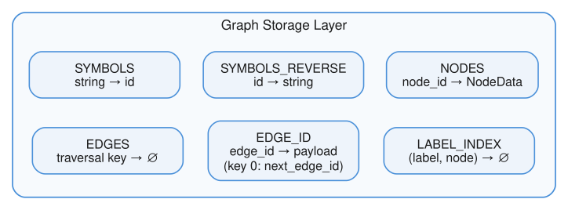

# Graph Storage

## The Property Graph Model

Lattice implements a **Labeled Property Graph** - the same model used by Neo4j, Amazon Neptune, and other graph databases. It consists of:

```
Node:
  - id: unique identifier (u64)
  - labels: set of strings (e.g., "Person", "Employee")
  - properties: key-value pairs (e.g., name: "Alice", age: 30)

Edge:
  - id: stable unique identifier (u64)
  - source: node id
  - target: node id
  - type: string (e.g., "KNOWS", "WORKS_AT")
  - properties: key-value pairs (e.g., since: 2020)
```

This model is expressive enough to represent almost any domain while remaining simple to query and traverse.

## The Storage Challenge

How do you store a graph in a B+Tree (which is fundamentally a key-value store)?

The key insight: **decompose the graph into multiple B+Trees, each optimized for a specific access pattern.**



The core graph uses these six trees. The database keeps further trees beside
them for property indexes, full-text search, vectors and streams; the
[Summary](#summary) lists the graph-related ones.

## String Interning (Symbol Table)

Graphs have lots of repeated strings: label names, property keys, edge types. Storing "Person" thousands of times wastes space. Instead, we **intern** strings.

| Interned string | Symbol ID |
|-----------------|----------:|
| `"Person"` | 1000 |
| `"Employee"` | 1001 |
| `"name"` | 1002 |
| `"KNOWS"` | 1003 |

Storing `"Person"` costs 6 bytes every time it appears; storing the symbol `1000`
costs 2. On a graph with millions of nodes carrying a handful of labels each, that
is most of the property storage.

The Symbol Table uses two B+Trees:

```
SYMBOLS (forward):           SYMBOLS_REVERSE:
  "Person"   → 1000           1000 → "Person"
  "Employee" → 1001           1001 → "Employee"
  "name"     → 1002           1002 → "name"
  "KNOWS"    → 1003           1003 → "KNOWS"
```

Symbol IDs are u16 (0-65535):
- 0: Reserved (null)
- 1-999: Reserved for system use
- 1000-65535: User-defined symbols

The next ID to hand out is found when the database opens, by scanning the
reverse tree for the highest one in use. If that scan fails when an existing
database is opened for writing, the open fails: starting again at 1000 would give
a new name the ID of an existing one, and the two names would become one.

### API

```zig
var symbols = SymbolTable.init(allocator, &forward_tree, &reverse_tree);

// Intern a string (creates if not exists, returns existing if present)
const person_id = try symbols.intern("Person");  // 1000

// Lookup without creating
const id = try symbols.lookup("Person");  // 1000
// or
try symbols.lookup("Unknown");  // SymbolError.NotFound

// Resolve ID back to string
const name = try symbols.resolve(person_id);  // "Person"
defer symbols.freeString(name);  // Must free allocated string
```

## Node Storage

Nodes are stored in a B+Tree with simple u64 keys:

```
NODES B+Tree:
  Key: node_id (u64, little-endian)
  Value: NodeData (serialized)
```

### NodeData Format

**NodeData**

| Field | Type | Notes |
|-------|------|-------|
| `num_labels` | u16 | |
| `labels` | u16 × `num_labels` | Interned symbol ids |
| `num_properties` | u16 | |
| `properties` | `PropertyEntry` × `num_properties` | |

**PropertyEntry**

| Field | Type | Notes |
|-------|------|-------|
| `key_id` | u16 | Interned string id |
| `value_type` | u8 | See the table below |
| `value_data` | variable | Encoding depends on `value_type` |

**Value types**

| Code | Type | Encoding |
|-----:|------|----------|
| 0 | Null | No payload |
| 1 | Bool | 1 byte, 0 or 1 |
| 2 | Int64 | 8 bytes, little-endian |
| 3 | Float64 | 8 bytes, IEEE 754 |
| 4 | String | u32 length, then bytes |
| 5 | Bytes | u32 length, then bytes |
| 6 | Vector | u32 length, then f32 values |
| 7 | List | u32 length, then nested values |
| 8 | Map | u32 length, then key/value entries |

Node records are serialized into heap buffers sized from the exact labels and
properties being written. The old fixed 4 KiB serialization buffer is no longer
part of the node path; large string and bytes properties are handed to the
B+Tree, which stores them inline or through overflow pages according to the
entry-size rules in [B+Tree](./btree.md).

### API

```zig
var store = NodeStore.init(allocator, &nodes_tree);

// Create a node
const labels = [_]SymbolId{ person_id, employee_id };
const properties = [_]Property{
    .{ .key_id = name_id, .value = .{ .string_val = "Alice" } },
    .{ .key_id = age_id, .value = .{ .int_val = 30 } },
};
const node_id = try store.create(&labels, &properties);

// Get a node
var node = try store.get(node_id);
defer node.deinit(allocator);

// Check existence (can fail with an I/O error, so it needs `try`)
if (try store.exists(node_id)) { ... }

// Update a node
try store.update(node_id, &new_labels, &new_properties);

// Delete a node
try store.delete(node_id);
```

### Node ids

Node ids come from a counter that never goes down. The database keeps it in the
file header and writes it with every flush, in the same header image as the node
tree pages it describes, so opening a database reads it rather than scanning the
node tree, and the id of a committed node is never handed out again, even after the
node is deleted. Ids handed out by a transaction that rolled back, or that had not
committed when the process died, can be handed out again. A file last written by
0.16.0 has no stored counter; the first read-write open finds the highest id with
one scan and stores the counter from then on. If that scan fails, the open fails
rather than start the ids again at 1.

### Deleting a node that has relationships

`NodeStore.delete` removes the node record only. The rule that a node with
relationships cannot be deleted lives one level up, in the database:
`Database.deleteNode` (C `lattice_node_delete`) refuses a node that has any
relationship the transaction can see, its own uncommitted ones included, with
`NodeHasRelationships` (`LATTICE_ERROR_HAS_RELATIONSHIPS`), and
`detachDeleteNode` (`lattice_node_detach_delete`) deletes the relationships with
the node. Cypher's `DELETE` and `DETACH DELETE` go through the same two calls. The
check is one range probe over the node's edge keys, plus a look at the node's own
pending edges in the transaction. Creating an edge likewise checks that both its
ends exist as the transaction sees them, a key probe each, and fails with
`NotFound` (`LATTICE_ERROR_NOT_FOUND`) otherwise. So no committed edge points at a
node that does not exist.

## Edge Storage

Edges are more complex because we need efficient traversal in **both directions**
and stable identity for properties, recovery, and parallel edges:
- "Find all people Alice knows" (outgoing)
- "Find all people who know Alice" (incoming)
- "Set this edge's properties after creation" (stable edge ID)

### Traversal Tree Plus Edge-ID Index

For edge `(Alice)-[:KNOWS]->(Bob)`, the traversal tree stores **two keys** and
the payload is stored once in an edge-ID index:

```
Entry 1 (Outgoing from Alice):
  Key: (Alice, OUTGOING, KNOWS, Bob, edge_id)
  Value: empty

Entry 2 (Incoming to Bob):
  Key: (Bob, INCOMING, KNOWS, Alice, edge_id)
  Value: empty

Payload entry:
  Key: edge_id
  Value: serialized source, target, type, and properties
```

This keeps traversal efficient in either direction without duplicating large
edge properties. The stable `edge_id` lets callers update properties by ID and
lets the storage layer restore or delete the exact edge during WAL recovery.

### Edge-ID Index

The edge-ID tree is a separate B+Tree from the traversal tree. Unlike the
traversal keys, its keys are **little-endian** u64 edge IDs, because nothing
needs them in ID order: lookups are by exact ID, and a walk of the whole tree
comes back in a stable order that is not numeric (edge 256 before edge 2).

| Key | Value |
|-----|-------|
| `0` (`EDGE_ID_META_KEY`) | `next_edge_id: u64`, little-endian |
| `edge_id` (≥ 1) | Edge payload, see below |

Key 0 is reserved: it stores the next edge ID to hand out, so IDs survive a
reopen and are never reused. Edge IDs therefore start at 1. If the metadata
entry is missing, the store derives it from the largest edge ID in the tree and
writes it back. If the tree cannot be read when an existing database is opened
for writing, the open fails rather than counting from 1 again, which would hand
out the IDs of existing edges.

**Edge payload** (all integers little-endian)

| Field | Type | Notes |
|-------|------|-------|
| `source` | u64 | Source node id |
| `target` | u64 | Target node id |
| `edge_type` | u16 | Interned edge type |
| `num_properties` | u16 | |
| `properties` | `PropertyEntry` × `num_properties` | Same encoding as node properties |

### Key Format

Edge keys are 27 bytes, stored big-endian so that byte order matches sort order
and a prefix scan on `source_id` returns all edges out of a node.

| Offset | Size | Field |
|--------|------|-------|
| 0–7 | 8 B | `source_id: u64` |
| 8 | 1 B | `direction: u8` |
| 9–10 | 2 B | `type_id: u16` — interned edge type |
| 11–18 | 8 B | `target_id: u64` |
| 19–26 | 8 B | `edge_id: u64` |

| `direction` | Meaning |
|------------:|---------|
| 0 | Outgoing — source → target |
| 1 | Incoming — target ← source |

Big-endian encoding ensures keys sort correctly for range scans:
- All edges from node X are contiguous
- Within that, all outgoing edges are together
- Within that, edges of same type are together
- Within a source/type/target tuple, parallel edges remain distinct by edge ID

### Why This Key Order?

The key `(source, direction, type, target)` is optimized for common queries:

```
Query: "All outgoing edges from Alice"
  Scan: (Alice, 0, *, *)
  Keys are contiguous!

Query: "All KNOWS edges from Alice"
  Scan: (Alice, 0, KNOWS, *)
  Even more specific prefix!

Query: "Does Alice know Bob?"
  Prefix scan: (Alice, 0, KNOWS, Bob, *)
  Returns the first matching edge ID, if present
```

Large edge properties use the same heap serialization and B+Tree overflow path
as node properties. The store checks whether the serialized edge payload can be
represented before replacing an existing edge-ID entry, so oversized updates
return `ValueTooLarge` without deleting the previous edge record.

### API

```zig
var store = EdgeStore.init(allocator, &edges_tree, &edge_id_tree);

// Create an edge
const properties = [_]Property{
    .{ .key_id = since_id, .value = .{ .int_val = 2020 } },
};
const edge_id = try store.createAndGetId(alice_id, bob_id, knows_id, &properties);

// Get an edge (the lowest edge ID among parallel edges; use getById for an exact edge)
var edge = try store.get(alice_id, bob_id, knows_id);
defer edge.deinit(allocator);

// Check existence
if (store.exists(alice_id, bob_id, knows_id)) { ... }

// Delete an edge (removes both outgoing and incoming entries)
try store.delete(alice_id, bob_id, knows_id);

// Iterate all outgoing edges from a node
var iter = try store.getOutgoing(alice_id);
defer iter.deinit();
while (try iter.next()) |e| {
    var edge = e; // deinit needs a mutable Edge
    defer edge.deinit(allocator);
    // Process edge...
}

// Iterate incoming edges
var incoming = try store.getIncoming(bob_id);
defer incoming.deinit();

// Filter by edge type
var knows_edges = try store.getOutgoingByType(alice_id, knows_id);
defer knows_edges.deinit();

// Count edges without allocating
const out_count = try store.countOutgoing(alice_id);
const in_count = try store.countIncoming(bob_id);

// Property updates use the stable edge ID through the database layer
try db.setEdgePropertyById(null, edge_id, "since", .{ .int_val = 2020 });
```

The C API exposes typed traversal with a caller-provided limit:

```c
lattice_edge_get_outgoing_by_type(txn, alice_id, "KNOWS", 100, &edges);
lattice_edge_get_incoming_by_type(txn, bob_id, "KNOWS", 100, &edges);
```

For these APIs, `limit == 0` means unlimited. The limit is applied while
collecting visible edge references, before edge type strings are materialized
for the result handle.

`lattice_edge_scan(txn, edge_type_or_null, limit, &edges)` walks native edge
identities once via the edge-ID index. It is intended for administrative work
such as index rebuilds, consistency checks, and export jobs, not for hot-path
graph expansion. Use node-local traversal for request-path graph walks.

## Label Index

For queries like `MATCH (n:Person)`, we need to find all nodes with a given label efficiently. The Label Index provides this.

```
LABEL_INDEX B+Tree:
  Key: (label_id: u16, node_id: u64) - big-endian
  Value: empty (existence only)
```

### How It Works

```
When creating node Alice with labels [Person, Employee]:
  Insert: (Person, Alice) → empty
  Insert: (Employee, Alice) → empty

Query "all Person nodes":
  Range scan: (Person, 0) to (Person, MAX)
  Returns: Alice, Bob, Carol, ...
```

### API

```zig
var index = LabelIndex.init(allocator, &label_tree);

// Add labels when creating a node
try index.addLabels(&[_]SymbolId{ person_id, employee_id }, node_id);

// Check if node has a label
if (index.hasLabel(person_id, node_id)) { ... }

// Remove a label from a node
try index.remove(person_id, node_id);

// Get all nodes with a label (allocates result slice)
const person_nodes = try index.getNodesByLabel(person_id);
defer allocator.free(person_nodes);
for (person_nodes) |node_id| {
    // Process each Person node...
}

// Lazy iteration (memory-efficient for large result sets)
var iter = try index.iterNodesByLabel(person_id);
defer iter.deinit();
while (try iter.next()) |node_id| {
    // Process one node at a time...
}

// Count nodes without allocating
const person_count = try index.countNodesByLabel(person_id);
```

## Putting It Together

A complete graph operation involves multiple B+Trees:

```
Creating node Alice:Person with name="Alice":

1. Symbol Table:
   - intern("Person") → 1000
   - intern("name") → 1001

2. Node Store:
   - Allocate node_id = 1
   - Serialize: [1 label: 1000][1 prop: 1001="Alice"]
   - Insert: 1 → serialized_data

3. Label Index:
   - Insert: (1000, 1) → empty


Creating edge (Alice)-[:KNOWS]->(Bob):

1. Symbol Table:
   - intern("KNOWS") → 1002

2. Edge Store:
   - Allocate edge_id = 1
   - Insert traversal keys: (1, OUT, 1002, 2, 1) → empty and (2, IN, 1002, 1, 1) → empty
   - Insert payload: 1 → serialized edge data and properties
   - Update edge-ID key 0: next_edge_id = 2
```

## Performance Characteristics

| Operation | Complexity | Notes |
|-----------|------------|-------|
| Create node | O(log n) | One B+Tree insert + label index inserts |
| Get node | O(log n) | Single B+Tree lookup |
| Delete node | O(log n) | One B+Tree delete |
| Create edge | O(log n) | Two traversal inserts + one edge-ID payload insert + `next_edge_id` update |
| Get edge | O(log n + k) | Prefix scan to edge ID, then payload lookup |
| Delete edge | O(log n) | Two traversal deletes + one edge-ID payload delete |
| Check label | O(log n) | Single B+Tree lookup |
| Remove label | O(log n) | Single B+Tree delete |
| All nodes with label | O(log n + k) | Range scan, k = result count |
| All edges from node | O(log n + k) | Range scan, k = edge count |

Where n = total items in the respective B+Tree.

## Current Limitations

The stores described here have no notion of transactions. Isolation is
provided above them by the database layer (a single writer plus per-transaction
overlays; see [Transaction Manager](./transaction-manager.md)); this chapter only
describes the underlying graph-storage structures.

1. **Property updates rewrite records**: No in-place partial property update at the storage-record level

## Future Enhancements

1. **Edge type index**: Fast lookup by edge type across all nodes
2. **Cross-node edge type scans**: Dedicated indexes for type-wide traversals

## Summary

| Component | B+Tree Key | Purpose |
|-----------|------------|---------|
| Symbol Table (forward) | string | String → ID mapping |
| Symbol Table (reverse) | symbol_id | ID → String mapping |
| Node Store | node_id | Node data storage |
| Edge Store | (src, dir, type, tgt, edge_id) | Traversal keys |
| Edge ID Index | edge_id | Stable edge identity and property payload |
| Label Index | (label_id, node_id) | Label-based queries |
| Property Index Catalog | (entity_kind, scope_id, property_id) | Durable explicit index definitions |
| Node Property Index | (scope_id, property_id, value_digest, node_id) | Indexed node-property equality lookup |
| Edge Property Index | (scope_id, property_id, value_digest, edge_id) | Indexed edge-property equality lookup |

The graph storage layer transforms B+Trees into a full property graph database
through careful key design, stable edge IDs, and a traversal/payload split for
edges.
