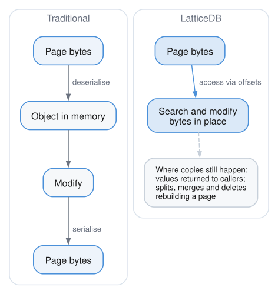

# Architecture Overview

This section explains how LatticeDB's storage engine works, from the ground up. Each chapter builds on the previous, showing how simple primitives combine to create a durable, transactional graph database with vector search, full-text search, and local event streams.

LatticeDB is an embedded, single-file property-graph database with vector and BM25
full-text indexes, durable named streams, and a built-in graph changefeed. These
chapters explain that substrate: local storage, graph layout, streams, vector search,
full-text search, and the query layer over all of them.

## The Stack

The `Database` (`src/storage/database.zig`) is the orchestrator. It owns every
component below it, stages each transaction's writes in an in-memory overlay, and at
commit time logs that overlay, applies it to the stores, and asks the transaction
manager to make the commit durable. The transaction manager only writes log records;
it does not touch the B+Trees or the checkpointer.

## Chapters

### Storage Engine
1. [Virtual File System](./vfs.md) - Abstracting file I/O for portability and testing
2. [Portable Databases](./portable-databases.md) - Serializing to bytes, and running with no files at all
3. [Page Manager](./page-manager.md) - Fixed-size pages, allocation, and checksums
4. [Buffer Pool](./buffer-pool.md) - Caching pages in memory with eviction
5. [B+Tree](./btree.md) - Ordered key-value storage with efficient lookups

### Durability & Transactions
6. [Write-Ahead Log](./wal.md) - Durability through logging committed changes
7. [Transaction Manager](./transaction-manager.md) - Transactions with begin/commit/abort
8. [Checkpointing](./checkpointing.md) - Flushing dirty pages and resetting the log
9. [Recovery](./recovery.md) - Redo-only crash recovery from the log

### Data Model
10. [Graph Storage](./graph-storage.md) - Nodes, edges, labels, and properties
11. [Durable Streams](../guides/durable-streams.md) - Transactional event records and semantic graph changes

### Search Indexes
12. [Vector Search](./vector-search.md) - HNSW approximate nearest neighbor search
13. [Full-Text Search](./full-text-search.md) - BM25-scored inverted index, per-property declarations, and search as an access path

### Query System
14. [Query Execution](./query-execution.md) - Volcano iterator model, operators, and planning

## Design Principles

### Direct Page Manipulation

We don't deserialize B+Tree pages into node objects. Searches and in-place inserts read and write bytes directly in the page buffer at calculated offsets, with no intermediate representation of the node.

It is not copy-free end to end. A lookup returns an owned copy of the value, and
splits, merges and deletes rebuild a page from a temporary list of its entries.

### Everything in the File is Pages

The database file is built on fixed-size pages. The size is 4 KB by default and is
chosen when the database is created (4096 to 65535 bytes); it is recorded in the
file header and cannot change afterwards.

- B+Tree nodes are pages
- Large B+Tree values spill into linked overflow pages
- Vector data and HNSW neighbour lists live in their own page types
- The file header is page 0
- Free pages form a linked list of pages

This uniformity keeps the file simple: one page format and one caching layer for
everything in it. The write-ahead log is the exception. It is a separate
`<database>-wal` file of page-sized frames, written directly through the VFS rather
than through the buffer pool.

### Durability Through WAL

A transaction's changes are held in memory until commit. At commit they are logged,
applied, and then the commit record is forced to disk:

- Commit = commit record is on disk (fast, sequential write)
- Actual data pages can be written lazily
- Crash recovery re-executes committed log records

### Simple Concurrency Model

A database allows one read-write transaction at a time; a second one is refused
rather than queued. The C API also serialises the calls on a database handle
behind one mutex. Below that, each buffer-pool frame has a reader-writer latch,
which protects a page while it is being read or modified. There are no complex lock
hierarchies - simplicity over maximum concurrency.
