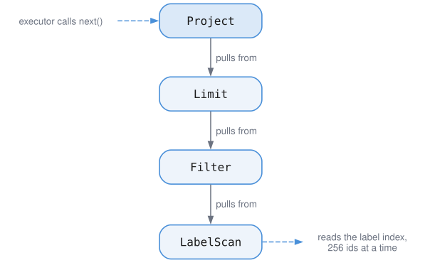

# Query Execution

## Overview

Lattice executes Cypher queries using the **Volcano iterator model**—a pull-based execution engine where operators form a tree and data flows upward one row at a time. This design enables lazy evaluation, memory efficiency, and composable query plans.


## The Volcano Iterator Model

Every operator implements four methods:

```zig
pub const Operator = struct {
    vtable: *const VTable,
    ptr: *anyopaque,

    pub const VTable = struct {
        open:  fn (*anyopaque, *ExecutionContext) OperatorError!void,
        next:  fn (*anyopaque, *ExecutionContext) OperatorError!?*Row,
        close: fn (*anyopaque, *ExecutionContext) void,
        deinit: fn (*anyopaque, Allocator) void,
    };
};
```

- **open()**: Initialize the operator, acquire resources (iterators, memory)
- **next()**: Return the next row, or `null` if exhausted
- **close()**: Release resources (unpin pages, close iterators)
- **deinit()**: Free the operator itself

### Pull-Based Execution

Data flows **upward** through the operator tree. The root operator "pulls" from its children:



When the executor calls `root.next()`:
1. Project calls Limit.next()
2. Limit checks its count (returns null if the limit is reached), then calls Filter.next()
3. Filter calls LabelScan.next()
4. LabelScan returns a row for the next node id with the label, reading the label index a batch at a time
5. Filter evaluates predicate—if false, pulls another row
6. Limit counts the row and passes it up
7. Project evaluates expressions, transforms row

Without aggregation, `ORDER BY`, `SKIP` and `LIMIT` are planned *under* the
projection, so they can still see variables the projection drops (`RETURN n.name
ORDER BY n.age`). With aggregation they go on top, because they may refer to
aggregated values that only exist after grouping. `RETURN DISTINCT` splits them:
`ORDER BY` stays under the projection and its sort keeps every row, while `SKIP`
and `LIMIT` go above `Distinct`, so they count rows after duplicates are removed.

### Lazy Evaluation

Rows are produced only when `next()` is called, and building, filtering and
projecting each row happens on demand: with `LIMIT 10`, evaluation stops after 10
matching rows. In a query that only reads, a label scan also reads its ids on
demand, so `MATCH (n:Person) RETURN n LIMIT 1` reads one batch of the label index
rather than every `Person`. The other scans, and a label scan in a query that
writes, collect their ids when they open.

## Rows and Slots

A `Row` is a fixed-size tuple flowing between operators:

```zig
pub const Row = struct {
    slots: [16]SlotValue,      // Variable bindings
    distances: [16]f32,        // Vector search distances
    scores: [16]f32,           // FTS relevance scores
    populated: u16,            // Bitmask of populated slots
    measured: u16,             // Slots whose distance a vector search set
    scored: u16,               // Slots whose score a full-text search set
};
```

`measured` and `scored` say which slots' `distances` and `scores` belong to the
entity now in the slot. Setting a slot clears both bits, so a distance or score
never outlives the node it was measured for, and projection carries them only for
an item that is the same variable in the same slot (`WITH d`, not `WITH d AS e`).

### Slot Values

Each slot holds one of:

```zig
pub const SlotValue = union(enum) {
    empty: void,               // Unset
    node_ref: NodeId,          // Reference to a node (just the ID)
    edge_ref: EdgeId,          // Reference to an edge
    property: PropertyValue,   // Actual value (int, string, bool, etc.)
};
```

### Why Slots Instead of Named Variables?

Performance. Looking up `slots[3]` is O(1). The planner assigns each variable to
a numbered slot. For `(p:Person)-[r:KNOWS]->(f:Person)` it allocates the
relationship's target node before the relationship itself:

| Pattern element | Slot |
|-----------------|-----:|
| `(p:Person)` | 0 |
| `(f:Person)` | 1 |
| `[r:KNOWS]` | 2 |

A row has 16 slots, so a query can bind at most 16 variables (including
internal ones the planner adds, such as a slot that holds an anonymous
relationship so a later expand can avoid reusing it), and `RETURN` or `WITH` can
take at most 16 items; more fails to plan with `TooManyVariables`.

A name keeps the slot it was first bound to for the whole query. `WITH` puts an
item named like an earlier variable back in that variable's slot, and new names
take slots no earlier scope used while any are left. If a name would ever need a
second slot, the plan is refused rather than run with expressions reading the
wrong slot. A null result (from `UNWIND`, `WITH` or an aggregate) is stored as a
bound null, so reading it gives null; only a slot that was never filled is an
"unbound variable" error.

The execution context maintains the mapping from names to slots for expression evaluation.

### Lazy Materialization

Rows store **references** (NodeId, EdgeId), not full objects. Properties are fetched on-demand during expression evaluation. This avoids loading data that's never accessed.

A node property read (`n.name`) decodes just that property: the evaluator resolves
the key's id once per query, and `Database.getNodePropertyByKeyInTxn` answers from
the transaction's overlay when it holds the node and otherwise walks the stored
record to the one value. In a query that only reads, the evaluator also keeps the
last record it read, so `n.a, n.b, n.c` costs one B+Tree lookup. A storage error
during the read fails the query rather than reading as null. Relationship
properties take the same path (`getEdgePropertyByKeyInTxn`, which decodes only the
wanted value of the stored record, with a one-record cache in queries that only
read). `type(r)` reads only the relationship's endpoints and type, and `labels(n)`
only the node's label ids. `properties()` still decodes the whole record.

## Operators

### Scan Operators

**AllNodesScan**: Iterates every node in the database.

```
open():  Collect every node id visible to the transaction into a slice,
           sorted, so rows come in id order (in a file created before format 5
           node keys are little-endian, so the tree walk alone is not, and
           the transaction's own nodes come after the tree's in any file)
next():  Take the next id from the slice, set output slot
close(): Free the slice
```

**LabelScan**: Iterates nodes with a specific label.

```
open():  Query only reads: allocate a 256-id buffer and take the ids the
           transaction's overlay gives the label
         Query writes: collect every id carrying the label (label index, plus
           the transaction's own changes) into a slice
next():  Streaming: refill the buffer from the label index after the last id
           read, skip ids the overlay says lost the label, and merge in the
           overlay's ids in id order
         Collected: take the next id from the slice
         Then set the output slot
close(): Free the buffer or the slice
```

A query that writes collects its ids up front so that nodes it creates, relabels
or deletes while scanning cannot change which nodes the scan visits. Streaming
relies on nothing else changing the overlay or the index during a read-only
query, which holds because the C API runs one call per database handle at a time.

**PropertyIndexScan**: Used instead of a label scan when an explicit property
index covers an equality on the pattern's label (inline `{k: v}` or a `WHERE`
equality right after the `MATCH`). It evaluates the value once at open and
reads the matching ids from the index.

**NodeIdSeek**: Used when the `WHERE` right after the `MATCH` has, among
its `AND`ed conditions, `id(n) = v`, `v = id(n)` or `id(n) IN list`, where `v`
and `list` do not depend on the row (literals and parameters). It takes the
place of every other scan for that node, labelled or not. At open it evaluates
the value, takes every whole non-negative number in it as an id (so
`id(n) = 3.0` finds node 3, as the comparison would), sorts and deduplicates
them, and keeps those that exist as the transaction sees them. The condition
stays in the `WHERE` and the pattern's labels are checked by `LabelFilter`s,
so the seek only has to offer every node that could match. A `WHERE` with a
vector or full-text search keeps its own access path. Before it, such a query
read every node and filtered; now it reads only the nodes named.

**IndexRangeScan** (`index_range_scan.zig`): Used when no equality applies and
the `WHERE` right after the `MATCH` compares an indexed property of the
pattern's node with a value that does not depend on the row (`<`, `<=`, `>`,
`>=`, either way round, and `STARTS WITH`). The planner folds every such
conjunct on one property into one range and takes them out of the `WHERE`
filter (`consumed_conjuncts`, `residualCondition`). At open the scan evaluates
the bounds, turns them into a key range, and merges the index's entries with the
transaction's own nodes of the label that fall in it. It re-checks the consumed
conjuncts only where the key cannot decide: a string bound longer than the 128
bytes a key keeps. Like the label scan it streams 256 keys at a time in
read-only queries and collects its ids up front in queries that write. With no
range it can also read a whole label's index in order (`property_order_scan`),
which holds the nodes that lack the property too, after every value. It reads
forward for an ascending sort and backward, from the last leaf down, for a
descending one; backward, the index gives equal values highest id first, so
the scan collects each run of equal keys and returns it lowest id first, the
order a stable sort leaves a label scan's rows in. When the query sorts on
something the range does not read in order (`WHERE n.w > 3 ... ORDER BY n.v`),
the scan collects the range's ids and returns them in id order, so rows the
sort finds equal come as they would from a label scan and a `LIMIT` that cuts
through them keeps the same ones.

**OrderedCutoff** (same file): Placed under the Sort of `ORDER BY n.p [SKIP s]
LIMIT k` when the scan below reads `p`'s index in order. It passes rows through
and stops once it has passed `s + k` rows and the sort key moves past the last
of them, so the Sort sees only the rows that can be returned. The planner uses
it for a single `MATCH` pattern, an optional `WHERE` without a vector or
full-text search, and a `RETURN` that neither aggregates nor uses `DISTINCT`,
sorted first by a property of the scanned node, ascending or descending.

**EdgeTypeScan** (`edge_type_scan.zig`): Used for `(a)-[r:T]->(b)` (or
incoming) when `a` has no label, properties or earlier binding: one walk of the
edge-ID index, 256 edges at a time, keeping edges of the wanted types whose
start node exists, plus the transaction's staged edges. There is no index from
type to edge (see [Graph Storage](./graph-storage.md#current-limitations)); this
replaces an expand from every node. Rows come in the edge-ID index's order.
When the one type named has an ordered property index and the `WHERE` or the
inline map compares that property with a value (`=`, a range or `STARTS
WITH`), the planner uses IndexRangeScan over the type's index instead
(`edge_range_scan`), which fills the same three slots in the index's order. The
`WHERE` keeps the conditions and checks each row. A relationship read through
the index costs several times one found by the walk, so when it opens the scan
counts the range's keys, up to a fifth of the highest relationship id, and walks
the type with EdgeTypeScan instead when it gets there.

All of them produce rows with node references (EdgeTypeScan also fills the
relationship and the other node). None keeps a B+Tree iterator open between
`next()` calls: the streaming scans open and close their own range for each
batch, so no page stays pinned or latched between calls.

A property index created by this release keys a value by an encoding whose byte
order is `ORDER BY`'s order, in which an integer and the float with the same
value share a key (see [Graph Storage](./graph-storage.md#property-indexes)).
An index 0.16.0 created keys a digest of the type and bits, so an integer and the
equal float land under different keys; `PropertyIndexScan` looks up both forms
and merges them, so `{age: 30}` finds a node stored with `30.0`, as a scan would,
and such an index is never used for ranges until it is rebuilt
(`Database.upgradePropertyIndexes`).

### Filter Operator

Evaluates a predicate and passes through only matching rows.

```zig
fn next(self: *Filter, ctx: *ExecutionContext) !?*Row {
    while (true) {
        const row = try self.input.next(ctx) orelse return null;

        const result = try self.evaluator.evaluate(self.predicate, row, ctx);
        if (result.isTruthy()) {
            return row;
        }
        // Predicate failed, try next row
    }
}
```

Supports short-circuit evaluation for `AND`/`OR`.

**LabelFilter** checks a node's label through the label index
(`Database.nodeHasLabelInTxn`, which asks the transaction's overlay first)
instead of reading the whole node, and a storage error fails the query.

### Project Operator

Transforms rows by evaluating expressions for each output column.

| Return item | Expression |
|-------------|-----------:|
| `p.name` | `expr[0]` |
| `p.age + 1` | `expr[1]` |
| `"literal"` | `expr[2]` |

```zig
fn next(self: *Project, ctx: *ExecutionContext) !?*Row {
    const input_row = try self.input.next(ctx) orelse return null;

    self.output_row.clear();
    for (self.items) |item| {
        const value = try self.evaluator.evaluate(item.expr, input_row, ctx);
        self.output_row.setSlot(item.output_slot, resultToSlotValue(value));
    }
    return self.output_row;
}
```

### Expand Operator

Traverses edges from input nodes. This implements pattern matching like `(a)-[r]->(b)`.

```
State:
    source_slot      = slot containing the source node
    target_slot      = slot to write target node
    edge_slot        = slot to write edge (optional)
    edges            = edge references for the current input (a slice)
    current_input    = row being expanded

next():
    loop:
        if edges has another edge ref:
            output_row = copy input row
            output_row[target_slot] = edge.target
            output_row[edge_slot] = edge id (if requested)
            return output_row

        // Exhausted edges for current input, get next input
        current_input = input.next()
        if null: return null

        source = current_input[source_slot]
        edges = database.getOutgoingEdgeRefs[ByType]InTxn(txn, source[, type])
```

A relationship's types reach the expand as an `EdgeConstraints` value. With one
type the storage layer filters the edges; with several (`-[:A|B]->`) the operator
reads the node's edges and keeps those whose type is in the set. A type the
database has never seen matches nothing.

Within one `MATCH`, a relationship is used once. The planner lists every
relationship of the clause, and a single-hop relationship that a later one could
collide with (their type sets overlap, or either is untyped) keeps its edge in a
slot, hidden if it has no variable. Each later expand skips edges already held in
those slots. An undirected expand also skips a self-loop in its incoming half, so
the loop is returned once. When a later relationship could collide with a
variable-length one, the variable-length expand writes the ids of its path's
edges, as a list, into a hidden slot, and `EdgeConstraints.usedEarlier` skips an
edge found in such a list as it skips one held in an edge slot. The list is built
only when a later relationship needs it, in the row arena so that a row kept by
`ORDER BY` or `collect()` stays valid.

Inside a write transaction, the expand merges the stored edges with the
transaction's own. The transaction's overlay files each edge it creates under both
endpoints (`edges_by_node`), so expanding a node reads only that node's pending
edges, not every edge the transaction has touched; the check that refuses deleting
a node with relationships reads the same list. A transaction that holds no edge
changes, which is every read-only one unless a writer has committed since it
began, takes the stored edges as they come: no lookup in the overlay per edge and
no set of the ids already returned.

When the far end of the relationship is a node that is already bound, the expand
keeps only edges that lead to it, and a bound node at the start of a pattern is
checked against its labels and properties rather than scanned again.

`VariableLengthExpand` handles `-[*min..max]->` patterns. It is a depth-first
search over a stack of frames that tracks the edges on the current path: an edge
already on the path is skipped, nodes may repeat, and every step whose length is
within the bounds emits a row, so a node reached by two paths is returned twice.
There is no hop cap; an unbounded pattern ends because a path cannot use more
relationships than exist, though the number of paths can grow exponentially on a
dense graph. Edge lists are read only for frames that can still extend. When the
target node carries labels, the planner adds a `LabelFilter` above the expand.

This is a **one-to-many** operator: one input row can produce multiple output rows.

Supports three directions:
- `outgoing`: `(a)-[r]->(b)` — traverse outgoing edges
- `incoming`: `(a)<-[r]-(b)` — traverse incoming edges
- `both`: `(a)-[r]-(b)` — traverse both directions

### Limit and Skip

**Limit**: Returns at most N rows.

```zig
fn next(self: *Limit, ctx: *ExecutionContext) !?*Row {
    if (self.returned >= self.count) return null;
    const row = try self.input.next(ctx) orelse return null;
    self.returned += 1;
    return row;
}
```

**Skip**: Discards the first N rows.

```zig
fn next(self: *Skip, ctx: *ExecutionContext) !?*Row {
    while (self.skipped < self.count) {
        _ = try self.input.next(ctx) orelse return null;
        self.skipped += 1;
    }
    return try self.input.next(ctx);
}
```

### Sort Operator (Blocking)

Sort must see all input before producing any output—it's a **blocking operator**.

```text
open():
    for each input row:
        evaluate the row's sort keys once and keep them beside the row
        (an evaluation error fails the query)
        with a bound: keep the row only if it is among the best SKIP + LIMIT
        so far, in a bounded max-heap
    order the kept rows by their keys, ties by arrival order
next():
    return the next kept row
```

The planner hands Sort the `SKIP` and `LIMIT` that follow it, so `ORDER BY ...
LIMIT k` over n rows costs n log k comparisons and k rows of memory. Sort still
reads all of its input, so writes below it happen. Ties keep input order, so the
result is the same as a stable sort of everything followed by `SKIP` and `LIMIT`.

The keys are compared by `orderValues`, a total order over all values: maps,
nodes, relationships, lists, paths, vectors, bytes, strings, booleans, numbers,
then null (`typeRank`). `NULLS FIRST` or `NULLS LAST` on a sort item puts nulls
where it says, whichever the direction. Nodes and relationships order by id. Integers and floats compare by exact
value (converting the integer to a float would round above 2^53), and NaN is
above every other number.

This breaks the streaming model but is necessary for ordering.

### Vector Search Operator

The planner turns a `WHERE` of the form `x.prop <=> $q` or `x.prop <=> $q <
threshold` (or `<=`; the query may also be a literal list) into a
**VectorSearchWithInput** placed over the pattern's scan. It does not replace
the scan:

```text
open():
    resolve the threshold (a literal or a parameter; null matches nothing)
    if the input is a label scan of this same variable (openOverLabel):
        read the scan only until it holds more nodes than measuring each
        would pay for (Database.exactScanCount); a label that ends first is
        measured node by node, a larger one is searched through the graph
        with the label as the filter, and the rest of the scan is never read
    otherwise read every input row, grouped by node; the nodes are the
    candidates
    k = what bounds the answer: SKIP + LIMIT, or 100 (DEFAULT_K) nodes
    loop:
        results = database.vectorSearchAmongInTxn(txn, query, k, ids = candidates)
                  (a few candidates: each measured; many: a graph search
                   that keeps only candidates as results)
        stop when: with a LIMIT or neither bound, always (every result is a
                   candidate with at least one row);
                   with a threshold alone, the farthest result is beyond it;
                   or fewer than k came back
        k = 2 * k
    if fewer than k came back, measure the candidates the search did not return
next():
    emit kept rows in distance order, storing each row's distance
```

The input rows are the candidates, so the pattern's label narrows the answer, and
a threshold query returns every candidate within it. `<` is strict and `<=` is
not. The LIMIT bound applies only when a `RETURN` with a `LIMIT` follows with no
`DISTINCT` or aggregation in between, and with no `ORDER BY` unless that `ORDER BY`
is one ascending `<=>` of this same search (or the alias of a `RETURN` item that is),
the order the search already returns its rows in. A set small enough to measure
(see [Vector Search](./vector-search.md), limitation 4) is answered exactly; what
stays approximate is HNSW recall over a large set, and with that `ORDER BY` the
answer is the index's approximate top `k`, as it is under a plain `LIMIT`. The
property name in `x.prop` is not used to choose an index: a database has one
vector index. Distances are measured with the metric recorded for the index, and
the operator measures candidates the search did not return with the same metric.

The distance is stored in the row and marked as measured. The planner records each
vector search's variable, property and query (`VectorQueries`), and an `x.prop <=>
query` elsewhere in the query written the same way returns the stored distance
instead of computing it again. (A leaf
`VectorSearch` operator, which emits the search results directly, also exists
in `vector.zig`, but the planner does not use it.)

### FTS Operators

There are two, and which one the planner picks is the difference between reading
an index and reading a corpus.

**FtsIndexSeek** is a leaf. It searches the declared index and emits one row per
hit, in score order. It has no input because it needs none: a `Document.body`
index holds only `Document` nodes, so seeking it does the label scan's job as well
as answering the text question.

```zig
fn open(self: *FtsIndexSeek, ctx: *ExecutionContext) !void {
    self.results = try runSearches(self.database, ctx, self.searches, self.limit, self.allocator);
}

fn next(self: *FtsIndexSeek, _: *ExecutionContext) !?*Row {
    const hit = self.results.?[self.current_index];
    self.current_index += 1;
    self.row.?.setSlot(self.output_slot, .{ .node_ref = hit.doc_id });
    self.row.?.setScore(self.output_slot, hit.score);
    return self.row;
}
```

**FtsSearchWithInput** filters rows somebody else produced, keeping those the
index named. It is what runs when the entity is already bound by an upstream
expand, so the input decides which rows exist and the index can only narrow them.

Both run their searches through one shared function, so they cannot come to
disagree about what a disjunction of `@@` predicates means. Both store each hit's
BM25 score in the row and mark it as scored, which is what `score(d)` reads.

When the `MATCH` has a seek with a single search and its `WHERE` is that same
search (same variable, index, and query text or parameter), the planner adds no
`FtsSearchWithInput` for it: every row the seek emits already matches.

The full reasoning, including the measurements that motivated the seek, is in
[Full-Text Search](./full-text-search.md), section 16.

### Mutation Operators

Mutation operators modify the graph structure. Unlike read operators, they have side effects.
The snippets below are simplified; the real operators call `Database` methods
with the execution context's transaction.

**CreateNode**: Creates new nodes with labels and properties.

```zig
fn next(self: *CreateNode, ctx: *ExecutionContext) !?*Row {
    const node_id = try ctx.storage.createNode(self.labels);
    for (self.properties) |prop| {
        const value = try self.evaluator.evaluate(prop.value, null, ctx);
        try ctx.storage.setProperty(node_id, prop.key, value);
    }
    self.output_row.setSlot(self.output_slot, .{ .node_ref = node_id });
    return &self.output_row;
}
```

**DeleteNode**: Removes nodes from the graph. With DETACH, also removes connected edges.

```text
first next():
    drain the input, collecting each target node once (null targets are skipped)
    without DETACH: if any collected node still has a relationship
        (Database.nodeHasRelationshipsInTxn), fail with NodeHasRelationships
        before deleting anything; then Database.deleteNode each node
    with DETACH: Database.detachDeleteNode each node
then: return the drained rows one at a time
```

The rule lives in the database, so `lattice_node_delete` refuses the same nodes and
`lattice_node_detach_delete` does what `DETACH DELETE` does. A refused `DELETE`
returns `LATTICE_ERROR_HAS_RELATIONSHIPS` through the C API, and a `CREATE` of a
relationship to a node deleted earlier in the query `LATTICE_ERROR_NOT_FOUND`, the
codes the direct calls return.

Draining first is what lets `DELETE r, n` work: the `DeleteEdge` below it in the
chain has removed every `r` before any node is checked. **DeleteEdge** treats a
relationship this statement already deleted as done, since an undirected match
lists each relationship from both ends.

**SetProperty**: Updates properties on nodes or edges.

```cypher
MATCH (n:Person {name: "Alice"}) SET n.age = 31, n.city = "NYC"
```

```zig
fn next(self: *SetProperty, ctx: *ExecutionContext) !?*Row {
    const row = try self.input.next(ctx) orelse return null;
    const target = row.slots[self.target_slot];
    const value = try self.evaluator.evaluate(self.value_expr, row, ctx);

    // SET n.prop = NULL removes the property
    if (value == .null_val) {
        try ctx.storage.removeProperty(target, self.property_name);
    } else {
        try ctx.storage.setProperty(target, self.property_name, value);
    }
    return row;
}
```

**SetLabels**: Adds labels to nodes.

```cypher
MATCH (n:Person {name: "Alice"}) SET n:Admin:Verified
```

**RemoveProperty**: Explicitly removes properties.

```cypher
MATCH (n:Person {name: "Alice"}) REMOVE n.city
```

**RemoveLabels**: Removes labels from nodes.

```cypher
MATCH (n:Person {name: "Alice"}) REMOVE n:Verified
```

The remaining mutation operators are **CreateEdge**, **DeleteEdge**,
**SetPropertiesReplace** (`SET n = {...}`), **SetPropertiesMerge**
(`SET n += {...}`), and **MergeNode** / **MergeEdge** for `MERGE`. None of them
stores a null: where the node or relationship may already have the property
(`SET n += {...}`, `ON CREATE SET`, `ON MATCH SET`) a null removes it, as in
**SetProperty**, and where it cannot (a `CREATE`, or `SET n = {...}` after it has
cleared the properties) the null is skipped.

**MergeNode** evaluates the pattern's properties once (a null value is an
error), then takes candidates from a property index on one of the pattern's
labels when one exists, otherwise from the first label's index, otherwise from
every node. It keeps the candidates that carry every label and every property,
comparing as `=` does, and emits a row for each, applying `ON MATCH` to each. It
creates a node only when nothing matches. A label or property name the database
has never seen means nothing can match. **MergeEdge** refuses a null pattern
property the same way before it looks for a relationship.

### Operator Inventory

| File | Operators |
|------|-----------|
| `scan.zig` | AllNodesScan, LabelScan, PropertyIndexScan, NodeIdSeek |
| `index_range_scan.zig` | IndexRangeScan, OrderedCutoff |
| `edge_type_scan.zig` | EdgeTypeScan |
| `source.zig` | SingleRow (one empty row: the input of a query that starts with `UNWIND` or `RETURN`) |
| `filter.zig` | Filter, LabelFilter |
| `expand.zig` | Expand |
| `var_expand.zig` | VariableLengthExpand |
| `cross_product.zig` | CrossProduct (disconnected patterns) |
| `project.zig` | Project |
| `aggregate.zig` | Aggregate (`count`, `count(*)`, `sum`, `avg`, `min`, `max`, `collect`) |
| `distinct.zig` | Distinct |
| `limit.zig` | Limit, Skip, Sort |
| `materialize.zig` | Materialize (drains its input before mutations run, so a clause's reads finish before its first write and see the graph as it was when the clause began) |
| `unwind.zig` | Unwind |
| `vector.zig` | VectorSearchWithInput (and the unused leaf VectorSearch) |
| `fts.zig` | FtsIndexSeek, FtsSearchWithInput |
| `optional.zig` | Argument (the leaf a plan run once per input row starts from), Apply (`OPTIONAL MATCH`), Foreach, CallSubquery (`CALL { ... }`) |
| `subquery.zig` | SubqueryHost, SubqueryPlan (`EXISTS { }`, `COUNT { }`, `COLLECT { }`, pattern predicates and pattern comprehensions, run by the expression evaluator for the row it is evaluating) |
| `union.zig` | Union (`UNION ALL`; `UNION` puts a Distinct on top) |
| `path.zig` | BindPath (a named path, `p = (a)-[r]->(b)`) |
| `shortest_path.zig` | ShortestPath (`shortestPath`, `allShortestPaths`: breadth-first from both ends) |
| `procedure.zig` | ProcedureCall (`CALL db.labels()`, `db.relationshipTypes()`, `db.propertyKeys()`, `db.indexes()`) |
| `mutation.zig` | CreateNode, CreateEdge, DeleteNode, DeleteEdge, SetProperty, SetLabels, SetPropertiesReplace, SetPropertiesMerge, RemoveProperty, RemoveLabels, MergeNode, MergeEdge |

## Expression Evaluation

The expression evaluator handles predicates and projections.

```zig
pub fn evaluate(expr: *const Expression, row: *const Row, ctx: *ExecutionContext) !EvalResult {
    return switch (expr.*) {
        .literal => |lit| evaluateLiteral(lit),
        .variable => |v| evaluateVariable(v, row, ctx),
        .property_access => |pa| evaluatePropertyAccess(pa, row, ctx),
        .binary => |b| evaluateBinary(b, row, ctx),
        .unary => |u| evaluateUnary(u, row, ctx),
        .function_call => |f| evaluateFunction(f, row, ctx),
        // ...
    };
}
```

### Supported Operations

**Comparison**: `=`, `<>`, `<`, `<=`, `>`, `>=`

**Logical**: `AND`, `OR`, `NOT`, `XOR` (with short-circuit evaluation)

**Arithmetic**: `+`, `-`, `*`, `/`, `%`, `^`, unary `-`

**String**: `CONTAINS`, `STARTS WITH`, `ENDS WITH`, `=~` (regular expression match)

**List**: `IN`

**Null handling**: `IS NULL`, `IS NOT NULL`, which always give true or false. Every
other operator follows three-valued logic: a comparison, arithmetic or string
operation with a null operand is null, `NOT`/`AND`/`OR` are Kleene (`false AND null`
is false, `true OR null` is true), and Filter keeps a row only when the predicate is
true

**Functions** (names are matched without regard to case):
- Graph and type: `id()`, `labels()`, `type()`, `properties()`
- Numeric and conversion: `abs()`, `toInteger()`, `toFloat()`, `toString()`, `coalesce()`
- String: `toUpper()`, `toLower()`, `trim()`, `replace()`, `substring()`, `split()`
- List: `size()`, `head()`, `last()`, `tail()`, `range()`
- Search: `score()`

Each built-in function is described once, in `builtin_functions` in
`expression.zig` (name, argument counts, signature text). Semantic analysis checks
every call against it, so an unknown name or a wrong argument count is a semantic
error with its location before anything is planned, and a unit test keeps the
table and `evaluateFunction` in step. String functions count and cut in Unicode
code points and case-map with the simple one-to-one mappings the full-text
tokenizer folds with.

**Aggregates** (planned as an `Aggregate` operator): `count()`, `count(*)`,
`sum()`, `avg()`, `min()`, `max()`, `collect()`. Every aggregate but `count(*)`
skips nulls. `sum` of integers is computed exactly in an `i128` and must fit in
an `i64`; any float makes it a float. `min` and `max` compare values with the
same total order as `ORDER BY`, so they are defined over mixed types.

**Regular expressions**: `=~` compiles its pattern with `src/query/regex.zig` into
a small program and runs it as a Pike VM, which follows every alternative at once,
so matching takes time proportional to the text length times the program size.
Each execution caches up to 32 compiled patterns. The supported syntax is listed
in that file; backreferences and lookaround fail the query.

**Vector Search**: `<=>` (vector distance operator)
```cypher
// k-NN search with distance threshold
MATCH (c:Chunk) WHERE c.embedding <=> $query < 0.5 RETURN c
```

**Full-Text Search**: `@@` (FTS match operator)
```cypher
// BM25-scored full-text search
MATCH (d:Doc) WHERE d.text @@ $search RETURN d
MATCH (d:Doc) WHERE d.text @@ "neural networks" RETURN d
```

These operators are recognized by the planner and converted to specialized search
operators that use the HNSW and FTS indexes.

For full-text search, an `FtsIndexSeek` reads the index instead of scanning,
but only in conjunctive positions — the whole `WHERE`, or a branch of an `AND`.
Under an `OR` the planner keeps the label scan on purpose, because the other
branch can admit entities the index never names and seeking would silently drop
them.

Vector search does not avoid the scan. The `<=>` pattern is recognised only when
it is the whole `WHERE` clause and its threshold is a number or a parameter; it
is then planned as `VectorSearchWithInput` over the label (or all-nodes) scan,
which searches among the scan's nodes only (see
[Vector Search Operator](#vector-search-operator)). Any other `<=>` predicate is
evaluated by `Filter`, row by row and exactly.

### Type Coercion

Numeric operations promote integers to floats when mixed:
```
42 + 3.14  →  45.14 (float)
```

Comparisons do not: an integer and a float compare by their exact values
(`compareIntFloat`), in `=`, `<` and the other comparisons, in `ORDER BY`, and in
`MERGE`. Keys for `DISTINCT` and grouping write a float that an `i64` can hold
exactly as that integer, `-0.0` as `0` and every NaN as one NaN, so the groups are
the classes `=` defines.

Null propagates through most operations, and comparisons follow Cypher's
three-valued logic:
```
null + 1    →  null
null = null →  null (use IS NULL to test for null)
```

A `WHERE` keeps a row only when its predicate is `true`; `false` and `null`
both drop it.

## The Query Planner

The planner transforms an AST into an operator tree by walking the query clauses.

### Planning Algorithm

Simplified from `QueryPlanner.plan` in `planner.zig`:

```zig
pub fn plan(query: *Query) !Operator {
    // q1 UNION [ALL] q2 ...: each single query planned on its own, under a
    // Union (and a Distinct for UNION)
    var current: ?Operator = if (query.unions.len == 0)
        try planClauses(query.clauses)
    else
        try planUnion(query);
    // EXISTS / COUNT / COLLECT subqueries and pattern predicates are planned
    // over Argument leaves and hung from a SubqueryHost at the root
    if (query.subqueries.len > 0) current = try hostSubqueries(query, current);
    return current orelse error.InvalidQuery;
}

fn planClauses(clauses: []Clause) !?Operator {
    var current: ?Operator = null;

    for (clauses, 0..) |clause, i| {
        current = switch (clause) {
            // OPTIONAL MATCH, with its WHERE, becomes an Apply over a plan
            // that starts from an Argument leaf
            .match => if (clause.match.optional)
                try planOptionalMatch(clause.match, whereAfter(i), current orelse singleRow())
            // The following WHERE is passed in so an index can be chosen
            else
                try planMatch(clause.match, current, whereAfter(i)),
            .where => try planWhere(clause.where, current),
            // Also plans the ORDER BY / SKIP / LIMIT that follow it:
            // underneath the projection, or on top if it aggregates
            // (with DISTINCT, SKIP and LIMIT on top)
            .return_ => try planReturnAndTrailing(clause.return_, current),
            .order_by => try planOrderBy(clause.order_by, current),
            .limit => try planLimit(clause.limit, current),
            .skip => try planSkip(clause.skip, current),
            .create => try planCreate(clause.create, current),
            .delete => try planDelete(clause.delete, current),
            .set => try planSet(clause.set, current),
            .remove => try planRemove(clause.remove, current),
            .with => try planWith(clause.with, current),
            .merge => try planMerge(clause.merge, current),
            .unwind => try planUnwind(clause.unwind, current),
            .foreach => try planForeach(clause.foreach, current orelse singleRow()),
            // CALL { ... }: run once per incoming row
            .call_subquery => try planCallSubquery(clause.call_subquery, current orelse singleRow()),
            // CALL db.labels() and the other catalog procedures
            .call => try planCall(clause.call, current orelse singleRow(), standalone(i)),
        };
    }
    return current;
}
```

### Example: Simple Query

```cypher
MATCH (p:Person) WHERE p.age > 30 RETURN p.name LIMIT 10
```

Produces:

```text
Project([p.name → slot 0])
  └── Limit(count=10)
        └── Filter(p.age > 30)
              └── LabelScan(label="Person", output=slot 0)
```

### Example: Edge Traversal

```cypher
MATCH (a:Person)-[:KNOWS]->(b:Person) RETURN a.name, b.name
```

Produces:

```text
Project([a.name → slot 0, b.name → slot 1])
  └── LabelFilter(slot 1, label="Person")
        └── Expand(source=0, target=1, type="KNOWS", dir=outgoing)
              └── LabelScan(label="Person", output=slot 0)
```

### Variable Binding

The planner allocates slots for variables. For `(a)-[r]->(b)`:

| Variable | Slot | Kind |
|----------|------|------|
| a        | 0    | node |
| b        | 1    | node |
| r        | 2    | edge |

These bindings are registered in the ExecutionContext for expression evaluation.

## Execution Context

Runtime state for query execution:

```zig
pub const ExecutionContext = struct {
    allocator: Allocator,
    row_arena: ArenaAllocator,                  // Fast row allocation
    parameters: StringHashMap(PropertyValue),   // Query parameters ($name)
    variables: StringHashMap(u8),               // Variable → slot mapping
    node_store: ?*NodeStore,                    // Property lookups
    symbol_table: ?*SymbolTable,                // Property key resolution
    database: ?*Database,                       // Mutations and searches
    txn: ?*Transaction,                         // Transaction reads and writes go through
    fts_cache: ?*FtsFilterCache = null,         // Full-text results reused within one execution
};
```

### Row Arena

Rows are allocated from an arena that's reset between queries. This avoids per-row allocation overhead:

```zig
// During query execution
const row = try ctx.allocRow();  // Fast bump allocation

// After query completes
ctx.resetRowArena();  // Frees all rows at once
```

### Query Parameters

Parameters allow safe value injection:

```cypher
MATCH (p:Person) WHERE p.age > $min_age RETURN p
```

```zig
try ctx.setParameter("min_age", .{ .int_val = 30 });
```

## Operator Composition

Operators are composable—any operator can wrap any other:

```text
// Filter wrapping Expand wrapping LabelScan
Filter
  └── Expand
        └── LabelScan

// Limit wrapping Sort wrapping Filter
Limit
  └── Sort
        └── Filter
              └── ...
```

This enables flexible query plans without special-casing combinations.

## Memory Management

### Operator Lifecycle

```
1. Planner creates operators in a per-query arena
2. Executor calls open() on root (cascades down)
3. Executor calls next() repeatedly (rows flow up)
4. Executor calls close() on root (cascades down)
5. The query arena is freed, taking the operators with it
```

Every operator has a `deinit()` in its vtable, but `Database.query()` does not
need it: the operators, the plan and intermediate evaluation results all live in
the query's arena.

### Resource Cleanup

Operators release what they acquired in `open()` from `close()`. For the scans
that is the id slice they collected:

```zig
fn close(ptr: *anyopaque, _: *ExecutionContext) void {
    const self: *LabelScan = @ptrCast(@alignCast(ptr));
    if (self.node_ids) |node_ids| {
        self.database.allocator.free(node_ids);
        self.node_ids = null;
    }
}
```

Operators that do hold storage resources across calls must release them here,
or pinned pages leak.

The executor closes the tree only after a successful `open()`. An operator that
drains its input while opening (Aggregate, Distinct, Sort, Materialize,
CrossProduct) therefore closes that input itself when the drain fails, so a
query that fails during open leaves nothing open behind it.

## Future Optimizations

The current planner uses simple heuristics. Future improvements could include:

### Predicate Pushdown

Move filters closer to scans:
```
Before: Filter(a.x > 10) → Expand → LabelScan
After:  Expand → Filter(a.x > 10) → LabelScan
```

### Cost-Based Index Selection

The planner already selects explicit property indexes for eligible inline and
immediately following `WHERE` equalities, ranges and prefixes, and for an
`ORDER BY ... LIMIT` in either direction. Its rule has no statistics: an equality first,
then a range on the property the query sorts by (read in order), then the first
indexed property with a range, then an ordered read for the sort; a range is
always preferred to the label scan. A future cost model could choose between
available label and property indexes using cardinality and selectivity
statistics instead.

### Join Ordering

For multi-pattern queries, order joins by estimated cardinality.

### Vectorized Execution

Process rows in batches instead of one-at-a-time for better cache utilization.

## Database Query API

The `Database.query()` method provides the primary interface for executing Cypher queries. It orchestrates all components of the query pipeline.

### Basic Usage

```zig
// Open database (returns *Database)
const db = try Database.open(allocator, "mydb.ltdb", .{ .create = true });
defer db.close();

// Create some data (null = no explicit transaction)
_ = try db.createNode(null, &[_][]const u8{"Person"});
_ = try db.createNode(null, &[_][]const u8{"Person"});

// Execute a query
var result = try db.query("MATCH (n:Person) RETURN n");
defer result.deinit();  // Always clean up results

// Process results
std.debug.print("Found {} rows\n", .{result.rowCount()});
for (result.rows) |row| {
    for (row.values) |val| {
        switch (val) {
            .node_id => |id| std.debug.print("Node: {}\n", .{id}),
            .string_val => |s| std.debug.print("String: {s}\n", .{s}),
            .int_val => |i| std.debug.print("Int: {}\n", .{i}),
            .null_val => std.debug.print("null\n", .{}),
            else => {},
        }
    }
}
```

### Result Types

```zig
/// A single value in a query result
pub const ResultValue = union(enum) {
    null_val: void,                 // NULL
    bool_val: bool,                 // true/false
    int_val: i64,                   // integers
    float_val: f64,                 // floating point
    string_val: []const u8,         // strings
    node_id: NodeId,                // node reference
    edge_id: EdgeId,                // relationship reference
    bytes_val: []const u8,          // byte strings
    vector_val: []const f32,        // vectors
    list_val: []const ResultValue,  // lists
    map_val: []const MapEntry,      // maps
};

/// A row in a query result
pub const ResultRow = struct {
    values: []ResultValue,  // One value per column
};

/// Complete query result
pub const QueryResult = struct {
    columns: [][]const u8,  // Column names from RETURN clause
    rows: []ResultRow,      // Result rows
    allocator: Allocator,

    pub fn deinit(self: *QueryResult) void;  // Free all memory
    pub fn rowCount(self: *const QueryResult) usize;
    pub fn columnCount(self: *const QueryResult) usize;
};
```

### Error Handling

The `query()` method returns `QueryError` on failure:

```zig
pub const QueryError = error{
    ParseError,      // Syntax error in Cypher
    SemanticError,   // Undefined variable, type mismatch
    PlanError,       // Query cannot be planned
    ExecutionError,  // Runtime error during execution
    OutOfMemory,
};
```

Example error handling:

```zig
const result = db.query("MATCH (n RETURN n");  // Missing )
if (result) |res| {
    var r = res; // deinit needs a mutable QueryResult
    defer r.deinit();
    // process results
} else |err| switch (err) {
    QueryError.ParseError => std.debug.print("Syntax error\n", .{}),
    QueryError.SemanticError => std.debug.print("Semantic error\n", .{}),
    else => std.debug.print("Query failed: {}\n", .{err}),
}
```

`query()` keeps only the stage. `queryDetailed()` returns a `QueryDetailedResult`,
whose `failure` case is a `QueryFailure`: the stage, the message, a diagnostic
code (`"DivisionByZero"`, `"unknown_function"`, ...), the line, column and length
of the part of the query at fault, and a `cause` that says whether the query itself
failed (`.query`), the storage underneath it (`.storage`), or memory ran out
(`.out_of_memory`):

```zig
var detailed = try db.queryDetailed("RETURN 1/0");
defer detailed.deinit();
switch (detailed) {
    .success => |res| { _ = res; },
    .failure => |f| std.debug.print("{s}: {s}\n", .{ @tagName(f.stage), f.message }),
    // execution: Division by zero: 1 / 0
}
```

Operators and the evaluator record the message and location through
`ExecutionContext.fail` at the point of failure, and `executeParsed` copies them
into the `QueryFailure`. The C API maps `cause` to `LATTICE_ERROR_IO` or
`LATTICE_ERROR_OUT_OF_MEMORY`, and the execution codes `NodeHasRelationships` and
`NotFound` to the codes `lattice_node_delete` and `lattice_edge_create` return;
any other failure is `LATTICE_ERROR_INVALID_ARG` (parse, semantic) or
`LATTICE_ERROR` (plan, execution). Planner refusals carry a detail saying what is
not supported, such as "CREATE needs a node at each end of a relationship".

### Internal Pipeline

When you call `db.query(cypher)`, the following happens:

```text
1. normalizeCypher(cypher), then look it up in the query cache
   ├── hit:  reuse the cached AST and variable bindings (skip 2 and 3)
   └── miss: run 2 and 3, then store the result in the cache

2. Parser.init(allocator, cypher)
   └── parser.parse() → AST (or ParseError)

3. SemanticAnalyzer.init(allocator)
   └── analyzer.analyze(ast) → AnalysisResult (or SemanticError)

4. QueryPlanner.init(query_arena, storage_context)
   └── planner.plan(ast, analysis) → Operator tree (or PlanError)

5. If no transaction was passed, the query writes, and the database is
   writable: begin a read-write transaction

6. ExecutionContext.initWithStorage(...)
   └── Register variable bindings from planner, attach the transaction

7. execute(query_arena, root_operator, context)
   └── Pull rows through operator tree → executor.QueryResult

8. convertResult(exec_result, planner)
   └── Transform to user-friendly QueryResult

9. Commit the automatic transaction (it is aborted if any step fails)
```

The query cache holds up to 128 entries by default (`enable_query_cache`,
`query_cache_size`). It caches parsed and analysed queries, not plans: every
execution is planned afresh, so planning decisions follow the current indexes
and data. Schema changes, such as creating or dropping an index, invalidate the
cache.

A prepared query takes a shorter path. `Database.prepareCached` parses and
analyses through the cache and returns the entry pinned; the C API keeps it on
the query handle, `lattice_query_writes` answers from its AST, execution runs it
through `executePreparedDetailedInTxn` (steps 4 to 9 above), and
`lattice_query_free` unpins it. A pinned entry survives cache clears and
eviction, and a prepared query run N times counts as one cache lookup, at
prepare. A query that does not parse still prepares, without an entry, and
executing it parses it and reports the error. With more than 128 prepared
queries open, new ones fall back to uncached parsing.

The automatic transaction is why a single write query is atomic. Only one
read-write transaction may be open at a time, so a write query run while
another writer is open fails rather than waits.

The `StorageContext` connects the planner to database storage:

```zig
const storage_ctx = StorageContext{
    .node_tree = &self.node_tree,       // B+Tree for nodes
    .label_index = &self.label_index,   // Label → NodeId index
    .edge_store = &self.edge_store,     // Edge storage
    .symbol_table = &self.symbol_table, // String interning
    .hnsw_index = ...,                  // Vector index, if enabled
    .fts_index = ...,                   // Full-text index, if enabled
    .database = self,                   // Transaction-aware reads and writes
};
```

### Memory Management

- **QueryResult owns all memory**: Call `deinit()` when done
- **Strings are copied**: Safe to use after query components are freed
- **Row arena**: Internal rows use arena allocation, reset between queries

## Files

| File | Purpose |
|------|---------|
| `src/storage/database.zig` | Database.query() API, QueryResult types |
| `src/query/executor.zig` | Operator interface, Row, ExecutionContext |
| `src/query/expression.zig` | Expression evaluator |
| `src/query/planner.zig` | AST to operator tree transformation |
| `src/query/cache.zig` | Parsed-query cache |
| `src/query/operators/scan.zig` | AllNodesScan, LabelScan, PropertyIndexScan |
| `src/query/operators/filter.zig` | Filter, LabelFilter |
| `src/query/operators/project.zig` | Project operator |
| `src/query/operators/expand.zig` | Edge traversal |
| `src/query/operators/var_expand.zig` | Variable-length traversal |
| `src/query/operators/aggregate.zig` | Aggregation |
| `src/query/operators/vector.zig` | HNSW k-NN search |
| `src/query/operators/fts.zig` | Full-text search |
| `src/query/operators/limit.zig` | Limit, Skip, Sort |
| `src/query/operators/mutation.zig` | CREATE, DELETE, SET, REMOVE, MERGE |
| `src/query/operators/*.zig` | Others: see [Operator Inventory](#operator-inventory) |
