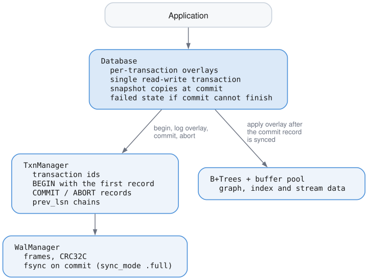

# Transaction Manager

## What is a Transaction?

A transaction is a **logical unit of work** - a group of operations that should either all succeed or all fail together.

This chapter explains the internal transaction machinery: the `TxnManager` in
`src/transaction/manager.zig` and how the `Database` uses it. It is not by itself
the public contract. For what a transaction guarantees to an application, see
[Transactions and Durability](../guides/transactions.md).

| | Without transactions | With transactions |
|---|---|---|
| Step 1 | Debit Alice $100 — succeeds | `BEGIN` |
| Step 2 | Crash | Debit Alice $100 |
| Step 3 | Credit Bob $100 — never runs | Credit Bob $100 |
| Step 4 | — | `COMMIT` |
| **Result** | Alice lost $100 and Bob got nothing | Either both happen or neither does |

## The ACID Properties

Transactions guarantee four properties:

| Property | Meaning | How We Achieve It |
|----------|---------|-------------------|
| **A**tomicity | All or nothing | Per-transaction overlay + commit record |
| **C**onsistency | Valid state to valid state | Application logic |
| **I**solation | Transactions don't interfere | One writer at a time; snapshot copies for other open transactions |
| **D**urability | Committed = permanent | WAL + fsync |

The public contract permits one live read-write transaction per database. Starting
a second one while the first is open fails with `TransactionConflict` (in C,
`LATTICE_ERROR_LOCK_TIMEOUT`) instead of waiting. The transaction manager also
hands out MVCC-style timestamps (`start_ts`, `commit_ts`), and
`src/transaction/mvcc.zig` holds version-chain machinery, but the storage layer
does not use either; they are an internal target, not a guarantee.

## The Core Data Structures

### Transaction (User-Facing Handle)

This is what the application sees:

```zig
pub const Transaction = struct {
    id: u64,              // Unique identifier (1, 2, 3, ...)
    state: TxnState,      // active, committed, or aborted
    mode: TxnMode,        // read_only or read_write
    isolation: IsolationLevel,  // snapshot, read_committed, serializable
    start_ts: u64,        // When transaction started (for visibility)
    commit_ts: u64,       // When committed (0 until commit)
};
```

### TxnEntry (Internal State)

The manager keeps more detailed state internally:

```zig
const TxnEntry = struct {
    txn: Transaction,           // The user-facing handle
    last_lsn: u64,              // LSN of most recent operation
    begin_lsn: u64,             // LSN of TXN_BEGIN record
    savepoints: ArrayList,      // Stack of savepoints
    undo_log: ArrayList,        // Operations to reverse on abort
};
```

### TxnManager (The Coordinator)

```zig
pub const TxnManager = struct {
    allocator: Allocator,
    wal: *WalManager,                        // For durability
    active_txns: HashMap(u64, TxnEntry),     // All running transactions
    next_txn_id: u64,                        // Counter for IDs
    current_ts: u64,                         // Global timestamp clock
    committed_count: u64,                    // Statistics
    aborted_count: u64,
    mutex: Mutex,                            // Thread safety
};
```

## Transaction Lifecycle

### 1. BEGIN

When you start a transaction:

`Database.beginTransaction` first refuses a second read-write transaction while one
is open. Then the transaction manager:

1. Locks the manager mutex.
2. Assigns `txn_id = 1`.
3. Assigns `start_ts = 1`.
4. `appendRecord(TXN_BEGIN)` — the WAL returns `lsn = 1`. The record sits in the
   frame buffer; nothing is synced yet.
5. Creates a `TxnEntry` with `last_lsn = 1`.
6. Stores it in `active_txns`.
7. Unlocks the mutex.
8. Returns `Transaction { id = 1, ... }` to the caller.

The database then creates an empty overlay for the transaction. That happens for
read-only transactions too.

`start_ts` is recorded but nothing in the storage layer reads it.

### 2. Operations

Writes inside a transaction do not go to the log as they happen. Creating a node,
setting a property or deleting an edge records the new state in the transaction's
overlay, an in-memory map from node, edge and vector ids to their pending state,
plus lists of stream appends, offsets and trims. Reads in the same transaction look
in the overlay first.

The log is written at commit, when the database turns each overlay entry into one
or more records and passes them to `logOperation`:

1. Check `txn.canWrite()`.
2. Look up the `TxnEntry`.
3. `appendRecord(INSERT, txn_id = 1, prev_lsn = 1, payload = data)` — `prev_lsn`
   is the entry's current `last_lsn`. The WAL returns `lsn = 2`.
4. Update `last_lsn = 2`.
5. Return `lsn = 2` to the caller.

Notice how `prev_lsn` points to the previous operation. This builds a **backward chain**.

(A write with no transaction at all, through the Zig API's `null` transaction, goes
straight to the stores and is not logged. It reaches the file only when its pages
are flushed.)

### 3. COMMIT

Commit makes everything permanent:

1. Check that `txn.state == active`.
2. `appendRecord(TXN_COMMIT, prev_lsn = last_lsn)`.
3. `wal.sync()` — this issues the `fsync()`, and it is the point at which the
   transaction becomes durable. Everything before this step can still be lost.
4. Assign `commit_ts`.
5. Set `txn.state = committed`.
6. Remove the entry from `active_txns`.
7. Increment `committed_count`.
8. Return to the caller.

**The critical point**: We only return success to the application AFTER `fsync()` completes. This is the durability guarantee.

Those are the transaction manager's steps. `Database.commitTransaction` wraps them.
For a transaction whose overlay holds changes, it runs, in order:

1. Copy the pre-commit state of every node, edge and vector the overlay changes
   into each other open transaction's overlay (see
   [Timestamps and Isolation](#timestamps-and-isolation)).
2. Stage graph changefeed records and assign stream sequence numbers.
3. Log the overlay: append its logical records (`logOperation`); nothing is synced.
4. Apply the overlay to the base stores — graph stores, label index, vector index,
   streams, and the full-text and property indexes that follow from them. This
   dirties pages in the buffer pool.
5. `tm.commit`: append `TXN_COMMIT` and fsync the WAL (the steps above).
6. Discard the overlay, clear the active writer, and wake stream readers if streams changed.
7. Run an automatic checkpoint if the WAL has reached its threshold (best effort).

A transaction with no changes, read-only or not, goes straight to step 5.

Two consequences of applying before the fsync: the buffer pool can evict a page
holding the new state before the commit record is on disk, and if the fsync fails,
commit returns an error with the overlay already applied in memory.

Large property updates avoid carrying both old and new full values in commit-time
WAL records when redo does not require both; the changefeed uses summary maps for
values that would exceed stream/WAL sizing limits.

### 4. ABORT

Abort discards everything. At the database level that means dropping the
transaction's overlay: nothing it staged ever reached the stores. (The transaction
manager also keeps a per-transaction undo log, replayed on abort only for writes
that bypassed the overlay; ordinary transactional writes do not.) Then the
transaction manager:

1. `appendRecord(TXN_ABORT)`.
2. `wal.sync()`.
3. Set `txn.state = aborted`.
4. Clean up the `TxnEntry`.
5. Remove it from `active_txns`.
6. Return to the caller.

We log TXN_ABORT so that during crash recovery, we know this transaction was intentionally aborted.

## The prev_lsn Chain

Every record points back to the previous record **from the same transaction**. This creates a linked list through the WAL:

| LSN | Record | Transaction | `prev_lsn` |
|----:|--------|------------:|-----------:|
| 1 | `TXN_BEGIN` | 1 | 0 |
| 2 | `INSERT` | 1 | 1 |
| 3 | `TXN_BEGIN` | 2 | 0 |
| 4 | `UPDATE` | 1 | 2 |
| 5 | `DELETE` | 2 | 3 |
| 6 | `TXN_COMMIT` | 1 | 4 |

Following `prev_lsn` backwards gives each transaction's chain without scanning the
whole log:

- Transaction 1: 6 → 4 → 2 → 1
- Transaction 2: 5 → 3

**What is it for?** In a classic ARIES design the chain drives rollback and undo
during recovery without scanning the whole log. LatticeDB writes it, but nothing
reads it today: abort discards the overlay, and recovery identifies uncommitted
transactions by scanning the log forward and has no undo pass.

## Savepoints (Internal, Incomplete)

`TxnManager` has `savepoint` and `rollbackToSavepoint`, but nothing above it calls
them: there is no savepoint API in the database layer, the C API, the bindings or
Cypher. They are also incomplete. Rolling back to a savepoint logs
`SAVEPOINT_ROLLBACK` and truncates the transaction manager's undo log, but it does
not touch the transaction's overlay, and recovery ignores savepoint records, so
nothing is actually undone.

## Timestamps and Isolation

Every transaction gets two timestamps:

```
start_ts:  Assigned at BEGIN
commit_ts: Assigned at COMMIT
```

They are the hooks an MVCC design would use to decide visibility. The storage layer
does not consult them. Isolation comes from two simpler mechanisms instead:

1. **One writer.** Only one read-write transaction can be open at a time, so
   writers never interleave.
2. **Snapshot copies at commit.** Uncommitted writes live only in the writer's
   overlay, so nobody else can see them. When the writer commits, the database
   first copies the pre-commit state of every node, edge and vector it changed into
   each other open transaction's overlay (unless that overlay already has an entry
   for it). Those transactions read their overlay first, so they keep seeing the
   values from before the commit.

### Snapshot Isolation Example

| Step | Transaction | Event |
|----:|-------------|-------|
| 1 | Txn A | `BEGIN` (read-write) |
| 2 | Txn A | `SET x = 100` — staged in A's overlay |
| 3 | Txn B | `BEGIN` (read-only) |
| 4 | Txn A | `COMMIT` — the old `x` is copied into B's overlay, then A's change is applied |
| 5 | Txn B | Reads `x` |

**Question**: What does Txn B see when it reads x?

Txn B was open when Txn A committed, so its overlay received the old value of `x`
at step 4. B does NOT see x=100; it sees whatever x was before Txn A.

The copies cover node, edge and vector state only. How long-lived concurrent readers
behave beyond that is not part of the public contract.

## Read-Only Transactions

Read-only transactions are special:

```zig
var txn = try tm.begin(.read_only, .snapshot);

// This fails:
const result = tm.logOperation(&txn, .insert, "data");
// Error: TxnError.ReadOnly
```

Why have read-only transactions?
1. **No single-writer conflict** - any number can be open alongside the one writer
2. **A stable view** - they receive snapshot copies when a writer commits, as above
3. **Nothing to log** - their overlay stays empty, so commit has nothing to apply

They are not free of log I/O, though: `begin` appends `TXN_BEGIN`, and `commit`
appends `TXN_COMMIT` and fsyncs the WAL, the same as for a read-write transaction.

## Thread Safety

The TxnManager uses a mutex to protect shared state:

```zig
pub fn begin(self: *Self, ...) TxnError!Transaction {
    self.mutex.lock();         // ← Only one thread at a time
    defer self.mutex.unlock(); // ← Released when function exits

    // Safe to modify next_txn_id, active_txns, etc.
    ...
}
```

This is a simple approach. The mutex is held briefly (microseconds), and the WAL I/O dominates latency anyway.

## Statistics

The manager tracks statistics for monitoring:

```zig
const stats = tm.getStats();

stats.active_count     // Currently running transactions
stats.committed_count  // Total successful commits
stats.aborted_count    // Total aborts
stats.oldest_active_id // Oldest running transaction
stats.current_ts       // Current timestamp
```

`oldest_active_id` is what garbage collection of old versions would need. The
engine keeps no old versions to collect, so nothing uses it yet.

## API Summary

This is the internal API the `Database` drives; applications use
`Database.beginTransaction`, `commitTransaction` and `abortTransaction` (or the
bindings' equivalents) instead.

```zig
var tm = TxnManager.init(allocator, &wal);

// Start a transaction
var txn = try tm.begin(.read_write, .snapshot);

// Log operations (the database does this at commit, from the overlay)
_ = try tm.logOperation(&txn, .insert, payload);
_ = try tm.logOperation(&txn, .update, payload);

// Commit or abort
try tm.commit(&txn);  // or tm.abort(&txn)
```

## Integration



The Transaction Manager is the **log-facing half** of transactions - it doesn't store
data itself, and it does not touch the B+Trees. It assigns ids, writes the begin,
commit and abort records, and makes the commit durable. The `Database` owns the
other half: the overlays, the single-writer rule, and applying committed changes.
