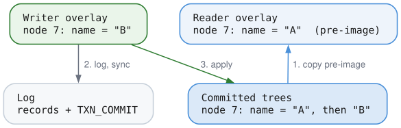

# Transaction Manager

## What is a Transaction?

A transaction is a **logical unit of work** - a group of operations that should either all succeed or all fail together.

This chapter explains the internal transaction machinery: the `TxnManager` in
`src/transaction/manager.zig` and how the `Database` uses it. It is not by itself
the public contract. For what a transaction guarantees to an application, see
[Transactions and Durability](../guides/transactions.md).

| | Without transactions | With transactions |
|---|---|---|
| Step 1 | Debit Alice $100 — succeeds | `BEGIN` |
| Step 2 | Crash | Debit Alice $100 |
| Step 3 | Credit Bob $100 — never runs | Credit Bob $100 |
| Step 4 | — | `COMMIT` |
| **Result** | Alice lost $100 and Bob got nothing | Either both happen or neither does |

## The ACID Properties

Transactions guarantee four properties:

| Property | Meaning | How We Achieve It |
|----------|---------|-------------------|
| **A**tomicity | All or nothing | Per-transaction overlay + commit record |
| **C**onsistency | Valid state to valid state | Application logic |
| **I**solation | Transactions don't interfere | One writer at a time; snapshot copies for other open transactions |
| **D**urability | Committed = permanent | The synced commit record, and recovery |

The public contract permits one live read-write transaction per database. Starting
a second one while the first is open fails with `TransactionConflict` (in C,
`LATTICE_ERROR_LOCK_TIMEOUT`) instead of waiting. The transaction manager also
hands out MVCC-style timestamps (`start_ts`, `commit_ts`), and
`src/transaction/mvcc.zig` holds version-chain machinery, but the storage layer
does not use either; they are an internal target, not a guarantee.

## The Core Data Structures

### Transaction (User-Facing Handle)

This is what the application sees:

```zig
pub const Transaction = struct {
    id: u64,              // Unique identifier (1, 2, 3, ...)
    state: TxnState,      // active, committed, or aborted
    mode: TxnMode,        // read_only or read_write
    isolation: IsolationLevel,  // snapshot, read_committed, serializable
    start_ts: u64,        // When transaction started (for visibility)
    commit_ts: u64,       // When committed (0 until commit)
};
```

### TxnEntry (Internal State)

The manager keeps more detailed state internally:

```zig
const TxnEntry = struct {
    txn: Transaction,           // The user-facing handle
    last_lsn: u64,              // LSN of most recent operation
    begin_lsn: u64,             // LSN of TXN_BEGIN, once it has been written
    wal_started: bool,          // Whether TXN_BEGIN has been written
    savepoints: ArrayList,      // Stack of savepoints
    undo_log: ArrayList,        // Operations to reverse on abort
};
```

### TxnManager (The Coordinator)

```zig
pub const TxnManager = struct {
    allocator: Allocator,
    wal: *WalManager,                        // For durability
    active_txns: HashMap(u64, TxnEntry),     // All running transactions
    next_txn_id: u64,                        // Counter for IDs
    current_ts: u64,                         // Global timestamp clock
    committed_count: u64,                    // Statistics
    aborted_count: u64,
    mutex: Mutex,                            // Thread safety
};
```

## Transaction Lifecycle

### 1. BEGIN

When you start a transaction:

`Database.beginTransaction` first refuses a second read-write transaction while one
is open, and refuses everything on a handle that has [failed](#when-commit-fails).
Then the transaction manager:

1. Locks the manager mutex.
2. Assigns the next transaction id.
3. Assigns `start_ts`.
4. Creates a `TxnEntry` with `wal_started = false` and stores it in `active_txns`.
5. Unlocks the mutex and returns the `Transaction` to the caller.

Nothing is written to the log. `TXN_BEGIN` is appended with the transaction's first
record, which for a transaction begun through the database means at commit. A
transaction that never logs anything never touches the log at all.

The database then creates an empty overlay for the transaction. That happens for
read-only transactions too.

Transaction ids do not restart with each session. A log can outlive the session
that wrote it, and if ids started at 1 again, a later recovery could read one
session's uncommitted records and another session's commit as a single
transaction. Recovery reports the largest id it saw in the log, and the new session
numbers its transactions above it.

`start_ts` is recorded but nothing in the storage layer reads it.

### 2. Operations

Writes inside a transaction do not go to the log as they happen. Creating a node,
setting a property or deleting an edge records the new state in the transaction's
overlay, an in-memory map from node, edge and vector ids to their pending state,
plus lists of stream appends, offsets and trims. Reads in the same transaction look
in the overlay first. Checks that can reject a change for its content, such as an
edge too large for a page, run when the change is staged, so a transaction that
would fail for what it contains fails before anything is logged.

The log is written at commit, when the database turns each overlay entry into one
or more records and passes them to `logOperation`:

1. Check `txn.canWrite()`.
2. Look up the `TxnEntry`.
3. If `wal_started` is false, append `TXN_BEGIN` first and set it.
4. `appendRecord(INSERT, txn_id, prev_lsn = last_lsn, payload = data)`. The WAL
   returns the new LSN.
5. Update `last_lsn` and return the LSN to the caller.

Notice how `prev_lsn` points to the previous operation. This builds a **backward chain**.

(A write with no transaction at all, through the Zig API's `null` transaction, goes
straight to the stores and is not logged. It reaches the file only when its pages
are flushed.)

### 3. COMMIT

Commit makes everything permanent. The transaction manager's part:

1. Check that `txn.state == active`.
2. If the transaction has written anything (`wal_started`):
   `appendRecord(TXN_COMMIT, prev_lsn = last_lsn)`, then `wal.sync()`, which issues
   the `fsync()`. In `sync_mode = .normal` it calls `wal.flush()` instead, which
   writes the frame without waiting for the disk.
3. Assign `commit_ts`, set `txn.state = committed`, remove the entry from
   `active_txns`, and increment `committed_count`.

A transaction that wrote nothing skips step 2: no record, no write, no fsync.

`Database.commitTransaction` wraps those steps. For a transaction whose overlay
holds changes, it runs, in order:


1. Copy the pre-commit state of every node, edge and vector the overlay changes
   into each other open transaction's overlay (see
   [Timestamps and Isolation](#timestamps-and-isolation)).
2. Stage graph changefeed records and assign stream sequence numbers.
3. Log the overlay: append its logical records (`logOperation`); nothing is synced.
4. `tm.commit`: append `TXN_COMMIT` and sync the WAL. **This is the commit point.**
   Before the sync returns the transaction can still be lost, and losing it is the
   same as it never having run; after it, recovery will find the commit record and
   redo the transaction.
5. Apply the overlay to the base stores — graph stores, label index, vector index,
   streams, and the full-text and property indexes that follow from them. This
   dirties pages in the buffer pool.
6. Discard the overlay, clear the active writer, flush early if half the buffer
   pool is dirty and nothing is pinned, and wake stream readers if streams changed.
7. Run an automatic checkpoint if the WAL has reached its threshold (best effort).

A transaction with no changes, read-only or not, goes straight to `tm.commit`,
which writes nothing.

The order used to be different: the overlay was applied before the commit record
was written. A failure while applying then left half a transaction visible in the
process, and written out by the next checkpoint, while the log said it had never
committed. With the synced commit record as the commit point, nothing is applied
until the log holds the whole transaction.

Large property updates avoid carrying both old and new full values in commit-time
WAL records when redo does not require both; the changefeed uses summary maps for
values that would exceed stream/WAL sizing limits.

#### When commit fails

A failure before the commit point (steps 1 to 3) is an ordinary error. Some of the
transaction's records may be in the log, but no commit record, so recovery will
ignore them. The transaction is still open, and the caller rolls it back.

A failure at or after the commit point cannot be undone. If the sync fails, the
commit record may or may not be on disk, and nobody can say which. If applying
fails, the record is on disk and the stores are missing part of the transaction.
Either way the process's memory no longer matches its log, so the database marks
the handle **failed** and returns an error.

A failed handle refuses new transactions and commits, refuses `sync()` and
checkpoints, does no early flushes, and on close abandons its dirty pages, so the
half-applied state never reaches the database file. Open transactions are ended
without writing to the log, since an abort record after a commit record of unknown
fate would decide an outcome nobody knows. The caller's recourse is to close and
reopen: recovery replays the log and produces the state it describes, which includes
the transaction if its commit record reached the disk.

### 4. ABORT

Abort discards everything. At the database level that means dropping the
transaction's overlay: nothing it staged ever reached the stores. (The transaction
manager also keeps a per-transaction undo log, replayed on abort only for writes
that bypassed the overlay; ordinary transactional writes do not.) Then the
transaction manager:

1. If the transaction has written anything to the log, appends `TXN_ABORT`. It is
   not synced.
2. Sets `txn.state = aborted`, cleans up the `TxnEntry` and removes it from
   `active_txns`.
3. Returns to the caller.

In the common case nothing was logged, so abort does not touch the log. An
overlay transaction has records in the log only if a commit attempt failed after
logging some of them. The abort record is not synced because recovery only redoes
transactions whose commit record it finds: a lost `TXN_ABORT` changes nothing.
Written, it lets recovery report the transaction as aborted rather than as in
progress at the crash. On a failed handle, open transactions are ended with
`discard`, which writes nothing.

## The prev_lsn Chain

Every record points back to the previous record **from the same transaction**. This creates a linked list through the WAL:

| LSN | Record | Transaction | `prev_lsn` |
|----:|--------|------------:|-----------:|
| 1 | `TXN_BEGIN` | 1 | 0 |
| 2 | `INSERT` | 1 | 1 |
| 3 | `UPDATE` | 1 | 2 |
| 4 | `TXN_COMMIT` | 1 | 3 |
| 5 | `TXN_BEGIN` | 2 | 0 |
| 6 | `DELETE` | 2 | 5 |
| 7 | `TXN_COMMIT` | 2 | 6 |

Because records are written at commit and only one writer runs at a time, one
transaction's records are contiguous in the log. Following `prev_lsn` backwards
gives each transaction's chain:

- Transaction 1: 4 → 3 → 2 → 1
- Transaction 2: 7 → 6 → 5

**What is it for?** In a classic ARIES design the chain drives rollback and undo
during recovery without scanning the whole log. LatticeDB writes it, but nothing
follows it for that: abort discards the overlay, and recovery identifies
uncommitted transactions by scanning the log forward and has no undo pass. The one
reader is the reassembly of fragmented records, which checks that the pieces of one
record agree.

## Savepoints (Internal, Incomplete)

`TxnManager` has `savepoint` and `rollbackToSavepoint`, but nothing above it calls
them: there is no savepoint API in the database layer, the C API, the bindings or
Cypher. They are also incomplete. Rolling back to a savepoint logs
`SAVEPOINT_ROLLBACK` and truncates the transaction manager's undo log, but it does
not touch the transaction's overlay, and recovery ignores savepoint records, so
nothing is actually undone.

## Timestamps and Isolation

Every transaction gets two timestamps:

```
start_ts:  Assigned at BEGIN
commit_ts: Assigned at COMMIT
```

They are the hooks an MVCC design would use to decide visibility. The storage layer
does not consult them. Isolation comes from two simpler mechanisms instead:



1. **One writer.** Only one read-write transaction can be open at a time, so
   writers never interleave.
2. **Snapshot copies at commit.** Uncommitted writes live only in the writer's
   overlay, so nobody else can see them. When the writer commits, the database
   first copies the pre-commit state of every node, edge and vector it changed into
   each other open transaction's overlay (unless that overlay already has an entry
   for it). Those transactions read their overlay first, so they keep seeing the
   values from before the commit.

### Snapshot Isolation Example

| Step | Transaction | Event |
|----:|-------------|-------|
| 1 | Txn A | `BEGIN` (read-write) |
| 2 | Txn A | `SET x = 100` — staged in A's overlay |
| 3 | Txn B | `BEGIN` (read-only) |
| 4 | Txn A | `COMMIT` — the old `x` is copied into B's overlay, then A logs, syncs and applies its change |
| 5 | Txn B | Reads `x` |

**Question**: What does Txn B see when it reads x?

Txn B was open when Txn A committed, so its overlay received the old value of `x`
at step 4. B does NOT see x=100; it sees whatever x was before Txn A.

The copies cover node, edge and vector state only. How long-lived concurrent readers
behave beyond that is not part of the public contract.

## Read-Only Transactions

Read-only transactions are special:

```zig
var txn = try tm.begin(.read_only, .snapshot);

// This fails:
const result = tm.logOperation(&txn, .insert, "data");
// Error: TxnError.ReadOnly
```

Why have read-only transactions?
1. **No single-writer conflict** - any number can be open alongside the one writer
2. **A stable view** - they receive snapshot copies when a writer commits, as above
3. **Nothing to log** - their overlay stays empty, so commit has nothing to apply

They cost no log I/O: begin writes nothing, and commit or abort writes no record
and does no fsync. A read-write transaction that changes nothing behaves the same
way.

What a reader does cost is memory, and some of the writer's time: each commit
copies into the reader's overlay the committed state of every entity the writer
changed that the reader does not already hold. A long-lived reader does not hold
back checkpoints, which only wait for open transactions that have records in the
log (see [Checkpointing](./checkpointing.md#refusals)).

## Thread Safety

The TxnManager uses a mutex to protect shared state:

```zig
pub fn begin(self: *Self, ...) TxnError!Transaction {
    self.mutex.lock();         // ← Only one thread at a time
    defer self.mutex.unlock(); // ← Released when function exits

    // Safe to modify next_txn_id, active_txns, etc.
    ...
}
```

This is a simple approach. The mutex is held briefly, and the WAL I/O dominates
latency anyway. `commit` holds it across the log sync, so commits are serialised
through it as well.

## Statistics

The manager tracks statistics for monitoring:

```zig
const stats = tm.getStats();

stats.active_count     // Currently running transactions
stats.committed_count  // Total successful commits
stats.aborted_count    // Total aborts
stats.oldest_active_id // Oldest running transaction
stats.current_ts       // Current timestamp
```

`oldest_active_id` is what garbage collection of old versions would need. The
engine keeps no old versions to collect, so nothing uses it yet.

## API Summary

This is the internal API the `Database` drives; applications use
`Database.beginTransaction`, `commitTransaction` and `abortTransaction` (or the
bindings' equivalents) instead.

```zig
var tm = TxnManager.init(allocator, &wal);

// Start a transaction
var txn = try tm.begin(.read_write, .snapshot);

// Log operations (the database does this at commit, from the overlay)
_ = try tm.logOperation(&txn, .insert, payload);
_ = try tm.logOperation(&txn, .update, payload);

// Commit or abort
try tm.commit(&txn);  // or tm.abort(&txn)

// Has any open transaction written to the log? (checkpoints check this)
const busy = tm.hasLoggedActiveTxn();
```

## Integration


The Transaction Manager is the **log-facing half** of transactions - it doesn't store
data itself, and it does not touch the B+Trees. It assigns ids, writes the begin,
commit and abort records, and owns the sync that makes a commit durable. The
`Database` owns the other half: the overlays, the single-writer rule, applying
committed changes once the commit record is on disk, and the failed state when that
cannot be finished.
