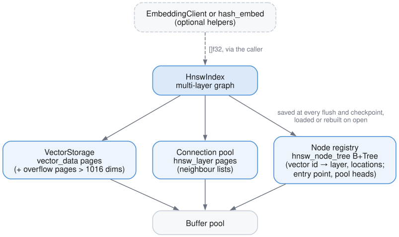

# Vector Search

## Overview

Lattice provides approximate nearest neighbor (ANN) search using the HNSW (Hierarchical Navigable Small World) algorithm. This enables semantic search over high-dimensional embedding vectors—a core requirement for AI/RAG applications.



## Embedding Generation

Lattice uses a **bring your own embeddings** approach by default. You can:

1. Generate embeddings externally and pass them directly
2. Use the optional `EmbeddingClient` to call HTTP embedding APIs

### Option 1: Bring Your Own Embeddings

```zig
// You generate embeddings however you want
const embedding: []const f32 = your_embedding_function("Hello world");

// Insert directly into HNSW index
try hnsw_index.insert(doc_id, embedding);
```

### Option 2: HTTP Embedding Client

The `EmbeddingClient` calls external HTTP endpoints to generate embeddings. It's **disabled by default**—you must explicitly create and configure it.

```zig
const lattice = @import("lattice");

// Ollama (local) - simplest config
var client = lattice.EmbeddingClient.init(allocator, .{
    .endpoint = "http://localhost:11434/api/embeddings",
});
defer client.deinit();

// Generate embedding
const vector = try client.embed("Hello, world!");
defer allocator.free(vector);
```

#### Configuration Options

```zig
const config = lattice.EmbeddingConfig{
    // Required: HTTP endpoint URL
    .endpoint = "http://localhost:11434/api/embeddings",

    // Model name (default: "nomic-embed-text")
    .model = "nomic-embed-text",

    // API format: .ollama (default) or .openai
    .api_format = .ollama,

    // Optional API key for authenticated endpoints
    .api_key = null,

    // Request timeout in milliseconds (default: 30000).
    // Not currently enforced: the client does not read this field.
    .timeout_ms = 30_000,
};
```

#### Supported API Formats

| Format | Request | Response |
|--------|---------|----------|
| `.ollama` | `{"model": "...", "prompt": "..."}` | `{"embedding": [...]}` |
| `.openai` | `{"model": "...", "input": "..."}` | `{"data": [{"embedding": [...]}]}` |

#### Examples

**Ollama (local)**
```zig
var client = EmbeddingClient.init(allocator, .{
    .endpoint = "http://localhost:11434/api/embeddings",
    .model = "nomic-embed-text",
});
```

**OpenAI**
```zig
var client = EmbeddingClient.init(allocator, .{
    .endpoint = "https://api.openai.com/v1/embeddings",
    .model = "text-embedding-3-small",
    .api_format = .openai,
    .api_key = "sk-...",
});
```

**Local OpenAI-compatible (llama.cpp, vLLM, etc.)**
```zig
var client = EmbeddingClient.init(allocator, .{
    .endpoint = "http://localhost:8080/v1/embeddings",
    .model = "local-model",
    .api_format = .openai,
});
```

## HNSW Index

HNSW (Hierarchical Navigable Small World) is a graph-based algorithm for approximate nearest neighbor search. It achieves O(log n) search complexity with high recall.

### How HNSW Works


- Upper layers have exponentially fewer nodes (sparse)
- Search starts at top layer, greedily descends
- Layer 0 uses beam search for final candidates
- Each node maintains bidirectional connections to neighbors

### Configuration

```zig
const config = lattice.HnswConfig{
    .dimensions = 384,         // Required: vector length (1-4096)
    .m = 16,                   // Connections per node (layers 1+)
    .m_max0 = 32,              // Connections at layer 0
    .ef_construction = 200,    // Search width during insert
    .ef_search = 64,           // Search width during query
    .ml = 1.0 / @log(2.0),     // Level multiplier, ≈ 1.4427 (the default)
    .metric = .cosine,         // Distance metric
};
```

| Parameter | Default | Description |
|-----------|---------|-------------|
| `dimensions` | none (required) | Vector length, 1 to 4096 |
| `m` | 16 | Max connections per node on layers 1+ (higher = better recall, more memory) |
| `m_max0` | 32 | Max connections at layer 0 (typically 2×m) |
| `ef_construction` | 200 | Beam width during insert (higher = better graph quality) |
| `ef_search` | 64 | Beam width during search (higher = better recall, slower) |
| `ml` | 1/ln 2 ≈ 1.4427 | Level multiplier; a new node's top layer is `floor(-ln(U) × ml)` |
| `metric` | `.cosine` | Distance metric: `.euclidean`, `.cosine`, `.inner_product` |

With `ml = 1/ln 2`, about half of all vectors reach layer 1 or higher, a
quarter reach layer 2, and so on. (The HNSW paper suggests `ml = 1/ln M`, which
for M = 16 is ≈ 0.36 and puts about 6% of vectors above layer 0.)

`m` and `m_max0` are capped at 64: neighbour lists are read into fixed 64-entry
buffers during insert and search, so `init` lowers a larger value to 64. With
`m_max0 = 2 × m`, that makes 32 the largest `m` that keeps the usual ratio.

**What a database lets you change.** These fields matter only when you build an
`HnswIndex` yourself. A database created with vector support always builds its
index with the defaults above (cosine, `m = 16`, `m_max0 = 32`,
`ef_construction = 200`, `ef_search = 64`); only `dimensions` comes from the
database configuration. The one setting exposed per query is `ef_search`, as the
`ef_search` argument of `lattice_vector_search` (0 means the default of 64) and
the equivalent binding parameters.

### API Usage

```zig
const lattice = @import("lattice");

// `buffer_pool` is a *lattice.BufferPool set up by the caller.

// Initialize vector storage (pages are owned by the buffer pool; no deinit)
var vector_storage = try lattice.VectorStorage.init(allocator, buffer_pool, 384);

// Initialize HNSW index
var hnsw = lattice.HnswIndex.init(allocator, buffer_pool, &vector_storage, .{
    .dimensions = 384,
    .metric = .cosine,
    .ef_search = 100,
});
defer hnsw.deinit();

// Insert vectors
try hnsw.insert(1, embedding1);
try hnsw.insert(2, embedding2);
try hnsw.insert(3, embedding3);

// Search for 10 nearest neighbors
const results = try hnsw.search(query_vector, 10, null);
defer hnsw.freeResults(results);

for (results) |result| {
    std.debug.print("ID: {}, Distance: {d:.4}\n", .{ result.node_id, result.distance });
}
```

`search(query, k, ef_override)` returns up to `k` results ordered by
distance; pass a value for `ef_override` to change the beam width for one
query. The beam is never narrower than `k`: the search uses `max(ef, k)`
(capped at 65535), so asking for more neighbours than `ef_search` still returns
`k` of them.

The index itself accepts any `f32` values, so that recovery can replay a log
written by an older release. The database rejects a vector with a NaN or
infinite component, whether stored or used as a query, with `InvalidArgument`
(`LATTICE_ERROR_INVALID_ARG` through the C API): such a value makes every
distance to it NaN or infinite and breaks the ordering the search relies on.

`insert` and `remove` are all or nothing. Every neighbour-list write records the
list's previous contents, and a failure part way (out of memory, a full buffer
pool, an I/O error) puts the lists, the node map entry, the entry point, the top
layer and the vector count back as they were.

### Distance Metrics

| Metric | Formula | Best For |
|--------|---------|----------|
| `.euclidean` | √Σ(aᵢ - bᵢ)² | General purpose |
| `.cosine` | 1 - (a·b)/(‖a‖‖b‖) | Text embeddings (normalized) |
| `.inner_product` | -Σ(aᵢ × bᵢ) | When vectors are pre-normalized |

For text embeddings from most models (OpenAI, Cohere, etc.), use `.cosine`.

With `.cosine`, the index normalizes each vector before storing it and
normalizes each query, then computes the distance as `1 - a·b`. The index's
copy of a vector is therefore its unit-length version, and it is the only copy
the file keeps: a committed vector reads back normalised (`n.embedding` in
Cypher, `getNodeVectorInTxn` in Zig). A vector a transaction has set but not yet
committed is scored the same way, normalised on both sides, so it ranks among
committed results on the same scale.

## Vector Storage

Vectors are stored in pages managed by the buffer pool, separate from the HNSW graph structure.

Vector pages use a 4096-byte layout. Each starts with the common 8-byte page
header, followed by a 16-byte vector header (all integers little-endian):

| Offset | Size | Field |
|--------|------|-------|
| 0–7 | 8 B | Common page header: `page_type` = `0x04` (`vector_data`), flags, reserved, checksum |
| 8–9 | 2 B | `dimensions: u16` |
| 10–11 | 2 B | `vector_count: u16` — records on this page |
| 12–15 | 4 B | `bytes_per_vector: u32` — record size |
| 16–19 | 4 B | `next_page: u32` — next vector page in the chain (0 if none) |
| 20–23 | 4 B | Layout marker: `0` = inline, `0x564F4631` (`"VOF1"`) = overflow |
| 24 → | variable | Records |

Vectors up to 4096 dimensions are supported. Vectors that fit in one page use
the inline layout: each record is `[vector_id: u64][f32 × dimensions]`, and a
page holds `(4096 - 24) / (8 + 4 × dimensions)` of them. That covers up to 1016
dimensions. Larger embeddings use a compact head record in the vector page:

```
[vector_id: u64][first_overflow_page: u32][reserved: u32]
```

The f32 payload is stored across linked overflow pages (page type `overflow`),
each with an 8-byte `[next_page: u32][bytes_used: u32]` header after the common
header, leaving room for 1020 floats per page. Common embedding sizes such as
1536, 3072, and 4096 dimensions therefore persist normally; they just span
multiple pages.

Vectors per page depends on dimensions:
- 384-dim (1544-byte record): 2 vectors/page
- 768-dim (3080-byte record): 1 vector/page
- 1536-dim (6144 bytes): head record plus 2 overflow pages
- 3072-dim (12288 bytes): head record plus 4 overflow pages
- 4096-dim (16384 bytes): head record plus 5 overflow pages

The graph itself is stored apart from the vectors:

- **Neighbour lists** live in connection-pool pages (page type `hnsw_layer`).
  Nodes are grouped by their top layer, and each group's pages hold fixed-size
  slots with room for `m_max0` neighbours at layer 0 and `m` at each layer above.
- **The node registry** maps each vector ID to its top layer, its vector
  location and its connection slot. It is kept in memory while the database is
  open and written to a dedicated B+Tree (`hnsw_node_tree`), together with the
  entry point and layer count, before every flush of the buffer pool: at each
  checkpoint, at `sync` and close, and at the early flushes a large transaction
  triggers. So the file never holds vector pages newer than the registry that
  describes them. A save writes only the entries added, changed or removed since
  the last one (the whole registry after a rebuild). On open the registry is
  loaded from that tree and validated; if the tree is missing or fails
  validation, the index is rebuilt from the stored vectors.
- **Free vector records** are kept in an in-memory list, built by one walk of the
  vector page chain the first time a store needs it, so storing a vector reuses
  a deleted record without scanning the chain.

## Performance Characteristics

| Operation | Complexity | Notes |
|-----------|------------|-------|
| Insert | O(log n) | Builds graph connections |
| Search (k-NN) | O(log n) | Independent of k for small k |
| Delete | Local, plus an occasional full pass | Repairs the removed vector's neighbours (see below) |
| Memory | O(n × m × layers) | ~1KB per vector at m=16 |

Removing a vector, which includes replacing one, finds the nodes that link to it
through its own neighbour lists. Each drops the link and, if that leaves room,
takes the nearest of the removed node's other neighbours that passes the same
diversity rule as neighbour selection. Links from nodes the removed one had
pruned from its own lists cannot be found that way; those ids are remembered and
dropped in one pass over every list before the next save, or sooner once they
reach about 3% of the index, or before the same id is inserted again. Search
skips ids that are no longer in the index, so a saved graph never names a
missing one.

### Tuning Guidelines

Through a database, `ef_search` is the only knob:

**For higher recall:**
- Increase `ef_search` (e.g., 100-200)

**For faster search:**
- Decrease `ef_search` (e.g., 32)
- Accept lower recall

A `k` larger than `ef_search` widens the beam to `k` on its own, so there is no
need to raise `ef_search` just to get more results.

When you build an `HnswIndex` directly, you can also raise `ef_construction`
(e.g., 400) for a better-connected graph, or raise `m` up to 32 (with
`m_max0` up to 64; see [Configuration](#configuration)).

## Complete Example

This uses the index directly, below the database layer. Opening the
`PageManager` is left out; `page_manager` is a `*lattice.PageManager`.

```zig
const std = @import("std");
const lattice = @import("lattice");

pub fn main() !void {
    var gpa = std.heap.DebugAllocator(.{}){};
    defer _ = gpa.deinit();
    const allocator = gpa.allocator();

    // Setup storage (abbreviated): a 4 MiB buffer pool over an open PageManager
    var buffer_pool = try lattice.BufferPool.init(allocator, page_manager, 4 * 1024 * 1024);
    defer buffer_pool.deinit();

    // Initialize embedding client (optional)
    var embedder = lattice.EmbeddingClient.init(allocator, .{
        .endpoint = "http://localhost:11434/api/embeddings",
    });
    defer embedder.deinit();

    // Initialize vector storage and HNSW index
    var vector_storage = try lattice.VectorStorage.init(allocator, &buffer_pool, 384);

    var hnsw = lattice.HnswIndex.init(allocator, &buffer_pool, &vector_storage, .{
        .dimensions = 384, // must match the embedding model's output
        .metric = .cosine,
    });
    defer hnsw.deinit();

    // Index some documents
    const docs = [_][]const u8{
        "Zig is a systems programming language",
        "Rust focuses on memory safety",
        "Go emphasizes simplicity and concurrency",
    };

    for (docs, 0..) |doc, i| {
        const embedding = try embedder.embed(doc);
        defer allocator.free(embedding);
        try hnsw.insert(i, embedding);
    }

    // Search
    const query_embedding = try embedder.embed("memory safe language");
    defer allocator.free(query_embedding);

    const results = try hnsw.search(query_embedding, 3, null);
    defer hnsw.freeResults(results);

    for (results) |result| {
        std.debug.print("Doc {}: distance {d:.4}\n", .{ result.node_id, result.distance });
    }
}
```

## SIMD-Optimized Distance Functions

Distance calculations use Zig's `@Vector` for portable SIMD acceleration. This provides 4-8x speedup over scalar implementations for typical embedding dimensions (384, 768, 1536).

```zig
// All distance functions are SIMD-optimized
const dist = lattice.vector.distance.euclideanDistance(vec_a, vec_b);
const cos_dist = lattice.vector.distance.cosineDistance(vec_a, vec_b);
const ip_dist = lattice.vector.distance.innerProductDistance(vec_a, vec_b);

// Additional utilities
const dot = lattice.vector.distance.dotProduct(vec_a, vec_b);
const magnitude = lattice.vector.distance.norm(vec);
lattice.vector.distance.normalize(vec);  // in-place
```

Implementation details:
- Processes 8 floats at a time (AVX-256 compatible)
- The dot product and squared Euclidean distance unroll four SIMD steps into
  four independent accumulators, so long vectors are not held to the latency of
  one chain of adds; fused multiply-add is not used
- Handles non-aligned remainder with scalar fallback
- Works on ARM NEON (128-bit, processed as 2×4)

## Current Limitations

1. **Fixed index settings per database**: `m`, `ef_construction` and the metric
   (cosine) cannot be changed for a database's index; only `ef_search` is
   exposed, per query.
2. **Registry saved at flush**: the node registry is written to `hnsw_node_tree`
   before each flush of the buffer pool, not on every insert. If it is missing
   or invalid on open, the whole graph is rebuilt from the stored vectors.
3. **Cosine reads back normalised**: the file keeps only the unit-length copy
   of each vector, so the original magnitude is not recoverable.
4. **Cypher `<=>` searches a fixed candidate set**: the query planner asks the
   index for the 100 nearest vectors and then keeps those that match the rest of
   the pattern (see [Query Execution](./query-execution.md)). A node outside
   those 100 is never returned, however loose the distance threshold.
5. **Single-threaded**: No concurrent insert/search yet

## Future Enhancements

1. **Concurrent access**: Reader-writer locks for parallel search
2. **Product quantization**: Compress vectors for larger datasets
3. **Filtered search**: Push label/property predicates into the index search
