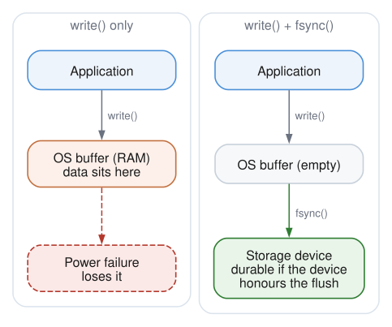

# Virtual File System (VFS)

## What It Is

The Virtual File System is an abstraction layer over file I/O operations. Instead of calling OS functions directly, all file operations go through a VFS interface.

## Why We Need It

### 1. Databases that are not files

The most visible thing this buys is databases with nothing underneath them. Open
`:memory:` and the engine runs against a filesystem held in RAM:


Everything above the interface is unchanged. The B+Tree, the buffer pool, the
write-ahead log, and recovery all run exactly as they do against a disk, because
none of them knows the difference. That is why in-memory support was a new backend
rather than a second path through the engine.

Tests get the same benefit, and run without touching a disk.

### 2. Portability

Different operating systems have different file APIs:
- Linux and macOS: `pread`, `pwrite`, `fsync`
- Windows: `ReadFile`, `WriteFile`, `FlushFileBuffers`

The rest of the database only sees the VFS interface. There is one file-backed
implementation, `PosixVfs`, despite its name: it is written against Zig's
standard-library file API (positioned reads and writes, sync, locks) rather than
raw system calls, so the per-platform differences live in Zig's standard library.
`defaultVfs` returns it unconditionally.

### 3. A Seam for Failure Injection

A backend that records every write and sync can be dropped in behind the same
interface to test what a power cut does. `FaultVfs` (`src/storage/fault_vfs.zig`)
is that backend: an in-memory filesystem that keeps a trace of every create,
delete, write, truncate, file sync and directory sync, and a disk model that
replays part of the trace and cuts the power, losing, reordering or tearing what
was not synced. `Database.openWithVfs` opens a database on any `Vfs` and treats it
as a disk, journal and configured buffer pool included, which `:memory:` does not.
The power-loss tests drive the engine through it; see
[Running Tests](../development/testing.md#power-loss-tests).

The same seam carries read-only recovery. `OverlayVfs`
(`src/storage/overlay_vfs.zig`) opens the files beneath it for reading only and
keeps every write in memory, in 4 KB blocks over them, up to a budget. A read-only
open of a crashed database runs recovery on it, so the handle sees every committed
transaction and the files are not touched (see
[Recovery](./recovery.md#the-order-of-work-at-open)).

The older crash tests in `tests/crash/` simulate a crash differently: some copy the
database file and its log while the handle is still open, which is what a killed
process leaves, and open the copy; others reset the database file to its header
page, leave the log in place, and check that reopening replays the committed
transactions; others build the state a crash part way through a flush leaves.

## The Interface

### File Operations

```zig
pub const File = struct {
    ptr: *anyopaque,
    vtable: *const VTable,

    pub const VTable = struct {
        read:     fn(ptr, offset: u64, buf: []u8) VfsError!usize,
        write:    fn(ptr, offset: u64, data: []const u8) VfsError!void,
        sync:     fn(ptr) VfsError!void,
        truncate: fn(ptr, size: u64) VfsError!void,
        size:     fn(ptr) VfsError!u64,
        close:    fn(ptr) void,
        lock:     fn(ptr, mode: LockMode) VfsError!void,
        tryLock:  fn(ptr, mode: LockMode) VfsError!bool,
        unlock:   fn(ptr) void,
    };

    // Convenience methods that call vtable
    pub fn read(self: File, offset: u64, buf: []u8) !usize {
        return self.vtable.read(self.ptr, offset, buf);
    }
    // ... etc
};
```

### VFS Operations

```zig
pub const Vfs = struct {
    ptr: *anyopaque,
    vtable: *const VTable,

    pub const VTable = struct {
        open:   fn(ptr, path: []const u8, flags: OpenFlags) VfsError!File,
        delete: fn(ptr, path: []const u8) VfsError!void,
        exists: fn(ptr, path: []const u8) bool,
        // Optional: make a file's directory entry durable. PosixVfs syncs the
        // parent directory; a backend without directories leaves it null.
        syncParentDir: ?fn(ptr, path: []const u8) void = null,
    };
};
```

The journal, a newly created database and a newly created log reach the directory
sync through the `Vfs` in use, so a power-loss test can see it.

### Open Flags

```zig
pub const OpenFlags = struct {
    read: bool = true,      // Open for reading
    write: bool = false,    // Open for writing
    create: bool = false,   // Create if doesn't exist
    exclusive: bool = false, // Fail if exists (with create)
    truncate: bool = false, // Truncate file to zero length
};
```

### Locks

`LockMode` is `shared` or `exclusive`. The page manager uses `tryLock` when it
opens a database: a read-write open takes the file exclusively and a read-only
open shares it, and a conflicting holder makes the open fail with
`DatabaseLocked` instead of waiting.

## Key Operations

### Positioned Read/Write

Unlike streaming I/O, we use positioned reads and writes:

```zig
// Read 4096 bytes starting at byte offset 8192
const bytes_read = try file.read(8192, buffer[0..4096]);

// Write 4096 bytes starting at byte offset 8192
try file.write(8192, data[0..4096]);
```

This maps directly to page-based access (shown for the default 4096-byte page):
- Page 0 is at offset 0
- Page 1 is at offset 4096
- Page N is at offset N * page_size

### Sync (fsync)

The most important operation for durability:

```zig
try file.sync();
```

This asks the operating system to push all pending writes for the file to the
storage device. Without it, data might sit in OS buffers and be lost on power
failure.



How far the flush goes depends on the platform. `sync` is Zig's standard
`File.sync`, which is plain `fsync` on Linux and macOS and `NtFlushBuffersFile` on
Windows. On macOS plain `fsync` hands the data to the drive but does not force the
drive's own write cache out, so a power loss there can still lose writes the drive
had acknowledged. Setting `full_fsync` in the database configuration, or
`LATTICE_FULL_FSYNC=1` in the environment, makes every sync on macOS use
`fcntl(F_FULLFSYNC)` instead, which does ask the drive to flush; a filesystem that
does not support it falls back to `fsync`. It is off by default because each sync
becomes markedly slower. The setting has no effect on other platforms.

`fsync` on a file covers its contents, not the directory entry that names it. When a
database is created, its parent directory is synced once after the new database
file and log are, so a power cut right after creation cannot leave complete files
that are missing from their directory (not on Windows, where this is skipped). The
flush journal, `<database>-journal`, is created at every read-write open and removed
at a clean close, so each session's journal is a new name in the directory: the
first journal write of a session syncs the directory before it returns, which is
before any page is written in place. A session that never flushes pays nothing. The
log is a new name too when an existing database is opened without one, as after a
backup is put back without its log: creating it syncs the new file and its
directory, once per file, so a power cut cannot take the log's name, and the
commits in it, with it. These directory syncs go through the `Vfs` in use.

## The File Implementation

`PosixVfs` opens files through Zig's standard file API. `compat.fs` is a thin
shim in `src/compat.zig` that papers over differences between Zig versions. The
snippets in this section are simplified from `src/storage/vfs.zig`:

```zig
pub const PosixVfs = struct {
    allocator: Allocator,

    pub fn openFile(self: *Self, path: []const u8, flags: OpenFlags) VfsError!File {
        const cwd = compat.fs.cwd();
        const handle = if (flags.create)
            cwd.createFile(path, .{ .read = flags.read, .truncate = flags.truncate,
                                   .exclusive = flags.exclusive })
        else
            cwd.openFile(path, .{ .mode = if (flags.write) .read_write else .read_only });
        // ... map std errors to VfsError, wrap the handle in a PosixFile
    }
};
```

(The real `openFile` also opens an existing file instead of re-creating it when
`create` is set without `truncate` or `exclusive`.)

### Read Implementation

Positioned reads, so there is no shared file cursor to seek:

```zig
pub fn readAt(self: *PosixFile, offset: u64, buf: []u8) VfsError!usize {
    return self.handle.preadAll(buf, offset) catch |err| switch (err) {
        error.InputOutput => VfsError.IoError,
        else => VfsError.Unexpected,
    };
}
```

### Write Implementation

Positioned writes. A handle opened without `write` refuses them:

```zig
pub fn writeAt(self: *PosixFile, offset: u64, data: []const u8) VfsError!void {
    if (!self.writable) return VfsError.NotOpenForWriting;
    self.handle.pwriteAll(data, offset) catch |err| return switch (err) {
        error.InputOutput => VfsError.IoError,
        error.NoSpaceLeft => VfsError.DiskFull,
        else => VfsError.Unexpected,
    };
}
```

### Sync Implementation

```zig
pub fn syncFile(self: *PosixFile) VfsError!void {
    if (builtin.os.tag.isDarwin() and self.full_fsync) {
        if (std.c.fcntl(self.handle.handle(), std.c.F.FULLFSYNC, 0) != -1) return;
    }
    self.handle.sync() catch |err| return switch (err) {
        error.InputOutput => VfsError.IoError,
        else => VfsError.Unexpected,
    };
}
```

## The Memory Implementation

`MemoryVfs` holds files in RAM. It backs `:memory:` databases and databases
opened from bytes, and it is a real backend rather than a testing convenience.

### Files are chunks, not one buffer

A file is a list of page-sized pieces:

```zig
const Chunk = union(enum) {
    borrowed: []const u8,
    owned: []u8,
};
```

The obvious implementation is one growing buffer, and it is the wrong one. A
growing buffer has to be reallocated as the file extends, and a reallocation moves
every byte to a new address. Anything holding a slice from before that moment is
left pointing at freed memory.

That matters because lending slices is the point. A database opened from a caller's
bytes can point at them instead of copying, which halves what loading costs. That
is only possible if addresses are stable, so chunks came first and the lending was
built on top.

### Copy-on-write

A chunk either owns its bytes or borrows them from whoever handed them over.
Writing to a borrowed chunk copies it first, at page granularity.

So a database loaded from a blob starts out borrowing all of itself, and only the
pages actually modified become private copies. Reading a database and changing a
little of it keeps one copy of nearly all of it, and the caller's buffer is never
modified.

### Locking is a no-op

Every lock succeeds. A lock exists to keep a second process off a database, and no
other process can reach memory this one owns. That is a decision rather than an
omission: file-backed databases take a real lock and refuse a conflicting opener, and
this backend declines to pretend there is anything to exclude.

### What it costs

Peak memory is the database plus the buffer pool, and the pool is a small constant
here — see [Buffer Pool](./buffer-pool.md) for why a cache barely matters when the
storage underneath it is already RAM.

```text
   100 nodes | database    240 KB | pool 256 KB | 2.62x
  4000 nodes | database   7416 KB | pool 256 KB | 1.04x
 10000 nodes | database  18432 KB | pool 256 KB | 1.01x
```

The overhead at small sizes is mostly the write-ahead log, which is a second file
in the same backend. It shrinks as automatic checkpointing truncates it, which is
why the ratio falls rather than rises as the database grows.

An in-memory database has no flush journal: with no file behind it there is no
crash for a journal to survive.

The log stays enabled in memory, incidentally. Turning it off with
`enable_wal = false` is allowed and changes less than it looks: transactions do not
depend on the log, so rollback and all-or-nothing queries work the same, and an
in-memory database has no crash for the log to protect against anyway.

## Error Handling

VFS operations can fail in various ways:

```zig
pub const VfsError = error{
    FileNotFound,      // Path doesn't exist
    PermissionDenied,  // No access rights
    DiskFull,          // No space left
    IoError,           // Hardware failure
    FileLocked,        // Another process has it
    InvalidPath,       // Bad path string
    AlreadyExists,     // Exclusive create failed
    NotOpenForWriting, // Write or truncate on a read-only handle
    Unexpected,        // Anything not mapped above
};
```

Each `PosixFile` method translates the standard library's errors itself, as in the
snippets above: `FileNotFound` and `PathAlreadyExists` keep their meaning,
`AccessDenied` becomes `PermissionDenied`, `NoSpaceLeft` becomes `DiskFull`,
`InputOutput` becomes `IoError`, and anything else becomes `IoError` or
`Unexpected`. There is no single mapping table.

## Usage Pattern

```zig
// Create VFS
var posix_vfs = PosixVfs.init(allocator);
const vfs = posix_vfs.vfs();  // Get interface

// Open file
const file = try vfs.open("database.db", .{
    .read = true,
    .write = true,
    .create = true,
});
defer file.close();

// Read page 5
var buf: [4096]u8 = undefined;
_ = try file.read(5 * 4096, &buf);

// Modify and write back
buf[0] = 42;
try file.write(5 * 4096, &buf);

// Ensure durability
try file.sync();
```

## Why Not Just Use std.fs?

`PosixVfs` *is* Zig's standard library underneath, including its positioned reads
and writes. The layer exists for what the standard library does not give:

1. **A swappable implementation** - The vtable is what lets `MemoryVfs` stand in for
   the disk
2. **Database-specific errors** - One small error set instead of every std error
3. **One place to absorb std changes** - File API changes between Zig versions are
   handled in `compat.zig` and the VFS, not throughout the engine

The VFS is a thin layer, but it gives us control where we need it.
