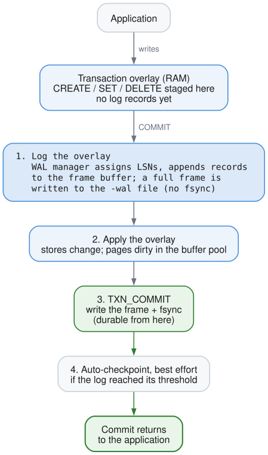

# Write-Ahead Log (WAL)

## The Problem

Imagine you're updating a B+Tree. You need to:
1. Modify a leaf page
2. Maybe split it (modify parent)
3. Maybe split the parent (modify grandparent)
4. Update the root

If power fails between steps 2 and 3, your database is **corrupted** - the tree structure is broken.

Even a single page write isn't safe. A 4KB page write might not be atomic at the hardware level - you could end up with half old data, half new data (a "torn write").

## The Insight

Instead of modifying data pages directly, first write a **log** of what you intend to do. The log is append-only and sequential. Only after the log is safely on disk do you modify the actual data pages.

If you crash:
- **Before log write**: Nothing happened, no corruption
- **After log write, before data write**: Replay the log to finish the operation
- **After both**: Everything is fine

This is the **write-ahead** rule: log first, then data.

### How LatticeDB applies it

LatticeDB logs *logical* changes — "create node 42 with label Person", "set
property name on edge 7" — not page images, and it logs them at commit rather than
as each statement runs. Inside a transaction, writes go to an in-memory overlay
and nothing reaches the log or the stores. At commit the database:

1. appends the overlay's changes to the log as records (buffered, not yet synced),
2. applies the overlay to the stores, which dirties pages in the buffer pool,
3. appends `TXN_COMMIT` and fsyncs the log — the commit is durable from here,
4. runs an automatic checkpoint if the log has grown past its threshold, and
   returns.

The database file catches up later, when the buffer pool evicts a dirty page or a
checkpoint or sync flushes it. Pages carry no LSN, and the buffer pool does not wait
for the log before writing a page, so the ordering is not enforced page by page:
the changes are applied in step 2, before the fsync in step 3, and a page evicted
in that window reaches the database file before the commit record is on disk.
Recovery is redo-only (see [Recovery](./recovery.md)), so it has no undo pass to
take such a page back.

If you crash:
- **Before the commit record is on disk**: the transaction does not count;
  recovery skips its records
- **After the commit record is on disk**: recovery re-executes its records against
  the stores, so the change survives even if no page was written

## Why Append-Only Sequential Writes Are Special

The WAL relies on a key property: **sequential append is much safer than random writes**.


With random writes, the disk head jumps around. A crash can leave any combination of pages in inconsistent states.

With sequential append:
- Only one "frontier" where writing happens
- Everything before the frontier is complete
- Everything after doesn't exist yet
- Much simpler to reason about crash states

## The System Primitive: fsync

The WAL's safety depends on one critical system call: **fsync** (or fdatasync).

```c
write(fd, data, len);  // Data goes to OS buffer cache
fsync(fd);             // Asks the OS to push the data to the storage device
```

Without fsync, your "written" data might sit in RAM for seconds or minutes. A power failure loses it. fsync is a **durability barrier** - when it returns, the operating system has handed the data to the device. How far that goes depends on the platform: on macOS plain `fsync` does not force the drive's write cache (that needs `F_FULLFSYNC`, which LatticeDB does not use). See [Virtual File System](./vfs.md#sync-fsync).

This is expensive (milliseconds, not microseconds), so we batch multiple records into frames before syncing.

## WAL Structure

The WAL is a separate file next to the database, named `<database>-wal`. It is a
4 KB header followed by a sequence of frames. A frame is the size of a database
page (4096 bytes by default, up to 65535); the size is recorded in the WAL header,
and an existing log keeps the frame size it was created with.

**WAL header (4 KB)**

| Field | Purpose |
|-------|---------|
| `magic` | `0x574C4F47` (`"WLOG"`) |
| `frame_size` | Size of every frame in this file |
| `frame_count` | How many frames have been written |
| `checkpoint_lsn` | Where recovery starts replaying |
| `database_uuid` | Binds this WAL to one database file |
| `version` | WAL format version (currently 2) |
| `checksum` | CRC32C of the rest of the header |

**Frame header (32 bytes, at the start of every frame)**

| Field | Purpose |
|-------|---------|
| `frame_number` | Position of this frame in the file |
| `record_count` | How many records the frame carries |
| `data_size` | Bytes of the frame actually used |
| `prev_frame_lsn` | LSN of the last record in the previous frame |
| `checksum` | CRC32C over the frame's data area |

Each record has its own 32-byte header — `record_type`, `flags`, `payload_size`,
`txn_id`, `lsn`, `prev_lsn` — followed by its payload.

The remainder of each frame holds records back to back, then unused space. A frame
carrying a single-statement transaction might look like this:

| LSN | Record | Transaction |
|----:|--------|------------:|
| 1 | `TXN_BEGIN` | 1 |
| 2 | `INSERT` (with payload) | 1 |
| 3 | `TXN_COMMIT` | 1 |

## LSN: The Universal Clock

Every record gets a **Log Sequence Number (LSN)** - a monotonically increasing integer.

```
LSN 1: TXN_BEGIN (txn 1)
LSN 2: INSERT key="alice" (txn 1)
LSN 3: INSERT key="bob" (txn 1)
LSN 4: TXN_BEGIN (txn 2)
LSN 5: DELETE key="charlie" (txn 2)
LSN 6: TXN_COMMIT (txn 1)
LSN 7: TXN_ABORT (txn 2)
```

LSN serves two purposes:
1. **Ordering**: Total order of all operations
2. **Recovery point**: "Replay from LSN 42"

Data pages do not record an LSN. Nothing compares a page's state with the log;
recovery decides what to redo from transaction outcomes alone.

## The prev_lsn Chain

Each record stores `prev_lsn` - the previous LSN **for the same transaction**:

| LSN | Record | Transaction | `prev_lsn` |
|----:|--------|------------:|-----------:|
| 1 | `TXN_BEGIN` | 1 | 0 |
| 2 | `INSERT` | 1 | 1 |
| 3 | `INSERT` | 2 | 0 |
| 4 | `UPDATE` | 1 | 2 |
| 5 | `TXN_COMMIT` | 1 | 4 |

Following `prev_lsn` from LSN 5 walks transaction 1 backwards — 5 → 4 → 2 → 1 —
skipping LSN 3, which belongs to transaction 2.

This creates a **backward chain** for each transaction:

```
Transaction 1: LSN 5 → LSN 4 → LSN 2 → LSN 1
Transaction 2: LSN 3 (just one operation)
```

The chain is the classic tool for rolling a transaction back from the log. LatticeDB
writes it but nothing reads it today: an abort discards the transaction's in-memory
overlay, and recovery has no undo pass.

## Write Flow



The key insight: we buffer multiple records in memory, only hitting disk when:
1. The frame buffer is full (a frame's worth of records accumulated) — the frame is
   written, but not fsynced
2. A transaction commits or aborts — the frame is written and the file is fsynced

`TXN_BEGIN` is appended when a transaction starts, and sits in the frame buffer
until something flushes it.

Logical WAL records can be larger than a single frame. Large graph, stream, vector, and
property payloads are fragmented into physical `large_fragment` records and
reassembled by recovery before redo. The logical payload limit is `64 MiB`; a
record above that limit returns `ValueTooLarge`.

Vector replacements and removals are logical transaction records too. Recovery
replays them into the vector index only for committed transactions; an index that
cannot replay a vector record causes open to fail rather than return incomplete
search results. Open with vector support and the same dimensions as the writer.
The initial empty tree pages and out-of-transaction FTS declarations are persisted
before writes rely on them. Recovered indexes and their roots are flushed before
open returns, so recovery does not require a later clean close to survive.

## Commit Protocol

When you call `COMMIT` on a transaction that changed something:

```
1. Append the overlay's changes as logical records (frame buffer; full frames written)
2. Apply the overlay to the stores (dirty pages in the buffer pool)
3. Append TXN_COMMIT, write the current frame, and fsync() - WAIT for the device
4. Checkpoint automatically if the log has reached its frame threshold (best effort:
   a failed checkpoint does not fail the commit)
5. Return "committed" to the application
```

After step 3, even if power fails immediately, the commit record is on disk. Recovery will see the commit and redo the transaction's records.

If we crash before step 3? The commit record might be lost. Recovery won't see a commit for that transaction, so it skips its records. The application was never told the commit succeeded. Because step 2 runs before step 3, though, a page that the buffer pool evicted in between can already hold some of those changes, and recovery does not undo it.

A read-only transaction, or one that changed nothing, skips steps 1 and 2 but still
appends `TXN_COMMIT` and fsyncs.

## Recovery: Redo Only

On startup, we need to:

1. **Find the end of valid log** - Scan frames, verify checksums, find last valid record
2. **Redo committed transactions** - Re-execute the logical records of every transaction with a commit record
3. **Skip everything else** - Records of transactions without a commit record are ignored; there is no undo pass

| LSN | Record | Transaction |
|----:|--------|------------:|
| 1 | `TXN_BEGIN` | 1 |
| 2 | `INSERT x=1` | 1 |
| 3 | `TXN_BEGIN` | 2 |
| 4 | `INSERT y=2` | 2 |
| 5 | `TXN_COMMIT` | 1 |
| 6 | `INSERT z=3` | 2 |

The process crashes after LSN 6.

| Transaction | Has `TXN_COMMIT`? | Recovery action |
|------------:|-------------------|-----------------|
| 1 | Yes | Redo — `x=1` is permanent |
| 2 | No | Skip — `y=2` and `z=3` are never applied |

## Why Frames?

Why not just append individual records?

**Reason 1: Atomicity**

A page-sized write at a page-aligned offset is more likely to be atomic than arbitrary-sized writes. Many storage systems guarantee 512-byte or 4KB atomic writes. Frames start after the 4 KB header at multiples of the frame size, which reduces torn write risk.

**Reason 2: Batching**

Each fsync is expensive (~1-10ms). By batching records into frames, we amortize the sync cost across many operations.

**Reason 3: Checksums**

Each frame has a checksum. During recovery, we can detect partial/corrupted frames and stop replay at the right point.

**Reason 4: Large logical records**

Frames remain page-sized for torn-write detection and batching, but the WAL no
longer requires each logical record to fit inside one frame. Fragmentation keeps
large transactional property updates on the WAL path without changing the frame
format used for normal records.

## The Checksum

We use CRC32C (the Castagnoli polynomial, the same function as page checksums) to detect corruption:

Every frame stores a CRC32C of its data area in its header:

| Frame region | Contents |
|--------------|----------|
| Header | `checksum = 0xABCD1234` |
| Data | `[record 1][record 2][record 3]` |

On read the checksum is recomputed and compared:

1. Read the frame.
2. Compute `CRC32C(data)`.
3. Compare against the stored checksum.
4. On mismatch, corruption is detected and replay stops.

This catches:
- Torn writes (partial frame written)
- Bit rot (storage degradation)
- Wrong WAL file (UUID also checked)

## The UUID Link

The WAL header stores the database file's UUID:


This prevents accidentally using database A's WAL with database B. The UUID is generated randomly when the database is created.

## Record Types

```zig
pub const WalRecordType = enum(u8) {
    // Transaction control
    txn_begin = 0x01,
    txn_commit = 0x02,
    txn_abort = 0x03,

    // Data modifications
    insert = 0x10,
    update = 0x11,
    delete = 0x12,

    // Page-level operations
    page_write = 0x20,

    // Checkpointing
    checkpoint_begin = 0x30,
    checkpoint_end = 0x31,

    // Savepoints
    savepoint = 0x40,
    savepoint_rollback = 0x41,

    // Compensation (for undo during recovery)
    clr = 0x50,

    // Physical record used to fragment a larger logical WAL record
    large_fragment = 0x60,
};
```

Not every type is in use. Transactions write `txn_begin`, `txn_commit`,
`txn_abort`, `insert`, `update` and `delete`, plus `large_fragment` for big
records. The first byte of an `insert`/`update`/`delete` payload says which logical
operation it is (node insert, delete or property update; edge insert, delete or
property update; label add or remove; vector set or remove; stream append, offset
or trim). Checkpoints write `checkpoint_begin`/`checkpoint_end`, which recovery
treats as informational. `savepoint` and `savepoint_rollback` are only written by
the transaction manager's internal savepoint calls, and `page_write` and `clr` are
reserved: nothing writes them.

## WalManager API

```zig
// Append a record, get back its LSN
const lsn = try wal.appendRecord(.insert, txn_id, prev_lsn, payload);

// Force all buffered records to disk
try wal.sync();

// Iterate records for recovery
var iter = wal.iterate(start_lsn);
while (try iter.next(&buf)) |record| {
    // Process record
}

// Update checkpoint position
try wal.setCheckpointLsn(lsn);

// Reset to an empty, header-only log (truncate checkpoints)
try wal.truncateToEmpty();
```

## Summary

| Concept | Purpose |
|---------|---------|
| Write-ahead rule | Commit record durable before commit returns = crash safety |
| Sequential append | Simpler crash states than random writes |
| fsync | Durability barrier to the storage device |
| LSN | Universal ordering of all operations |
| prev_lsn chain | Per-transaction back links (written, not yet used) |
| Frames | Atomic-ish writes + batching |
| Checksums | Detect corruption and torn writes |
| UUID | Match WAL to correct database file |

The WAL transforms the problem from "make random writes atomic" (very hard) to "make sequential append reliable" (much easier).
