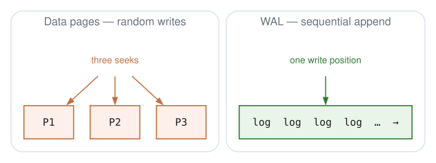

# Write-Ahead Log (WAL)

## The Problem

Imagine you're updating a B+Tree. You need to:
1. Modify a leaf page
2. Maybe split it (modify parent)
3. Maybe split the parent (modify grandparent)
4. Update the root

If power fails between steps 2 and 3, your database is **corrupted** - the tree structure is broken.

Even a single page write isn't safe. A 4KB page write might not be atomic at the hardware level - you could end up with half old data, half new data (a "torn write").

## The Insight

Instead of modifying data pages directly, first write a **log** of what you intend to do. The log is append-only and sequential. Only after the log is safely on disk do you modify the actual data pages.

If you crash:
- **Before log write**: Nothing happened, no corruption
- **After log write, before data write**: Replay the log to finish the operation
- **After both**: Everything is fine

This is the **write-ahead** rule: log first, then data.

### How LatticeDB applies it

LatticeDB logs *logical* changes — "create node 42 with label Person", "set
property name on edge 7" — not page images, and it logs them at commit rather than
as each statement runs. Inside a transaction, writes go to an in-memory overlay
and nothing reaches the log or the stores. At commit the database:

1. appends the overlay's changes to the log as records (buffered; full frames are
   written but not synced),
2. appends `TXN_COMMIT` and syncs the log — the commit is durable from here,
3. applies the overlay to the stores, which dirties pages in the buffer pool,
4. flushes early if half the buffer pool is dirty, runs an automatic checkpoint if
   the log has grown past its threshold, and returns.

The synced commit record is the commit point. Nothing has been applied before it,
so a failure up to that point leaves nothing committed. A failure after it (the
sync itself fails, or applying the overlay fails) cannot be taken back: the handle
marks itself failed and the next open replays the log. The
[Transaction Manager](./transaction-manager.md#3-commit) page walks through the
sequence.

A log of logical records can only be replayed onto a database file that is a
whole, consistent image of the database as of some moment. A record that says
"insert node 42" cannot repair a leaf that was half written, or a parent that was
written without its new child. Three rules follow, and the rest of the storage
engine keeps them:

- **The file changes one whole image at a time.** The buffer pool never writes a
  dirty page on its own. Every write to the database file is a flush of all the
  dirty pages, the freed pages and the header together, copied first to a journal
  file so that a crash part way through can be finished (see
  [Checkpointing](./checkpointing.md#the-journaled-flush)).
- **The log is synced before every flush.** A flush can capture half of a
  transaction (commit applies changes one entity at a time), and only the log can
  finish it after a crash.
- **Replay is idempotent.** The file can already hold some of what the log holds.
  Recovery replays every committed record anyway, and the records state outcomes
  ("property `age` of node 42 is 31") so that replaying one twice changes nothing.

If you crash:
- **Before the commit record is on disk**: the transaction does not count;
  recovery skips its records, and none of its changes reached the file
- **After the commit record is on disk**: recovery re-executes its records against
  the stores, so the change survives whether or not any page was written

## Why Append-Only Sequential Writes Are Special

The WAL relies on a key property: **sequential append is much safer than random writes**.



With random writes, the disk head jumps around. A crash can leave any combination of pages in inconsistent states.

With sequential append:
- Only one "frontier" where writing happens
- Everything before the frontier is complete
- Everything after doesn't exist yet
- Much simpler to reason about crash states

## The System Primitive: fsync

The WAL's safety depends on one critical system call: **fsync** (or fdatasync).

```c
write(fd, data, len);  // Data goes to OS buffer cache
fsync(fd);             // Asks the OS to push the data to the storage device
```

Without fsync, your "written" data might sit in RAM for seconds or minutes. A power failure loses it. fsync is a **durability barrier** - when it returns, the operating system has handed the data to the device. How far that goes depends on the platform: on macOS plain `fsync` does not force the drive's write cache, so a commit there survives a process or OS crash but not necessarily a power cut. The `full_fsync` option (or `LATTICE_FULL_FSYNC=1` in the environment) makes every sync use `F_FULLFSYNC`, which does ask the drive to flush; it is off by default because it makes each sync markedly slower. See [Virtual File System](./vfs.md#sync-fsync).

This is expensive (milliseconds, not microseconds), and it is most of what a small
write transaction costs. In the default sync mode every commit that changed
something pays for exactly one. `sync_mode = .normal` (or `LATTICE_SYNC_MODE=normal`)
skips it: the commit record is handed to the operating system and commit returns,
so the transaction survives the process being killed and reaches the disk at the
next checkpoint, flush or `sync()`. A power cut or OS crash can then lose the most
recent commits, from the end only. See
[Durability and the Log](../configuration/durability.md#sync-mode).

There is no group commit. One writer runs at a time and the transaction manager
holds its lock across the sync, so there is never a second commit to share an fsync
with.

## WAL Structure

The WAL is a separate file next to the database, named `<database>-wal`. It is a
4 KB header followed by a sequence of frames. A frame is the size of a database
page (4096 bytes by default, up to 65535); the size is recorded in the WAL header,
and an existing log keeps the frame size it was created with.

**WAL header (4 KB)**

| Field | Purpose |
|-------|---------|
| `magic` | `0x574C4F47` (`"WLOG"`) |
| `frame_size` | Size of every frame in this file |
| `frame_count` | How many frames have been written |
| `checkpoint_lsn` | Where recovery starts replaying |
| `database_uuid` | Binds this WAL to one database file |
| `version` | WAL format version: 3 while the log holds frames, 2 when it is empty |
| `checksum` | CRC32C of the rest of the header |

**Frame header (32 bytes, at the start of every frame)**

| Field | Purpose |
|-------|---------|
| `frame_number` | Position of this frame in the file |
| `record_count` | How many records the frame carries |
| `data_size` | Bytes of the frame actually used |
| `prev_frame_lsn` | LSN of the last record in the previous frame |
| `checksum` | CRC32C over the other header fields and the frame's data area |
| `synced_frames` | How many frames, from the start of the log, had been synced when this frame was written |

A log that holds frames is format version 3. An empty log is the same in every
version, so its header says 2, and 0.16.0, which reads versions up to 2, still
opens a database this release closed cleanly or checkpointed. A log this release
left holding frames after a crash says 3, and 0.16.0 refuses it rather than misread
it. This release reads logs written by 0.16.0, whose frames carry no
`synced_frames` and have a checksum of the data alone; appending to such a log adds
version 3 frames after the old ones.

Each record has its own 32-byte header — `record_type`, `flags`, `payload_size`,
`txn_id`, `lsn`, `prev_lsn` — followed by its payload.

The remainder of each frame holds records back to back, then unused space. Each
commit writes out the frame it is in, so a small transaction uses at least one
whole frame, and the next commit starts a new one. A frame carrying a
single-statement transaction might look like this:

| LSN | Record | Transaction |
|----:|--------|------------:|
| 1 | `TXN_BEGIN` | 1 |
| 2 | `INSERT` (with payload) | 1 |
| 3 | `TXN_COMMIT` | 1 |

## LSN: The Universal Clock

Every record gets a **Log Sequence Number (LSN)** - a monotonically increasing integer.

Because a transaction writes all of its records at commit and only one writer runs
at a time, one transaction's records sit together in the log:

```
LSN 1: TXN_BEGIN (txn 1)
LSN 2: INSERT node 42 (txn 1)
LSN 3: UPDATE node 42 name (txn 1)
LSN 4: TXN_COMMIT (txn 1)
LSN 5: TXN_BEGIN (txn 2)
LSN 6: DELETE edge 7 (txn 2)
LSN 7: TXN_COMMIT (txn 2)
```

LSN serves two purposes:
1. **Ordering**: Total order of all operations
2. **Recovery point**: "Replay from LSN 42"

LSNs are not a permanent clock. When a checkpoint empties the log, the running
session keeps counting, but a later open of an empty log starts again at 1: the
next LSN is always one past the largest the file holds. Data pages do not record an
LSN, and nothing compares a page's state with the log; recovery decides what to
redo from transaction outcomes alone.

## The prev_lsn Chain

Each record stores `prev_lsn` - the previous LSN **for the same transaction**:

| LSN | Record | Transaction | `prev_lsn` |
|----:|--------|------------:|-----------:|
| 1 | `TXN_BEGIN` | 1 | 0 |
| 2 | `INSERT` | 1 | 1 |
| 3 | `UPDATE` | 1 | 2 |
| 4 | `TXN_COMMIT` | 1 | 3 |

Following `prev_lsn` from LSN 4 walks transaction 1 backwards: 4 → 3 → 2 → 1.

The chain is the classic tool for rolling a transaction back from the log. LatticeDB
writes it but nothing follows it for that: an abort has nothing in the log to undo,
because a transaction's changes are only logged when it commits, and recovery has no
undo pass. The one reader is the reassembly of fragmented records (below), which
checks that the pieces of one record agree.

## Write Flow


Records accumulate in an in-memory frame and reach the file a frame at a time:

1. When the next record will not fit, the frame is written to the file and the
   header is rewritten with the new frame count. Neither write is synced.
2. A commit ends with `sync()`, which writes the partial frame and the header and
   fsyncs the file, or, in `sync_mode = .normal`, with `flush()`, which writes
   them and returns. A small commit therefore costs two writes (the frame and the
   4 KB header) and, by default, one fsync.

Nothing is written when a transaction begins. `TXN_BEGIN` goes out with the
transaction's first record, so a read-only transaction, or a read-write one that
changed nothing, never touches the log: it costs no write and no fsync. An abort
that does have records in the log (a commit that failed after logging some of
them) appends `TXN_ABORT` without syncing it; recovery only redoes transactions
whose commit record it finds, so a lost abort record changes nothing.

Logical WAL records can be larger than a single frame. Large graph, stream, vector, and
property payloads are fragmented into physical `large_fragment` records and
reassembled by recovery before redo. The logical payload limit is `64 MiB`; a
record above that limit returns `ValueTooLarge`.

Vector replacements and removals are logical transaction records too. Recovery
replays them into the vector index only for committed transactions; an index that
cannot replay a vector record causes open to fail rather than return incomplete
search results. The database file records its vector index, and the index is
written to the file at the open that creates it, before any vector record can be
logged, so recovery always has the index to replay into without being told its
dimensions. Deleting a node logs a vector removal only when the node has a
committed vector. (Logs written by 0.16.0 hold a removal for every deleted node;
recovery skips those when the file holds no vector data.)

The log file is created when a database is first opened for writing, and again if
it has gone missing, as when a backup is put back without its log. Creating it
syncs the new file and its directory entry, once per file, so a power cut cannot
lose the log's name together with the commits in it. No commit pays for this.

## Commit Protocol

When you call `COMMIT` on a transaction that changed something:

```
1. Append the overlay's changes as logical records (TXN_BEGIN first; full frames
   written, nothing synced)
2. Append TXN_COMMIT, write the current frame, and fsync() - WAIT for the device
   (sync_mode = .normal: write it and do not wait)
3. Apply the overlay to the stores (dirty pages in the buffer pool)
4. Flush early if half the pool is dirty; checkpoint automatically if the log has
   reached its frame threshold (best effort: a failed checkpoint does not fail the
   commit)
5. Return "committed" to the application
```

After step 2, even if power fails immediately, the commit record is on disk. Recovery will see the commit and redo the transaction's records.

If we crash before step 2 completes, the commit record might be lost. Recovery won't see a commit for that transaction, so it skips its records. The application was never told the commit succeeded, and nothing of the transaction reached the database file, because nothing was applied before step 2.

If step 2 or step 3 fails, the outcome cannot be undone: the commit record may be
on disk, or is on disk and the stores are missing part of the transaction. The
database marks the handle failed and returns an error. A failed handle refuses new
transactions, commits, `sync()` and checkpoints, and writes nothing more to the
database file; closing and reopening replays the log.

A read-only transaction, or one that changed nothing, writes nothing to the log at
all.

## Recovery: Redo Only

On startup, we need to:

1. **Find the end of valid log** - Verify each frame's checksum; a torn tail is cut
   off when the log is opened, and damage to frames that had been synced refuses the
   open
2. **Redo committed transactions** - Apply the logical records of every transaction
   with a commit record, each as an assignment of the state it logged
3. **Skip everything else** - Records of transactions without a commit record are ignored; there is no undo pass
4. **Empty the log** - Checkpoint, so the next open has nothing to replay

Redo is exact. Every record sets the state it describes, whether or not the file
already holds it: a node insert makes the node exist with exactly the logged labels
and no properties (its property records follow it), a property or label record sets
or clears exactly that key or label and its index entry, a delete makes the node or
edge absent. Replaying a record twice, or into a file a flush had already brought
up to date, gives the same result. A record that cannot be applied fails the open
instead of being skipped; see
[Recovery](./recovery.md#replay-errors).

| LSN | Record | Transaction |
|----:|--------|------------:|
| 1 | `TXN_BEGIN` | 1 |
| 2 | `INSERT x=1` | 1 |
| 3 | `TXN_COMMIT` | 1 |
| 4 | `TXN_BEGIN` | 2 |
| 5 | `INSERT y=2` | 2 |
| 6 | `INSERT z=3` | 2 |

The process crashes after LSN 6, while transaction 2 is still writing its records.

| Transaction | Has `TXN_COMMIT`? | Recovery action |
|------------:|-------------------|-----------------|
| 1 | Yes | Redo — `x=1` is permanent |
| 2 | No | Skip — `y=2` and `z=3` are never applied |

See [Recovery](./recovery.md) for the whole sequence at open.

## Why Frames?

Why not just append individual records?

**Reason 1: Atomicity**

A page-sized write at a page-aligned offset is more likely to be atomic than arbitrary-sized writes. Many storage systems guarantee 512-byte or 4KB atomic writes. Frames start after the 4 KB header at multiples of the frame size, which reduces torn write risk.

**Reason 2: Batching writes**

Records reach the file a frame at a time, so a large transaction costs one write per
page of log rather than one per record. Frames do not batch fsyncs across
transactions: each commit syncs its own frame.

**Reason 3: Checksums**

Each frame has a checksum, so the log can be verified a frame at a time and cut off
at the point where it stops being trustworthy.

**Reason 4: Large logical records**

Frames remain page-sized for torn-write detection and batching, but the WAL no
longer requires each logical record to fit inside one frame. Fragmentation keeps
large transactional property updates on the WAL path without changing the frame
format used for normal records.

## The Checksum

We use CRC32C (the Castagnoli polynomial, the same function as page checksums) to detect corruption:

Every frame stores, in its header, a CRC32C of the header's other fields and of
its data area, so a damaged `synced_frames` cannot pass:

| Frame region | Contents |
|--------------|----------|
| Header | `frame_number`, `record_count`, `data_size`, `prev_frame_lsn`, `checksum = 0xABCD1234`, `synced_frames` |
| Data | `[record 1][record 2][record 3]` |

On read the checksum is recomputed and compared. A frame verifies only if it also
holds at least one record: a frame that never reached the disk reads back as zeroes,
and a frame of zeroes would otherwise pass as an empty one. Every reader of the log
(the open, recovery and replication) applies the same check. Frames written by
0.16.0 have a checksum of the data alone; a frame is read as old or new by which of
the two checksums it matches.

**Telling a torn tail from damage.** After a power cut, the frames written since the
last sync can be in any state: some whole, some torn or never written, in any order,
because a disk need not write them in the order they were issued. None of them was
promised durable, so none of that is damage. A frame that was synced and then fails
its checksum is damage. `synced_frames` tells the two apart. Opening the log takes
the largest `synced_frames` among the frames that verify; call it S. The first frame
that fails is:

- **below S**: it had been synced, so this is damage to data that was promised
  durable. It is left exactly as found, and recovery refuses the open (see
  [Recovery](./recovery.md#corruption-detection)) rather than drop the commits in it.
- **at or above S**: it belongs to the unsynced tail. The log is cut back to the
  frame before it, and the next frame written takes its place.

A log of 0.16.0 frames only carries no such statement and keeps the rule it was
written under: a bad frame with any frame that verifies after it is damage, and one
with none after it is a torn tail.

The rule costs a commit nothing: the claim is the frame count at the last completed
sync, already in memory, and no extra write or sync is made for it. In exchange, the
open syncs a non-empty log before any new frame vouches for it, because a killed
process's frames may be only in the operating system's cache, and removes any bytes
past the frames the header counts, so a stale frame cannot later be read as part of
the log.

**The limit.** Only frames written after a later sync can vouch for a frame. Damage
to the last frames of the newest sync batch, with nothing written after them, cannot
be told from a torn write and is cut off as a torn tail: the commits in those frames
are lost without an error.

A transaction whose large record was being written as fragments when the process
died leaves the first fragments in whole frames and no commit record. When the next
record belongs to another transaction, as it does once later commits have been
logged after it, the unfinished fragments are skipped; a break in the fragments of
one transaction is still damage.

The header has a checksum too. A header whose checksum fails but whose magic,
version, frame size and database id are intact was torn while being rewritten; it is
rebuilt, taking the frame count from the file's length, and replay starts from the
beginning of the log.

This catches:
- Torn writes (partial frame written)
- Bit rot (storage degradation)
- Wrong WAL file (UUID also checked)

## The UUID Link

The WAL header stores the database file's UUID:


This prevents accidentally using database A's WAL with database B. The UUID is generated randomly when the database is created.

## Record Types

```zig
pub const WalRecordType = enum(u8) {
    // Transaction control
    txn_begin = 0x01,
    txn_commit = 0x02,
    txn_abort = 0x03,

    // Data modifications
    insert = 0x10,
    update = 0x11,
    delete = 0x12,

    // Page-level operations
    page_write = 0x20,

    // Checkpointing
    checkpoint_begin = 0x30,
    checkpoint_end = 0x31,

    // Savepoints
    savepoint = 0x40,
    savepoint_rollback = 0x41,

    // Compensation (for undo during recovery)
    clr = 0x50,

    // Physical record used to fragment a larger logical WAL record
    large_fragment = 0x60,
};
```

Not every type is in use. Transactions write `txn_begin`, `txn_commit`,
`txn_abort`, `insert`, `update` and `delete`, plus `large_fragment` for big
records. The first byte of an `insert`/`update`/`delete` payload says which logical
operation it is (node insert, delete or property update; edge insert, delete or
property update; label add or remove; vector set or remove; stream append, offset
or trim). Checkpoints write `checkpoint_begin`/`checkpoint_end`, which recovery
treats as informational. `savepoint` and `savepoint_rollback` are only written by
the transaction manager's internal savepoint calls, and `page_write` and `clr` are
reserved: nothing writes them, and recovery refuses a log that holds a committed
`page_write` record, as it refuses a payload type no release writes.

## WalManager API

```zig
// Append a record, get back its LSN
const lsn = try wal.appendRecord(.insert, txn_id, prev_lsn, payload);

// Write buffered records and fsync (commit in sync_mode .full, checkpoints)
try wal.sync();

// Write buffered records without an fsync (commit in sync_mode .normal)
try wal.flush();

// Iterate records for recovery
var iter = wal.iterate(start_lsn);
while (try iter.next(&buf)) |record| {
    // Process record
}

// Update checkpoint position
try wal.setCheckpointLsn(lsn);

// Reset to an empty, header-only log (truncate checkpoints)
try wal.truncateToEmpty();
```

## Summary

| Concept | Purpose |
|---------|---------|
| Write-ahead rule | Commit record synced before anything is applied; log synced before every flush |
| Sequential append | Simpler crash states than random writes |
| fsync | Durability barrier to the storage device |
| LSN | Universal ordering of all operations |
| Sync mode | `.full` fsyncs every commit; `.normal` leaves it to the next checkpoint or sync |
| prev_lsn chain | Per-transaction back links (written; only fragment reassembly reads them) |
| Frames | Page-sized, checksummed units of writing; a torn tail is cut off at open |
| `synced_frames` | Each frame says how much of the log was synced before it, so damage to synced frames refuses the open instead of being cut off |
| Checksums | Detect corruption and torn writes |
| UUID | Match WAL to correct database file |

The WAL transforms the problem from "make random writes atomic" (very hard) to "make sequential append reliable" (much easier).
